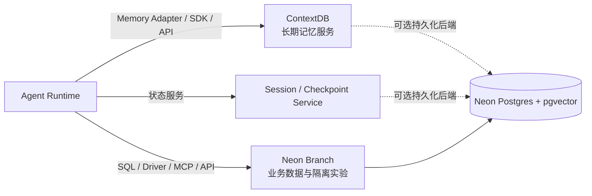
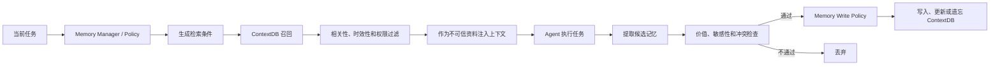
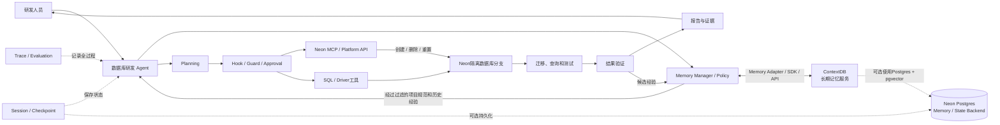

# Agent 开发实战学习与机会探索方案

> 课程定位：以 Agent 开发实战为主线，通过学习和解剖 Pi、DSH、Deep Agents、Codex 等不同风格的 Agent Harness，系统掌握 Agent 的核心机制；结合 Neon、ContextDB 开展综合实践，并在学习过程中观察数据库、缓存和存储相关的新机会。

## 1. 课程目标

本课程首先是一套 Agent 开发实战课程，需要让参与者真正理解并能够动手实现一个完整 Agent，而不是只做行业调研或产品讨论。

课程目标分为三个层次：

### 1.1 学习目标

- 理解大模型如何通过 Agent Runtime 完成多步骤任务。
- 掌握 Agent Loop、Planning、Tool、MCP、Skill、Hook 等核心机制。
- 掌握 Session、Context、Memory、Checkpoint 和任务恢复。
- 理解 Subagent、多 Agent、Human-in-the-loop 和权限控制。
- 掌握 Agent 的可观测、评测、安全和生产化方法。
- 能够阅读 Pi、DSH、Deep Agents、Codex 等 Agent Harness 的架构和关键实现。

### 1.2 实践目标

- 从零完成一个最小 Agent。
- 为 Agent 增加工具、MCP、Skill 和 Hook。
- 为 Agent 增加 Session、Memory 和任务恢复。
- 完成一个结合 Neon、ContextDB 的综合 Agent Demo。
- 建立一套可以重复运行的 Agent 测试集。

### 1.3 延伸目标

- 在学习 Agent 机制时，识别新的数据、状态、缓存和存储需求。
- 优先分析与 Neon、ContextDB 当前方向的结合点。
- 同时开放观察 NoSQL、缓存、存储及其他潜在方向。
- 对高价值机会提出最小 POC，而不是停留在概念判断。

课程内容建议保持以下比重：

| 内容 | 建议比重 |
|---|---:|
| Agent 机制学习与动手实验 | 70% |
| Neon、ContextDB 综合实践 | 20% |
| 新机会观察与讨论 | 10% |

---

## 2. Agent 整体思路图

```mermaid
flowchart TB
    U[用户 / 上游系统] --> INPUT[任务输入]

    subgraph RUNTIME[Agent Runtime]
        INPUT --> LOOP[Agent Loop / Orchestrator]
        LOOP --> PLAN[任务理解与 Planning]
        PLAN --> CONTEXT[Context Assembly]
        CONTEXT --> MODEL[Model Adapter / Router]
        MODEL --> DECIDE{模型决策}

        DECIDE -->|调用工具| TOOL[Tool Registry / Calling]
        DECIDE -->|委派任务| SUB[Subagent]
        DECIDE -->|请求信息| ASK[向用户提问]
        DECIDE -->|候选结果| VERIFY[结果与证据验证]

        TOOL --> GUARD[Policy / Guard / Permission]
        GUARD -->|必要时| APPROVAL[Human Approval]
        GUARD -->|允许| EXEC[Tool Executor]
        APPROVAL -->|批准| EXEC
        EXEC --> OBSERVE[观察结果]
        SUB --> OBSERVE
        ASK --> INPUT
        OBSERVE --> LOOP
        VERIFY -->|未通过| LOOP
        VERIFY -->|通过| OUTPUT[回答 / Artifact / Action]

        RULES[Instructions / AGENTS.md / Skills] -.提供规则和工作方法.-> LOOP
        SESSION[Session / State Manager] -.恢复状态与历史.-> LOOP
        MEMORY[Memory Manager / Policy] -.召回结果进入上下文.-> CONTEXT
        HOOK[Lifecycle Hooks / Middleware] -.监听和扩展生命周期.-> LOOP
        HOOK -.拦截工具事件.-> TOOL
        HOOK -.触发记忆召回与写入.-> MEMORY
        TRACE[Trace / Evaluation] -.记录和评价.-> RUNTIME
        SANDBOX[Sandbox / Security] -.限制执行边界.-> EXEC
    end

    MODEL <-->|推理请求 / 响应| LLM[LLM Provider / Model Serving]
    LLM --- KVC[KV Cache / Prefix Cache]

    EXEC --> CONNECT[MCP / API / SDK / CLI Adapter]
    EXEC --> LOCAL[Filesystem / Shell / Browser]
    CONNECT --> NEON[Neon Backend Platform<br/>Lakebase Postgres]
    CONNECT --> EXT[代码仓库及其他外部系统]

    SESSION <-->|持久化 / 恢复| STATE[(Session / Checkpoint Store)]
    MEMORY <-->|召回 / 写入 / 更新 / 遗忘| CDB[ContextDB / Long-term Memory Service]
    CONNECT -.可选管理或诊断接口.-> CDB
    STATE -.可选使用 Postgres.-> NEON
    CDB -.可选以 Postgres + pgvector 持久化.-> NEON
```

这张图表达的是**逻辑角色**，不是要求所有模块分别部署。几个容易混淆的位置需要特别说明：

- **模型不等于 Agent Runtime**：Runtime 负责循环、上下文、工具和状态管理，通过 Model Adapter 调用外部模型服务；KV Cache/Prefix Cache 位于模型推理服务侧，不是 Agent Memory。
- **MCP/API/SDK/CLI 是连接方式，不是数据资源**：文件系统、Shell、浏览器、Neon 和代码仓库才是 Agent 实际操作的资源。MCP 只是其中一种标准化工具协议。
- **Hook 与 Guard 不等价**：Hook/Middleware 是生命周期扩展机制；Guard、Permission 和 Approval 是其中可挂载的策略与控制能力。
- **Session 与长期记忆不同**：Session/Checkpoint 保存当前任务的可恢复运行状态；长期 Memory 保存跨会话仍有价值的知识、偏好和经验。

图中的长期 Memory 分成两层：

- **Memory Manager / Policy** 位于 Agent Runtime 内，负责决定记什么、何时召回、如何过滤、何时更新或遗忘。
- **ContextDB** 位于 Runtime 外部，作为 Agent 的长期记忆服务，负责持久化、检索、时间语义、隔离和治理。

典型流程是在模型推理前由 Hook/Middleware 触发召回，将经过过滤的记忆交给 Context Assembly；在任务或Turn结束后提取候选记忆，经策略判断后写入ContextDB。ContextDB可以通过SDK、API或Memory Adapter接入；MCP可以作为可选的管理或工具接口，但不是ContextDB在Agent架构中的唯一位置。

### 2.1 Neon 在图中的定义和位置

按当前官方定位，**Neon 是面向应用和 Agent 的 Backend Platform**，除数据库外还包括 Auth、Object Storage、Functions 和 AI Gateway；其核心数据库是 **Lakebase Postgres（Serverless Postgres）**。本课程不泛化研究整套 Backend，而聚焦最能体现 Agent 开发实战和数据机会的 Postgres、数据库分支、MCP/API/SDK 及 pgvector 能力。Lakebase Postgres 把运行查询的计算层与保存 WAL、页面和历史数据的持久化存储层解耦，从而支持计算弹性伸缩、闲置休眠、快速恢复以及轻量的 Copy-on-Write 数据库分支。

Neon 在 Agent 体系中不是 Agent 的内部模块，而是外部数据基础设施，可承担四种角色：

| Neon角色 | 与Agent的关系 | 本课程中的实践 |
|---|---|---|
| 业务/操作数据库 | Agent 通过 SQL、Driver、API 或 MCP 查询和变更数据 | Schema分析、SQL调优、故障排查 |
| 隔离执行环境 | Agent 为任务创建数据库分支，先试验再验证，避免直接影响主库 | Migration、危险SQL和回滚实验 |
| Agent状态存储 | Session、Checkpoint、Trace服务可选择使用Postgres持久化 | 中断恢复、幂等和审计实验 |
| ContextDB底层存储 | ContextDB在当前实现中可使用PostgreSQL + pgvector；Neon可作为一种部署后端 | 长期记忆、向量召回和隔离实验 |

因此需要区分：**ContextDB是长期记忆的逻辑服务，Neon是可承载应用、Agent和数据能力的平台；ContextDB可以使用Neon Postgres作为底层数据库，但不能把Neon直接画成Memory，也不能把ContextDB只画成普通MCP工具。**



Agent 最核心的运行闭环是：

```text
接收目标
  → 理解并拆分任务
  → 组装上下文
  → 模型判断下一步
  → 调用工具、委派任务或请求信息
  → 获取观察结果
  → 更新上下文和状态
  → 验证是否完成
  → 输出结果并沉淀有效信息
```

---

## 3. Agent 机制课程地图

下面的子项均需要覆盖，但根据重要程度分成三个层次。

### 3.1 核心必修

| 模块 | 要解决的问题 | 课程实践 |
|---|---|---|
| Agent Loop | Agent 如何持续推理、行动、观察和停止？ | 编写最小 Agent Loop |
| Context Assembly | 每轮模型调用应该看到哪些信息？ | 对比多种上下文组装方式 |
| Tool Calling | Agent 如何安全可靠地执行真实操作？ | 编写文件、SQL和状态工具 |
| MCP | Agent 如何标准化连接外部系统？ | 编写并接入 MCP Server |
| Skills / AGENTS.md | 如何沉淀项目规则和可复用工作流？ | 编写项目级 Skill |
| Hooks / Guard | 如何在生命周期节点监听、拦截和增强？ | SQL风险拦截 Hook |
| Session / State | Agent 如何保存任务状态和连续工作？ | 实现持久化 Session |
| Checkpoint / Recovery | Agent 中断后如何恢复且不重复副作用？ | 实现暂停和恢复 |
| Memory | Agent 如何跨任务记忆、更新和遗忘？ | 接入 ContextDB |
| Security / Permission | 如何限制文件、命令、网络和数据库操作？ | 建立权限分级和审批 |
| Observability / Eval | 如何知道 Agent 是否可靠、有效？ | 建立 Trace 和测试集 |

### 3.2 重要机制

| 模块 | 要解决的问题 | 课程实践 |
|---|---|---|
| Model / Provider / Router | 如何选择模型、降级、重试和控制成本？ | 多模型效果与成本对比 |
| Planning | 如何把复杂目标拆成可验证步骤？ | 数据库迁移任务规划 |
| Subagent / Multi-Agent | 如何分工、传递上下文和汇总结果？ | 主Agent调用两个专家Agent |
| Human-in-the-loop | 何时提问、暂停、审批或修改目标？ | 数据库写操作审批 |
| Verification | 如何判断任务真正完成而不是“看起来完成”？ | 加入测试和证据检查 |
| Prompt / Instruction | 不同层级指令如何影响 Agent 行为？ | 指令冲突和优先级实验 |

### 3.3 适度了解但不能遗漏

| 模块 | 学习内容 | 建议实践 |
|---|---|---|
| Artifact | 代码、报告、配置等结果的版本、来源和验证状态 | 保存并关联任务产物 |
| Async / Schedule | 长任务、定时任务、等待外部事件和 Heartbeat | 模拟异步任务 |
| Cost / Budget | Token、工具调用、模型费用、步数和时间预算 | 设置任务预算 |
| UI / Interaction | 流式输出、进度、审批和结果展示 | 简单任务状态界面 |
| Plugin / Extension | 插件发现、加载、隔离和兼容 | 编写最小插件 |
| Failure Handling | 模型、工具、进程和节点错误处理 | 故障注入实验 |

### 3.4 课程与学习资源对应表

| 课程 | 必读/必看 | 动手参考 | 课程作业 |
|---|---|---|---|
| 课程一：Agent Loop | [Hugging Face Unit 1](https://huggingface.co/learn/agents-course/en/unit1/introduction)、[How Pi Works](https://pi.dev/docs/latest/how-pi-works) | [OpenAI Agents SDK Quickstart](https://openai.github.io/openai-agents-python/quickstart/) | 两工具最小Agent和Loop时序图 |
| 课程二：Model与Context | [How Pi Works](https://pi.dev/docs/latest/how-pi-works)、[Deep Agents课程Module 3](https://academy.langchain.com/courses/foundation-introduction-to-deepagents) | [Agents SDK Sessions](https://openai.github.io/openai-agents-python/sessions/) | 四种Context策略对比 |
| 课程三：Planning | [Deep Agents Overview](https://docs.langchain.com/oss/python/deepagents/overview) | [Deep Agents官方课程](https://academy.langchain.com/courses/foundation-introduction-to-deepagents) | 数据库任务规划与动态调整 |
| 课程四：Tool Calling | [Hugging Face Unit 1](https://huggingface.co/learn/agents-course/en/unit1/introduction)、[Pi Extensions](https://pi.dev/docs/latest/extensions) | [Agents SDK Quickstart](https://openai.github.io/openai-agents-python/quickstart/) | 文件、SQL、状态三个工具 |
| 课程五：MCP | [MCP Server Primitives](https://modelcontextprotocol.io/specification/draft/server/index) | [MCP Python Get Started](https://py.sdk.modelcontextprotocol.io/get-started/)、[Quickstart Resources](https://github.com/modelcontextprotocol/quickstart-resources) | 只读数据库MCP Server |
| 课程六：Skill | [OpenAI Skills Concepts](https://developers.openai.com/plugins/concepts/skills) | [Build Skills](https://developers.openai.com/plugins/build/skills)、[Pi Documentation](https://pi.dev/docs/latest) | Neon检查Skill与ContextDB评测Skill |
| 课程七：Hook与Guard | [Pi Extensions](https://pi.dev/docs/latest/extensions)、[DSH Architecture](https://deepseek-harness.github.io/deepseek-harness/en/reference/) | [DSH Core](https://deepseek-harness.github.io/deepseek-harness/en/reference/subsystems/core)、[Plugin Architecture](https://developers.openai.com/plugins/concepts/plugins) | SQL拦截、审计与Stop Hook |
| 课程八：Session与Recovery | [How Pi Works](https://pi.dev/docs/latest/how-pi-works)、[DSH Core](https://deepseek-harness.github.io/deepseek-harness/en/reference/subsystems/core) | [Agents SDK Sessions](https://openai.github.io/openai-agents-python/sessions/)、[Deep Agents课程](https://academy.langchain.com/courses/foundation-introduction-to-deepagents) | 中断、恢复与幂等实验 |
| 课程九：Memory与RAG | [ContextDB Documentation](https://contextdb.ai/docs)、[Agentic RAG](https://huggingface.co/learn/agents-course/en/unit3/agentic-rag/introduction) | [Deep Agents课程Module 3](https://academy.langchain.com/courses/foundation-introduction-to-deepagents) | 四种记忆方案对照实验 |
| 课程十：Subagent | [Deep Agents课程Module 4](https://academy.langchain.com/courses/foundation-introduction-to-deepagents) | [Build a Research Agent](https://www.youtube.com/watch?v=5tn6O0uXYEg)、[Agents SDK Quickstart](https://openai.github.io/openai-agents-python/quickstart/) | 主Agent加两个专家Agent |
| 课程十一：安全与HITL | [Pi Security](https://pi.dev/docs/latest/security)、[MCP安全指南](https://developers.openai.com/api/docs/mcp) | [Sandbox Agents Quickstart](https://openai.github.io/openai-agents-python/sandbox_agents/)、[Deep Agents课程Module 2](https://academy.langchain.com/courses/foundation-introduction-to-deepagents) | 注入、越权与审批实验 |
| 课程十二：Observability与Eval | [OpenAI Agents SDK](https://openai.github.io/openai-agents-python/)、[Agents SDK Usage](https://openai.github.io/openai-agents-python/usage/) | [LangChain Academy](https://academy.langchain.com/)、[Deep Agents Research视频](https://www.youtube.com/watch?v=5tn6O0uXYEg) | 10～20个测试任务和评测报告 |

---

## 4. 课程一：Agent 基础与 Agent Loop

### 推荐资源

- 必读：[Hugging Face Unit 1：Introduction to Agents](https://huggingface.co/learn/agents-course/en/unit1/introduction)。
- 必读：[Pi：How Pi Works](https://pi.dev/docs/latest/how-pi-works)。
- 动手：[OpenAI Agents SDK Quickstart](https://openai.github.io/openai-agents-python/quickstart/)。
- 源码：[Pi Agent Toolkit](https://github.com/earendil-works/pi)。

### 学习点

- Agent 与普通 LLM 调用的区别。
- Agent、Session、Turn、Step、Model Call、Tool Call 的关系。
- 推理—行动—观察循环。
- 完成、失败、暂停、等待和取消状态。
- 最大步数、超时、预算和无限循环保护。
- 模型失败、工具失败和重试策略。
- 用户中途追加要求时如何 Steering。

### 探索对象

- Pi 的最小 Agent Loop、Session Tree 和 Tool Result 回灌过程。
- DSH 的 Agent、Agent Loop、事件和状态接口。
- Codex 的任务执行、工具调用、等待和终止过程。
- 同步循环、异步循环与事件驱动循环。

### 动手实验

1. 编写一个只有两个工具的最小 Agent。
2. 输出每个 Step 的模型输入、决策、工具参数和工具结果。
3. 制造工具超时、模型失败和无限循环。
4. 实现最大步数、重试、取消和用户中途转向。

### 学习产出

- Agent Loop 时序图。
- 最小可运行 Agent。
- 停止条件和错误处理说明。

---

## 5. 课程二：模型、Prompt 与 Context Assembly

### 推荐资源

- 必读：[Pi：How Pi Works](https://pi.dev/docs/latest/how-pi-works)，重点看Context、Session与Compaction。
- 课程：[Deep Agents官方课程](https://academy.langchain.com/courses/foundation-introduction-to-deepagents)，重点完成Module 3 Context Management。
- 动手：[OpenAI Agents SDK Sessions](https://openai.github.io/openai-agents-python/sessions/)。
- 延伸：[vLLM Automatic Prefix Caching](https://docs.vllm.ai/en/latest/design/prefix_caching/)。

### 学习点

- System、Developer、User、Assistant、Tool 消息。
- 项目规则、工具说明、对话历史、记忆和当前任务如何组合。
- 指令优先级、冲突和覆盖关系。
- Context Window、Token 和上下文成本。
- 上下文裁剪、滑动窗口、摘要、压缩和检索。
- 工具结果与外部资料为什么应被视为不可信数据。
- Prompt Injection 和间接注入。

### 动手实验

1. 使用完整历史、滑动窗口、摘要和检索式上下文完成同一任务。
2. 比较成功率、token、延迟和信息丢失。
3. 在工具结果中加入恶意指令，验证 Agent 是否被误导。
4. 改变工具数量和描述长度，观察工具选择准确率。

### 延伸学习：KV Cache

KV Cache 不作为 Agent 主课程的中心，但作为理解“长上下文如何影响模型推理”的延伸课题：

- Prefill 与 Decode。
- KV Cache 与 Prefix Cache。
- 长 Prompt 和重复前缀的推理成本。
- KV Connector 和缓存跨层、跨节点传输。
- KV Cache、语义缓存、RAG 和 Agent Memory 的区别。

这一部分以理解 Agent 上下文的推理成本为主，再观察 NoSQL、缓存和存储机会。

---

## 6. 课程三：Planning 与任务分解

### 推荐资源

- 必读：[Deep Agents Overview](https://docs.langchain.com/oss/python/deepagents/overview)，重点看Planning与Task Decomposition。
- 课程：[Introduction to Deep Agents](https://academy.langchain.com/courses/foundation-introduction-to-deepagents)，重点完成Module 1和Module 4。
- 视频：[What are Deep Agents?](https://www.youtube.com/watch?v=IVts6ztrkFg)。

### 学习点

- ReAct、Plan-and-Execute 等执行方式。
- 什么任务需要显式规划，什么任务适合边做边调整。
- 如何把模糊目标拆成可执行、可验证的步骤。
- 任务依赖、并行关系和完成条件。
- 执行中如何局部调整计划。
- 计划和实际执行结果如何保持一致。

### 动手实验

1. 使用“直接执行”和“先规划后执行”完成同一数据库任务。
2. 为每个步骤定义完成条件和证据。
3. 执行中修改目标，观察计划调整。
4. 使用任务 DAG 表达依赖和并行步骤。

### 学习产出

- 一套任务分解模板。
- 一个带计划、执行状态和完成条件的 Demo。

---

## 7. 课程四：Tool Calling

### 推荐资源

- 基础：[Hugging Face Unit 1](https://huggingface.co/learn/agents-course/en/unit1/introduction)，重点看Tools与Action/Observation。
- 动手：[OpenAI Agents SDK Quickstart](https://openai.github.io/openai-agents-python/quickstart/)，重点看Function Tool。
- 扩展：[Pi Extensions](https://pi.dev/docs/latest/extensions)，重点看Tool注册、`tool_call`和`tool_result`事件。
- 源码：[DSH Core](https://deepseek-harness.github.io/deepseek-harness/en/reference/subsystems/core)，重点看Tool Registry和执行Pipeline。

### 学习点

- 工具如何注册、发现、描述和选择。
- 工具名称、描述和参数 Schema 对调用准确率的影响。
- 工具粒度如何设计。
- 同步、异步、流式和长任务工具。
- 超时、重试、幂等和部分成功。
- 只读、有副作用和不可逆操作的区别。
- 工具结果如何向模型表达成功、失败和下一步建议。

### 工具设计原则

- 工具职责单一，名称和描述明确。
- 使用结构化参数和结构化结果。
- 写操作支持 Dry Run、幂等键和审计 ID。
- 错误进行分类，不能只返回模糊文本。
- 高风险操作必须经过策略检查或人工审批。

### 动手实验

1. 实现文件查询、SQL 查询和任务状态查询工具。
2. 故意设计含糊工具描述，再逐步优化。
3. 为数据库写工具加入 Dry Run 和幂等键。
4. 模拟超时、部分成功和重复调用。

---

## 8. 课程五：MCP 与外部系统集成

### 推荐资源

- 概念：[MCP Server Primitives](https://modelcontextprotocol.io/specification/draft/server/index)。
- 动手：[MCP Python SDK Get Started](https://py.sdk.modelcontextprotocol.io/get-started/)。
- 示例：[MCP Quickstart Resources](https://github.com/modelcontextprotocol/quickstart-resources)。
- 安全：[Building MCP Servers](https://developers.openai.com/api/docs/mcp)。
- 项目参考：[Connect MCP Clients to Neon](https://neon.com/guides/neon-mcp-server-github-copilot-vs-code)。

### 学习点

- MCP Server、Client、Tool、Resource 和 Prompt。
- 本地 MCP 与远程 MCP。
- MCP 与 API、SDK、CLI 的关系。
- Agent 如何发现和选择 MCP 工具。
- MCP 的认证、授权、审批和数据安全。
- 工具白名单、读写分级和最小权限。

### 动手实验

1. 接入一个只读 MCP Server。
2. 编写一个包含健康检查和查询工具的最小 MCP Server。
3. 将 Neon 能力封装为 MCP 工具；ContextDB的管理、解释或诊断能力也可以选择通过MCP暴露。
4. 对比 API 直连与 MCP 接入的开发、复用和治理成本。

说明：ContextDB承担长期记忆时，核心召回和写入通常由Memory Adapter、SDK/API及Hook/Middleware接入，不要求每次都由模型主动调用MCP工具。

### 学习产出

- 一个可运行的 MCP Server。
- Agent—MCP—数据库调用图。
- MCP 权限和安全边界说明。

---

## 9. 课程六：Skills、AGENTS.md 与可复用工作流

### 推荐资源

- 必读：[OpenAI Skills Concepts](https://developers.openai.com/plugins/concepts/skills)。
- 动手：[Build Skills](https://developers.openai.com/plugins/build/skills)。
- 对比：[Pi Documentation](https://pi.dev/docs/latest)，重点看Skills、Prompt Templates和Extensions的选择边界。
- 项目参考：[Neon Agent Skills](https://neon.com/docs/ai/ai-rules-neon-toolkit)。

### 学习点

- AGENTS.md、Skill、Prompt、Tool、MCP 和 Hook 的边界。
- Skill 的发现、触发和执行。
- Skill 如何组织说明、脚本、模板和参考资料。
- 项目级与用户级 Skill。
- 如何避免 Skill 太多、描述冲突和上下文膨胀。

### 选型参考

| 内容 | 推荐载体 |
|---|---|
| 项目长期通用规则 | AGENTS.md |
| 可复用标准工作流 | Skill |
| 实时数据读取或外部操作 | Tool / MCP |
| 生命周期自动检查 | Hook |
| 用户与项目历史信息 | ContextDB / Memory |

### 动手实验

- 编写“Neon 数据库变更检查”Skill。
- 编写“ContextDB 记忆质量评估”Skill。
- 对比无 Skill、长 Prompt 和使用 Skill 的效果。

---

## 10. 课程七：Hook、Event、Guard 与 Approval

### 推荐资源

- 动手：[Pi Extensions](https://pi.dev/docs/latest/extensions)，重点看生命周期事件、Tool Gate和Context Transformation。
- 架构：[DSH Architecture](https://deepseek-harness.github.io/deepseek-harness/en/reference/)，重点看Events和Turn Flow。
- 源码：[DSH Core](https://deepseek-harness.github.io/deepseek-harness/en/reference/subsystems/core)。
- 生产参考：[OpenAI Plugin Architecture](https://developers.openai.com/plugins/concepts/plugins)。

### 学习点

- Agent 生命周期中有哪些事件点。
- Hook 可以观察、修改、拦截或拒绝什么。
- Hook、Guard、业务代码和人工审批如何分工。
- Hook 执行顺序、超时、异常、幂等和隔离。

### 典型生命周期点

| 时机 | 可实现能力 |
|---|---|
| Session Start | 加载身份、项目配置和环境信息 |
| User Input | 分类、敏感信息识别、补充上下文 |
| Pre Model Step | 记忆召回、上下文裁剪、模型选择 |
| Pre Tool Use | 参数校验、权限检查、风险拦截 |
| Post Tool Use | 结果过滤、审计和指标记录 |
| Turn Stopping | 验证任务是否真正完成 |
| Session Stop | 总结、保存记忆、释放资源 |
| Subagent Start/Stop | 控制委派范围和记录状态 |

### 动手实验

1. 实现危险 SQL 拦截 Hook。
2. 实现工具调用日志 Hook。
3. 实现“没有验证证据不得结束”的 Stop Hook。
4. 为高风险数据库写入增加人工审批。

---

## 11. 课程八：Session、State、Checkpoint 与 Recovery

### 推荐资源

- 必读：[Pi：How Pi Works](https://pi.dev/docs/latest/how-pi-works)，重点看Session Tree、Branch和Compaction。
- 必读：[DSH Core](https://deepseek-harness.github.io/deepseek-harness/en/reference/subsystems/core)，重点看Session Event Log。
- 动手：[OpenAI Agents SDK Sessions](https://openai.github.io/openai-agents-python/sessions/)。
- 课程：[Deep Agents官方课程](https://academy.langchain.com/courses/foundation-introduction-to-deepagents)，重点看Threads、Checkpointers和HITL。

### 学习点

- Session 保存消息、事件还是完整运行状态。
- Agent 的运行、等待、完成、失败和取消状态。
- Append-only Event Log、Checkpoint 和 Replay。
- Agent 中断后如何恢复。
- 等待用户审批、外部任务和定时事件。
- 并发输入、重复事件和状态冲突。
- 如何避免恢复后重复执行有副作用操作。
- Session 与长期 Memory 的边界。

### 动手实验

1. 执行到一半终止 Agent，然后恢复任务。
2. 在数据库写入前暂停，审批后继续。
3. 重复投递同一事件，验证幂等处理。
4. 验证恢复后不会重复执行写操作。

### 结合方向

- 研究 Neon 是否适合承接 Agent Session、Checkpoint 和 Trace。
- 观察是否存在通用 Agent State Store 的机会。

---

## 12. 课程九：Memory、RAG 与 ContextDB

### 推荐资源

- 项目必读：[ContextDB Documentation](https://contextdb.ai/docs)。
- 基础课程：[Hugging Face Agentic RAG](https://huggingface.co/learn/agents-course/en/unit3/agentic-rag/introduction)。
- 深入课程：[Deep Agents官方课程](https://academy.langchain.com/courses/foundation-introduction-to-deepagents)，重点完成Module 3。
- 边界参考：[OpenAI Agents SDK Sessions](https://openai.github.io/openai-agents-python/sessions/)，用于区分Session History和长期Memory。

### 学习点

- Working Memory、Session History、RAG 和长期 Memory 的区别。
- 哪些信息值得保存，何时写入。
- 记忆的召回、更新、冲突、过期和删除。
- 记忆来源、时间、置信度和访问权限。
- 错误记忆、记忆污染和 Prompt Injection。
- 用户、项目、租户和 Agent 之间的隔离。
- 向量、关键词、结构化和时间检索。

### 记忆流程



### 动手实验

1. 对比无记忆、全量历史、普通向量检索和 ContextDB。
2. 注入错误、过期和恶意记忆。
3. 验证纠错、覆盖、删除和租户隔离。
4. 测量任务成功率、召回准确率、token 和延迟。

### 需要验证的判断

> ContextDB 是否能够成为 Agent 的通用长期记忆基础设施，其差异化是否来自可解释、可更新、时间语义、强隔离和记忆治理，而不只是向量检索。

---

## 13. 课程十：Subagent 与多 Agent

### 推荐资源

- 课程：[Deep Agents官方课程](https://academy.langchain.com/courses/foundation-introduction-to-deepagents)，重点完成Module 4 Delegation。
- 视频：[Build a Research Agent with Deep Agents](https://www.youtube.com/watch?v=5tn6O0uXYEg)。
- 动手：[OpenAI Agents SDK Quickstart](https://openai.github.io/openai-agents-python/quickstart/)，重点看Handoff和Agents as Tools。
- 产品观察：[Codex as a Platform](https://developers.openai.com/blog/codex-as-a-platform)。

### 学习点

- 为什么使用子 Agent，而不是扩大单 Agent 上下文。
- 按角色、领域或任务阶段拆分。
- 主 Agent 应传递多少上下文。
- 子 Agent 如何通信、等待、取消和汇总。
- 如何避免重复工作、冲突结论和成本失控。
- 主从、专家、并行探索、生成—审查等模式。

### 动手实验

1. 主 Agent 分别调用数据库专家和 ContextDB 专家。
2. 两个 Agent 独立评审同一方案，再由主 Agent 汇总。
3. 对比单 Agent 和多 Agent 的质量、耗时和成本。
4. 限制子 Agent 上下文，观察信息缺失和成本变化。

### 延伸观察

- Agent 间的消息、共享状态和任务如何持久化。
- 是否需要面向多 Agent 的队列、协调或状态服务。

---

## 14. 课程十一：安全、Sandbox 与 Human-in-the-loop

### 推荐资源

- 必读：[Pi Security](https://pi.dev/docs/latest/security)，理解本地Agent的信任边界。
- 动手：[OpenAI Sandbox Agents Quickstart](https://openai.github.io/openai-agents-python/sandbox_agents/)。
- MCP安全：[Building MCP Servers](https://developers.openai.com/api/docs/mcp)。
- 课程：[Deep Agents官方课程](https://academy.langchain.com/courses/foundation-introduction-to-deepagents)，重点看Module 1 HITL和Module 2 Sandbox。

### 学习点

- Agent 可以访问哪些文件、命令、网络、数据库和凭据。
- 工作区、容器和执行环境隔离。
- 只读、普通写入、可恢复写入和高风险操作分级。
- 最小权限、临时凭据和密钥管理。
- Prompt Injection、越权和敏感数据泄漏。
- 用户如何暂停、补充信息、修改目标、审批和取消任务。

### 权限建议

| 等级 | 示例 | 默认策略 |
|---|---|---|
| L0 | 读取文档、代码搜索、查询元数据 | 自动允许 |
| L1 | 修改工作区文件、生成测试数据 | 范围内允许 |
| L2 | 创建临时数据库、执行可回滚写入 | 策略检查或审批 |
| L3 | 生产 DDL、删除数据、发送外部消息 | 强制人工审批 |

### 动手实验

- 在用户输入、网页、工具结果和记忆中放入恶意指令。
- 测试 Agent 是否发生越权操作。
- 检查凭据和敏感信息是否进入 Prompt、日志或记忆。
- 对数据库写操作实现审批、拒绝和替代方案。

---

## 15. 课程十二：Observability、Evaluation 与生产化

### 推荐资源

- 总览：[OpenAI Agents SDK](https://openai.github.io/openai-agents-python/)，重点看Tracing、Guardrails和Sessions。
- 成本：[Agents SDK Usage](https://openai.github.io/openai-agents-python/usage/)。
- 课程入口：[LangChain Academy](https://academy.langchain.com/)，建议学习LangSmith Essentials。
- 视频案例：[Build a Research Agent with Deep Agents](https://www.youtube.com/watch?v=5tn6O0uXYEg)，重点观察LangSmith Trace和部署部分。

### 学习点

- Session、Turn、Step、Model Call 和 Tool Call 的关联。
- Agent Trace、事件、日志和指标。
- Token、模型成本、工具成本和任务预算。
- 固定测试集、回归测试和故障注入。
- Artifact 的来源、版本和验证状态。
- 长任务、异步任务、定时任务和 Heartbeat。
- 模型、工具、进程和节点故障恢复。

### 建议指标

| 维度 | 指标示例 |
|---|---|
| 正确性 | 任务成功率、SQL正确率、测试通过率 |
| 可靠性 | 重试次数、非预期停止率、恢复成功率 |
| 安全性 | 越权率、危险操作拦截率、泄漏率 |
| 效率 | Token、总耗时、工具调用次数、成本 |
| 记忆质量 | 召回准确率、错误记忆采用率 |
| 用户体验 | 人工介入次数、解释和证据完整性 |

### 动手实验

1. 建立10～20个固定任务作为初始测试集。
2. 对 Prompt、Skill、Memory 策略变更进行回归测试。
3. 注入工具超时、错误返回、权限拒绝和任务中断。
4. 输出成功率、成本、延迟和安全指标。

---

## 16. Pi、DSH、Deep Agents 与 Codex 的学习方式

四者都可以看作将大模型变成可执行任务 Agent 的 Harness，但设计取向不同。课程不把它们拆成四门产品介绍课，而是围绕相同机制横向比较。

### 16.1 四者的关系

```text
                         Agent Harness
                              │
          ┌───────────────────┼───────────────────┐
          │                   │                   │
      极简可组装          插件化运行时          开箱即用
         Pi                  DSH             Deep Agents
                                                  │
                                           LangGraph Runtime

                    完整产品与生产参考
                           Codex
```

| 观察对象 | 核心定位 | 重点学习内容 |
|---|---|---|
| [Pi](https://github.com/earendil-works/pi) | 极简、可扩展的 Agent Harness | 最小 Agent Loop、模型接口、Tool、Context、Session、Compaction、Extension |
| [DSH](https://github.com/deepseek-ai/deepseek-harness) | Everything-is-a-plugin 的 Agent Harness | Plugin、Hook、Typed Event、Session Log、运行时组合与生命周期 |
| [Deep Agents](https://github.com/langchain-ai/deepagents) | 基于 LangGraph 的开箱即用 Agent Harness | Planning、Filesystem、Subagent、Middleware、Checkpoint、长任务 |
| [Codex](https://developers.openai.com/blog/codex-as-a-platform) | 完整编码 Agent 产品与平台 | Skill、MCP、Hook、Sandbox、Approval、多Agent、Artifact和生产体验 |

可以用一句话记忆：

> Pi 看最小内核，DSH 看插件化架构，Deep Agents 看复杂能力组合，Codex 看生产级完整形态。

### 16.2 为什么同时观察四个系统

- 只看 Pi，容易理解内核，但不容易看到完整生产能力。
- 只看 DSH，容易理解插件体系，但可能忽略更简单的最小实现。
- 只看 Deep Agents，容易快速搭建复杂 Agent，但可能被高层封装遮住底层循环。
- 只看 Codex，容易看到成熟体验，但不一定能完整拆解所有内部实现。
- 横向比较可以区分“Agent 必需机制”和“某个框架的特定设计”。

### 16.3 推荐学习顺序

#### 第一步：用 Pi 看懂最小 Agent

重点跟踪：

- 一次模型请求如何产生 Tool Call。
- 工具结果如何重新进入消息上下文。
- Agent Loop 如何继续和停止。
- Session 如何保存、分支和压缩。
- Tool、Skill 和 Extension 如何加载。

实践：运行 Pi 完成一个简单代码或文件任务，再阅读 Agent Core、Session 和 Tool 的关键调用链。

#### 第二步：用 DSH 理解运行时扩展

重点跟踪：

- Agent Loop、Model Adapter、Tool Registry 和 Session Log 如何作为插件组合。
- 生命周期事件和 Hook 如何观察或拦截运行过程。
- 插件如何注册服务、事件和可逆副作用。
- Agent 状态如何被不同插件共享。

实践：编写一个最小插件或 Hook，记录工具调用并拦截危险操作。

#### 第三步：用 Deep Agents 理解复杂任务编排

重点跟踪：

- Planning 如何影响执行过程。
- Filesystem 如何作为 Agent 的外部工作空间。
- Subagent 如何隔离上下文和委派任务。
- Middleware、Graph State、Checkpoint 和 Recovery 如何协作。

实践：构建一个研究或数据库分析 Agent，使用 Planning 和两个 Subagent 完成长任务。

#### 第四步：用 Codex 观察生产级 Agent

重点跟踪：

- AGENTS.md、Skill、MCP 和 Hook 如何组合。
- Sandbox、权限和 Approval 如何控制副作用。
- 用户如何 Steering、暂停、继续和取消任务。
- 多 Agent、Artifact、Trace 和最终验证如何形成完整体验。

实践：使用相同任务在 Codex 中完成一次端到端执行，记录它在安全、交互和结果交付方面的设计。

### 16.4 统一横向问题

观察每个系统时统一回答：

- Agent Loop 如何运行和停止？
- Context 如何组装、压缩和恢复？
- 工具如何注册、授权、调用和处理错误？
- Session、事件和状态如何持久化？
- Skill、Hook、MCP、Middleware 和 Plugin 如何分工？
- Planning 和 Subagent 如何实现？
- 用户如何介入、审批、修改目标和取消任务？
- 权限、隔离、Sandbox 和审计如何实现？
- Trace、Evaluation 和 Artifact 如何组织？
- 哪些设计属于 Agent 的通用机制，哪些只是框架选择？
- 哪些设计可以用于 Neon、ContextDB 或新的数据基础设施方向？

### 16.5 推荐比较实验

选择同一个任务，例如“分析一次数据库变更并生成验证报告”，分别使用四种 Harness 观察：

- 完成任务需要多少内置能力和自定义代码。
- Agent Loop 和中间状态是否容易观察。
- 增加 Tool、Skill、Hook 或 Middleware 的成本。
- Session、Checkpoint 和恢复能力。
- Subagent 与复杂任务支持。
- Sandbox、审批和安全边界。
- Trace、调试、测试和部署体验。
- Token、耗时、成功率和人工介入次数。

横向实验的目的不是简单评选“最好用的框架”，而是帮助团队理解不同架构选择的取舍。

---

## 17. 综合实战：数据库研发 Agent

综合项目用于把课程中的机制真正串起来。

### 17.1 场景

> 用户提出数据库变更、性能分析或故障排查任务。Agent 通过 Memory Adapter 从 ContextDB 召回项目规范和历史经验，通过 Neon MCP/API 创建数据库分支，再通过 SQL/Driver 在隔离环境执行操作。Hook、Guard 和 Approval 在关键节点检查或拦截，Agent 完成测试和结果验证后输出报告，再将经过筛选的新经验写回 ContextDB。

### 17.2 架构



### 17.3 覆盖的课程机制

- Agent Loop 和 Planning。
- Tool Calling 和 MCP。
- Skills、Hooks、Guard 和 Approval。
- Session、Checkpoint 和 Recovery。
- ContextDB Memory。
- Neon 数据操作与隔离环境。
- Sandbox、安全、Trace 和 Evaluation。

### 17.4 最小验收场景

- 根据需求生成 Schema 变更计划。
- 在隔离环境执行并验证。
- 发现危险 SQL 时阻止执行。
- 工具失败后能够重试或安全结束。
- 中断后能够恢复且不重复写操作。
- 使用历史经验辅助定位问题。
- 记忆过期时以当前数据库事实为准。
- 不同用户和项目的数据、权限及记忆互相隔离。

---

## 18. 学习过程中的机会观察

机会观察是课程的延伸，不替代 Agent 学习主线。

| Agent 机制 | 可以顺带观察的方向 |
|---|---|
| Context / Memory | ContextDB、上下文管理、混合检索 |
| Session / Checkpoint | Agent State Store、任务恢复 |
| Tool / MCP | Neon接入、数据访问网关、MCP治理 |
| Hook / Guard | Agent数据安全、SQL风险控制 |
| Trace / Evaluation | Agent可观测和评测平台 |
| Multi-Agent | 消息、队列、共享状态和协调服务 |
| 长上下文 | KV Cache、语义缓存、推理成本优化 |
| Artifact | Agent产物、证据和数据版本管理 |

对每个候选机会只需回答：

1. 它对应哪个 Agent 机制？
2. 用户真正遇到什么问题？
3. 为什么需要数据库、缓存或存储能力？
4. 与 Neon、ContextDB 是否有关？
5. 如果不属于现有方向，是否值得继续观察？
6. 最小 POC 如何验证？

---

## 19. 推荐课程与学习资源

本节不是资料汇总，而是一条建议的实际学习路径。资料优先选择官方课程、官方文档和源码；每组资料都需要配套动手实验，避免只看视频或只读文档。链接核对时间为2026年10月22日，正式开课前由牵头人再检查一次版本和可访问性。

### 19.1 入门预习：建立 Agent 基本概念

| 类型 | 推荐资源 | 重点内容 | 建议投入 |
|---|---|---|---:|
| 系统课程 | [Hugging Face Agents Course](https://huggingface.co/learn/agents-course/en/unit0/introduction) | Agent基本概念、Messages、Tools、Thought-Action-Observation、框架和Agentic RAG | 4～6小时 |
| 核心单元 | [Unit 1：Introduction to Agents](https://huggingface.co/learn/agents-course/en/unit1/introduction) | Agent与普通LLM的区别、工具、ReAct循环、最小Agent | 2～3小时 |
| SDK入门 | [OpenAI Agents SDK Quickstart](https://openai.github.io/openai-agents-python/quickstart/) | Agent、Runner、Function Tool、Handoff、Trace | 1～2小时 |

建议先完成 Hugging Face Unit 1，不要求一开始学完整门课程。它适合统一团队术语；OpenAI Agents SDK Quickstart用于用少量Python代码完成第一个Agent。

配套作业：

1. 用不超过200行代码实现一个最小Agent。
2. 至少包含两个工具和一次连续工具调用。
3. 画出该Agent的Thought/Decision—Action—Observation流程。
4. 记录模型请求次数、工具调用次数和最终停止原因。

### 19.2 第一站：Pi——看懂最小 Agent Harness

| 类型 | 推荐资源 | 重点内容 |
|---|---|---|
| 总览 | [Pi Documentation](https://pi.dev/docs/latest) | 安装、会话、模型、配置和扩展入口 |
| 必读 | [How Pi Works](https://pi.dev/docs/latest/how-pi-works) | Agent Loop、Context、Session Tree、Compaction、Interfaces |
| 动手 | [Pi SDK](https://pi.dev/docs/latest/sdk) | 创建AgentSession、事件流、Tool、Session和嵌入应用 |
| 扩展 | [Pi Extensions](https://pi.dev/docs/latest/extensions) | Tool、Command、事件、上下文变换和生命周期 |
| 源码 | [earendil-works/pi](https://github.com/earendil-works/pi) | Agent Core、Coding Agent、Session与Extension实现 |

建议学习顺序：

1. 阅读“How Pi Works”，自己重画 Agent Loop。
2. 使用 Pi CLI 完成一次文件分析和修改任务。
3. 使用SDK创建最小AgentSession并监听事件。
4. 编写一个Extension：记录工具调用，或在危险命令前请求确认。
5. 阅读Agent Core和Session相关源码，找到消息如何进入下一轮模型请求。

配套作业：输出《Pi最小Agent调用链》，回答模型请求、Tool Call、Tool Result、Session和Compaction如何连接。

### 19.3 第二站：DSH——学习插件化 Agent Runtime

| 类型 | 推荐资源 | 重点内容 |
|---|---|---|
| 快速开始 | [DSH Quickstart](https://deepseek-harness.github.io/deepseek-harness/en/guide/quickstart) | 启动Web UI、模型配置和基本使用 |
| SDK实践 | [DSH Python SDK Tutorial](https://deepseek-harness.github.io/deepseek-harness/en/guide/python-sdk) | 最小Profile、SDK启动和自定义配置 |
| 架构必读 | [DeepSeek Harness Architecture](https://deepseek-harness.github.io/deepseek-harness/en/reference/) | Everything-is-a-plugin、Profile、Bundle、事件和Turn Flow |
| 子系统索引 | [DSH Subsystems](https://deepseek-harness.github.io/deepseek-harness/en/reference/subsystems/) | Core、Session、LLM、Tool等子系统 |
| Core详解 | [DSH Core](https://deepseek-harness.github.io/deepseek-harness/en/reference/subsystems/core) | Agent Loop、Session Event、System Prompt和Tool Registry |
| 源码 | [deepseek-ai/deepseek-harness](https://github.com/deepseek-ai/deepseek-harness) | Plugin、Agent Loop、Session和Tool源码 |

建议学习顺序：

1. 跑通Quickstart或Python SDK最小示例。
2. 阅读Architecture中的Core Packages、Events和Turn Flow。
3. 对照源码找到一次Turn和Step产生的持久事件。
4. 编写一个最小Plugin或Hook，记录Tool Call与Tool Result。
5. 增加Pre Tool Guard，拦截一个危险SQL或命令。

配套作业：输出《DSH插件树和事件流》，说明哪些数据进入持久Session Log，哪些只是运行时事件。

### 19.4 第三站：Deep Agents——学习复杂任务编排

| 类型 | 推荐资源 | 重点内容 | 建议投入 |
|---|---|---|---:|
| 官方免费课程 | [Introduction to Deep Agents](https://academy.langchain.com/courses/foundation-introduction-to-deepagents) | Agent、Tool、MCP、Checkpoint、HITL、Filesystem、Sandbox、Context、Memory、Subagent | 6～10小时 |
| 文档 | [Deep Agents Overview](https://docs.langchain.com/oss/python/deepagents/overview) | Planning、Filesystem、Subagent、Long-term Memory和权限 |
| 视频概览 | [What are Deep Agents?](https://www.youtube.com/watch?v=IVts6ztrkFg) | Planning、Filesystem、Subagent和详细Prompt四个核心要素 |
| 视频实战 | [Build a Research Agent with Deep Agents](https://www.youtube.com/watch?v=5tn6O0uXYEg) | Research Agent、Middleware、Subagent、Filesystem和LangSmith Trace |
| 源码 | [langchain-ai/deepagents](https://github.com/langchain-ai/deepagents) | Harness默认能力和LangGraph集成 |

LangChain Academy课程已经覆盖本方案中大部分复杂Agent主题，可以作为团队最完整的一门外部课程。建议重点完成：

- Module 1：Agent、Tool、MCP、Thread、Checkpointer、HITL。
- Module 2：Execution Environment、Filesystem、Sandbox。
- Module 3：Context、Summarization、Skills、Memory。
- Module 4：Delegation和Subagent Team。
- Module 5：综合项目和异步Subagent。

配套作业：实现一个“数据库方案研究Agent”，由主Agent规划任务，分别委派数据库专家和风险评审Agent，再汇总报告。

### 19.5 第四站：Codex——观察生产级 Agent 能力

| 类型 | 推荐资源 | 重点内容 |
|---|---|---|
| 平台架构 | [Codex as a Platform](https://developers.openai.com/blog/codex-as-a-platform) | Harness、SDK、App Server、Sandbox和应用集成 |
| Agent API | [Agents API Overview](https://developers.openai.com/api/docs/guides/agents-api/overview) | Session、Environment、Event、Tool、MCP和持久任务 |
| Plugin | [Plugin Architecture](https://developers.openai.com/plugins/concepts/plugins) | Skill、MCP Server、UI和Lifecycle Hook的组合 |
| Skill | [Skills Concepts](https://developers.openai.com/plugins/concepts/skills) | Skill与MCP的边界、发现和触发 |
| Skill实战 | [Build Skills](https://developers.openai.com/plugins/build/skills) | 创建、测试和打包Skill |
| MCP | [OpenAI Docs MCP](https://developers.openai.com/learn/docs-mcp) | 在Codex中配置和使用MCP |
| MCP安全 | [Building MCP Servers](https://developers.openai.com/api/docs/mcp) | 远程MCP、认证、工具安全和Prompt Injection |
| Sandbox | [Agents SDK Sandbox Quickstart](https://openai.github.io/openai-agents-python/sandbox_agents/) | Workspace、Manifest、Capability、Snapshot和恢复 |

建议使用Codex完成以下观察任务：

1. 使用AGENTS.md设置项目规则。
2. 编写并触发一个数据库检查Skill。
3. 接入一个只读MCP工具。
4. 对有副作用操作观察Approval流程。
5. 记录Sandbox、Tool、Subagent、Artifact和最终验证的完整过程。

配套作业：输出《Codex生产能力检查表》，并与Pi、DSH、Deep Agents进行横向比较。

### 19.6 MCP专题资源

| 类型 | 推荐资源 | 适用任务 |
|---|---|---|
| 官方Python教程 | [MCP Python SDK Get Started](https://py.sdk.modelcontextprotocol.io/get-started/) | 从零编写、测试和连接MCP Server |
| 官方示例 | [MCP Quickstart Resources](https://github.com/modelcontextprotocol/quickstart-resources) | 多语言Server和Client示例 |
| 协议概念 | [MCP Server Primitives](https://modelcontextprotocol.io/specification/draft/server/index) | Tool、Resource、Prompt及能力协商 |
| OpenAI接入 | [MCP Server Quickstart](https://developers.openai.com/plugins/build/app-quickstart) | 使用Node/Python MCP SDK暴露服务 |
| 数据安全 | [Building MCP Servers](https://developers.openai.com/api/docs/mcp) | 认证、授权、只读工具和注入防护 |

配套作业：实现一个只读数据库MCP Server，至少提供：

- 获取数据库Schema。
- 执行受限查询。
- 查询任务状态。
- 结构化错误返回。
- 工具调用审计。

第二阶段再增加写操作、Dry Run、审批和幂等键。

### 19.7 ContextDB 与 Memory专题资源

| 类型 | 推荐资源 | 重点内容 |
|---|---|---|
| ContextDB文档 | [ContextDB Documentation](https://contextdb.ai/docs) | Memory写入、召回、隔离、验证和Agent集成 |
| Deep Agents课程 | [Context Management模块](https://academy.langchain.com/courses/foundation-introduction-to-deepagents) | Summarization、Offload、Skills和Memory |
| OpenAI Session | [Agents SDK Sessions](https://openai.github.io/openai-agents-python/sessions/) | Session History与长期Memory的边界 |
| Hugging Face课程 | [Agentic RAG](https://huggingface.co/learn/agents-course/en/unit3/agentic-rag/introduction) | Agent如何主动检索和使用知识 |

配套作业：使用同一组任务比较无记忆、全量历史、普通向量检索和ContextDB，测量任务成功率、召回准确率、token和错误记忆采用率。

### 19.8 Neon 与 Agent数据库专题资源

| 类型 | 推荐资源 | 重点内容 |
|---|---|---|
| Neon产品定位 | [Neon](https://neon.com/) | 面向应用和Agent的Backend Platform，以及数据库、Auth、Storage、Functions和AI Gateway边界 |
| Neon架构 | [Neon Architecture Overview](https://neon.com/docs/introduction/architecture-overview) | Postgres计算层、持久化存储层、WAL和资源层级 |
| 数据库分支 | [Neon Branching](https://neon.com/docs/introduction/branching) | Copy-on-Write分支、隔离环境和Agent安全试错 |
| 向量存储 | [Neon pgvector](https://neon.com/docs/extensions/pgvector) | ContextDB候选持久化后端与向量检索能力 |
| Neon Agent Skills | [Neon Agent Skills](https://neon.com/docs/ai/ai-rules-neon-toolkit) | 数据库连接、平台API、Skill与开发助手集成 |
| Neon MCP | [Connect MCP Clients to Neon](https://neon.com/guides/neon-mcp-server-github-copilot-vs-code) | MCP配置、OAuth、API Key和Agent接入 |
| Neon Agent API | [Neon API for AI Agents](https://api-docs.neon.tech/reference/ai-agents) | 面向Agent的平台操作接口 |
| SQL Agent案例 | [LangChain SQL Agent Tutorial](https://docs.langchain.com/oss/python/learn) | SQL Agent与Human-in-the-loop模式 |

配套作业：先画出Neon计算与存储分离、项目/分支/计算端点之间的关系；再实现一个数据库研发Agent，能够读取Schema、生成变更计划、为任务创建独立分支、在隔离环境验证、拦截危险SQL并输出证据。加分实验是让ContextDB或Session Store使用Neon Postgres持久化，但必须在代码和图中保持“长期记忆服务”与“底层数据库”两个逻辑层次。

### 19.9 KV Cache延伸资源

KV Cache是从长上下文和推理成本延伸出的专题，不占用Agent主课程的大部分时间。

| 类型 | 推荐资源 | 重点内容 |
|---|---|---|
| Prefix Cache | [vLLM Automatic Prefix Caching](https://docs.vllm.ai/en/latest/design/prefix_caching/) | Block Hash、Prefix复用和缓存命中 |
| KV Offload | [vLLM KV Offloading Usage Guide](https://docs.vllm.ai/en/latest/features/kv_offloading_usage/) | CPU/二级存储Offload和Connector配置 |
| Connector接口 | [vLLM KV Connector API](https://docs.vllm.ai/en/stable/api/vllm/distributed/kv_transfer/kv_connector/v1/base/) | KV加载、保存和传输接口 |
| 技术报告 | [LMCache Technical Report](https://lmcache.ai/tech_report.pdf) | 外部KV Cache、Scheduler与Model Runner集成 |

配套作业：改变Prompt长度、复用率和并发数，测量TTFT、吞吐、显存和Cache命中率；再比较无Offload、本地Offload和远端存储。

### 19.10 推荐执行版课表

| 周次 | 学习主题 | 必看资源 | 实践产出 |
|---|---|---|---|
| 预习 | Agent基础 | Hugging Face Unit 1、Agents SDK Quickstart | 两工具最小Agent |
| 第1周 | 最小Agent内核 | Pi How Pi Works、SDK | Agent Loop调用链 |
| 第2周 | 插件与生命周期 | DSH Architecture、Core | Plugin/Hook Demo |
| 第3周 | 复杂任务编排 | Deep Agents课程Module 1～4 | Planning + Subagent Demo |
| 第4周 | Skill、MCP与安全 | Codex Plugin/Skill/MCP/Sandbox文档 | Skill + MCP + Guard Demo |
| 第5周 | Session、Memory与数据 | ContextDB、Neon资料 | Memory + Database Demo |
| 第6周 | 综合实战与评测 | 前述资料按需查阅 | Neon × ContextDB Agent、评测报告 |

每周建议安排：

- 2小时阅读或视频课程。
- 3～4小时动手实验。
- 30分钟内部分享。
- 30分钟代码和方案评审。

如果团队时间有限，优先保证“Pi最小内核、DSH Hook、Deep Agents Subagent、Codex MCP/Skill、ContextDB Memory、Neon综合Demo”六个实践，不要求把所有材料读完。

---

## 20. 课程安排建议

### 第一阶段：建立 Agent 全局认识

1. Agent 整体架构与 Agent Loop，使用 Pi 观察最小内核。
2. Model、Prompt 和 Context Assembly。
3. Planning 和任务分解。

阶段成果：最小 Agent、运行流程图和基础 Trace。

### 第二阶段：让 Agent 能够行动

4. Tool Calling，并使用 Pi、DSH 比较工具注册与执行。
5. MCP。
6. Skills、AGENTS.md。
7. Hooks、Guard 和 Approval，重点观察 DSH 与 Codex。

阶段成果：能够通过 MCP 安全访问外部系统的 Agent。

### 第三阶段：让 Agent 能够持续工作

8. Session、State、Checkpoint 和 Recovery。
9. Memory、RAG 和 ContextDB。
10. Subagent 和多 Agent，重点观察 Deep Agents 与 Codex。

阶段成果：可恢复、有长期记忆、能够委派任务的 Agent。

### 第四阶段：走向真实项目

11. Security、Sandbox 和 Human-in-the-loop。
12. Observability、Evaluation 和生产化。
13. Neon × ContextDB 综合实战。

阶段成果：综合 Demo、测试集、评测结果和机会清单。

---

## 21. 每次专题分享模板

每次分享建议控制在20～30分钟：

1. **学习目标**：这节课要搞清楚什么？
2. **机制原理**：它在 Agent 中处于什么位置？
3. **真实实现**：Pi、DSH、Deep Agents、Codex 中至少一个系统如何实现？
4. **动手实验**：做了什么，结果如何？
5. **项目结合**：如何用于 Neon、ContextDB 或综合 Agent？
6. **延伸观察**：是否产生新的数据基础设施机会？

每位负责人至少交付“三个一”：

- 一张能说明机制的图。
- 一个可运行、可复现的 Demo。
- 一份包含学习结论和项目结合点的短文档。

如果发现明确机会，再补充一张机会卡，不要求每个课题强行寻找产品方向。

---

## 22. 团队分工建议

| 课程组 | 负责内容 |
|---|---|
| Runtime组 | Agent Loop、Planning、Model、Session、Recovery |
| Tool组 | Tool Calling、MCP、Skill、Hook、Guard |
| Context组 | Context Assembly、RAG、Memory、ContextDB |
| Orchestration组 | Subagent、Approval、Async、Schedule |
| Quality组 | Sandbox、安全、Trace、Evaluation、Cost |
| 综合实践组 | Neon × ContextDB 数据库研发 Agent |

每个课题设置一名主负责人和一名交叉评审人。

牵头人主要负责：

- 维护 Agent 整体机制图和课程顺序。
- 控制课题范围，避免重复学习或遗漏关键机制。
- 统一实验、分享和文档模板。
- 组织内部分享和交叉评审。
- 将分散的课程 Demo 组合成综合 Agent。
- 汇总学习结论、项目结合点和高价值机会。

---

## 23. 最终交付物

1. Agent 整体架构图和术语表。
2. 一套完整、详略得当的 Agent 开发课程。
3. Pi、DSH、Deep Agents、Codex 的关键机制和源码入口对比。
4. 各课程的最小可运行 Demo。
5. Neon × ContextDB 数据库研发 Agent。
6. Agent 固定测试集和评测基线。
7. 权限、安全、审批和审计方案。
8. 与 Neon、ContextDB 的结合建议。
9. NoSQL、缓存、存储等其他方向的机会观察清单。
10. 值得继续验证的 POC 建议。

## 24. 向领导汇报的建议表述

> 我计划以“Agent开发实战”为主线，先建立完整的 Agent 机制图，再把 Agent Loop、Planning、Tool、MCP、Skill、Hook、Session、Memory、多 Agent、安全和评测等内容拆成专题，由团队成员分头学习和动手验证。课程会选择四种不同风格的 Agent Harness 进行对照：用 Pi 看懂最小内核，用 DSH 理解插件化和生命周期扩展，用 Deep Agents 学习 Planning、Subagent 和持久状态，用 Codex 观察 Sandbox、Approval、Skill、MCP 等生产级完整形态。每个专题都需要有原理、真实实现和可运行 Demo。实践上会结合我们正在做的 Neon、ContextDB，最终完成一个数据库研发 Agent，把各模块串起来。在学习过程中，我们也会观察 Agent 对数据库、缓存和存储提出的新需求；Neon、ContextDB 是优先结合方向，但如果发现其他有价值的机会，也会记录并提出验证方案。这样既能让团队真正搞清楚 Agent 机制，也能把学习结果转化为项目能力和新的机会判断。

