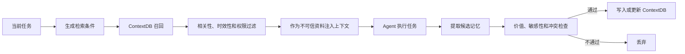
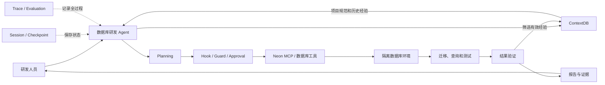

# Agent 开发实战学习与机会探索方案

> 课程定位：以 Agent 开发实战为主线，通过学习和解剖 DSH、Codex 等完整 Agent 工具，系统掌握 Agent 的核心机制；结合 Neon、ContextDB 开展综合实践，并在学习过程中观察数据库、缓存和存储相关的新机会。

## 1. 课程目标

本课程首先是一套 Agent 开发实战课程，需要让参与者真正理解并能够动手实现一个完整 Agent，而不是只做行业调研或产品讨论。

课程目标分为三个层次：

### 1.1 学习目标

- 理解大模型如何通过 Agent Runtime 完成多步骤任务。
- 掌握 Agent Loop、Planning、Tool、MCP、Skill、Hook 等核心机制。
- 掌握 Session、Context、Memory、Checkpoint 和任务恢复。
- 理解 Subagent、多 Agent、Human-in-the-loop 和权限控制。
- 掌握 Agent 的可观测、评测、安全和生产化方法。
- 能够阅读 DSH、Codex 等完整 Agent 工具的架构和关键实现。

### 1.2 实践目标

- 从零完成一个最小 Agent。
- 为 Agent 增加工具、MCP、Skill 和 Hook。
- 为 Agent 增加 Session、Memory 和任务恢复。
- 完成一个结合 Neon、ContextDB 的综合 Agent Demo。
- 建立一套可以重复运行的 Agent 测试集。

### 1.3 延伸目标

- 在学习 Agent 机制时，识别新的数据、状态、缓存和存储需求。
- 优先分析与 Neon、ContextDB 当前方向的结合点。
- 同时开放观察 NoSQL、缓存、存储及其他潜在方向。
- 对高价值机会提出最小 POC，而不是停留在概念判断。

课程内容建议保持以下比重：

| 内容 | 建议比重 |
|---|---:|
| Agent 机制学习与动手实验 | 70% |
| Neon、ContextDB 综合实践 | 20% |
| 新机会观察与讨论 | 10% |

---

## 2. Agent 整体思路图

```mermaid
flowchart TB
    U[用户 / 上游系统] --> INPUT[任务输入]

    subgraph RUNTIME[Agent Runtime]
        INPUT --> UNDERSTAND[任务理解]
        UNDERSTAND --> PLAN[Planning / 任务分解]
        PLAN --> CONTEXT[Context Assembly]
        CONTEXT --> MODEL[大模型推理]
        MODEL --> DECIDE{下一步决策}

        DECIDE -->|调用工具| TOOL[Tool Calling]
        DECIDE -->|委派任务| SUB[Subagent]
        DECIDE -->|需要信息| HUMAN[用户输入 / 审批]
        DECIDE -->|准备完成| VERIFY[结果验证]

        TOOL --> GUARD[Hook / Guard / Permission]
        GUARD --> EXEC[执行工具]
        EXEC --> OBSERVE[观察结果]
        SUB --> OBSERVE
        HUMAN --> CONTEXT
        OBSERVE --> CONTEXT
        VERIFY -->|未通过| CONTEXT
        VERIFY -->|通过| OUTPUT[回答 / Artifact / Action]

        RULES[AGENTS.md / Skills] -.提供规则和工作方法.-> PLAN
        SESSION[Session / State / Checkpoint] -.保存运行状态.-> CONTEXT
        MEMORY[Long-term Memory] -.召回与沉淀.-> CONTEXT
        HOOK[Lifecycle Hooks] -.监听和干预.-> TOOL
        TRACE[Trace / Evaluation] -.记录和评价.-> RUNTIME
        SANDBOX[Sandbox / Security] -.限制执行边界.-> EXEC
    end

    EXEC --> MCP[MCP / API / CLI / Filesystem]
    MCP --> NEON[Neon / 业务数据库]
    MCP --> CDB[ContextDB]
    MCP --> EXT[代码仓库及其他系统]
```

Agent 最核心的运行闭环是：

```text
接收目标
  → 理解并拆分任务
  → 组装上下文
  → 模型判断下一步
  → 调用工具、委派任务或请求信息
  → 获取观察结果
  → 更新上下文和状态
  → 验证是否完成
  → 输出结果并沉淀有效信息
```

---

## 3. Agent 机制课程地图

下面的子项均需要覆盖，但根据重要程度分成三个层次。

### 3.1 核心必修

| 模块 | 要解决的问题 | 课程实践 |
|---|---|---|
| Agent Loop | Agent 如何持续推理、行动、观察和停止？ | 编写最小 Agent Loop |
| Context Assembly | 每轮模型调用应该看到哪些信息？ | 对比多种上下文组装方式 |
| Tool Calling | Agent 如何安全可靠地执行真实操作？ | 编写文件、SQL和状态工具 |
| MCP | Agent 如何标准化连接外部系统？ | 编写并接入 MCP Server |
| Skills / AGENTS.md | 如何沉淀项目规则和可复用工作流？ | 编写项目级 Skill |
| Hooks / Guard | 如何在生命周期节点监听、拦截和增强？ | SQL风险拦截 Hook |
| Session / State | Agent 如何保存任务状态和连续工作？ | 实现持久化 Session |
| Checkpoint / Recovery | Agent 中断后如何恢复且不重复副作用？ | 实现暂停和恢复 |
| Memory | Agent 如何跨任务记忆、更新和遗忘？ | 接入 ContextDB |
| Security / Permission | 如何限制文件、命令、网络和数据库操作？ | 建立权限分级和审批 |
| Observability / Eval | 如何知道 Agent 是否可靠、有效？ | 建立 Trace 和测试集 |

### 3.2 重要机制

| 模块 | 要解决的问题 | 课程实践 |
|---|---|---|
| Model / Provider / Router | 如何选择模型、降级、重试和控制成本？ | 多模型效果与成本对比 |
| Planning | 如何把复杂目标拆成可验证步骤？ | 数据库迁移任务规划 |
| Subagent / Multi-Agent | 如何分工、传递上下文和汇总结果？ | 主Agent调用两个专家Agent |
| Human-in-the-loop | 何时提问、暂停、审批或修改目标？ | 数据库写操作审批 |
| Verification | 如何判断任务真正完成而不是“看起来完成”？ | 加入测试和证据检查 |
| Prompt / Instruction | 不同层级指令如何影响 Agent 行为？ | 指令冲突和优先级实验 |

### 3.3 适度了解但不能遗漏

| 模块 | 学习内容 | 建议实践 |
|---|---|---|
| Artifact | 代码、报告、配置等结果的版本、来源和验证状态 | 保存并关联任务产物 |
| Async / Schedule | 长任务、定时任务、等待外部事件和 Heartbeat | 模拟异步任务 |
| Cost / Budget | Token、工具调用、模型费用、步数和时间预算 | 设置任务预算 |
| UI / Interaction | 流式输出、进度、审批和结果展示 | 简单任务状态界面 |
| Plugin / Extension | 插件发现、加载、隔离和兼容 | 编写最小插件 |
| Failure Handling | 模型、工具、进程和节点错误处理 | 故障注入实验 |

---

## 4. 课程一：Agent 基础与 Agent Loop

### 学习点

- Agent 与普通 LLM 调用的区别。
- Agent、Session、Turn、Step、Model Call、Tool Call 的关系。
- 推理—行动—观察循环。
- 完成、失败、暂停、等待和取消状态。
- 最大步数、超时、预算和无限循环保护。
- 模型失败、工具失败和重试策略。
- 用户中途追加要求时如何 Steering。

### 探索对象

- DSH 的 Agent、Agent Loop、事件和状态接口。
- Codex 的任务执行、工具调用、等待和终止过程。
- 同步循环、异步循环与事件驱动循环。

### 动手实验

1. 编写一个只有两个工具的最小 Agent。
2. 输出每个 Step 的模型输入、决策、工具参数和工具结果。
3. 制造工具超时、模型失败和无限循环。
4. 实现最大步数、重试、取消和用户中途转向。

### 学习产出

- Agent Loop 时序图。
- 最小可运行 Agent。
- 停止条件和错误处理说明。

---

## 5. 课程二：模型、Prompt 与 Context Assembly

### 学习点

- System、Developer、User、Assistant、Tool 消息。
- 项目规则、工具说明、对话历史、记忆和当前任务如何组合。
- 指令优先级、冲突和覆盖关系。
- Context Window、Token 和上下文成本。
- 上下文裁剪、滑动窗口、摘要、压缩和检索。
- 工具结果与外部资料为什么应被视为不可信数据。
- Prompt Injection 和间接注入。

### 动手实验

1. 使用完整历史、滑动窗口、摘要和检索式上下文完成同一任务。
2. 比较成功率、token、延迟和信息丢失。
3. 在工具结果中加入恶意指令，验证 Agent 是否被误导。
4. 改变工具数量和描述长度，观察工具选择准确率。

### 延伸学习：KV Cache

KV Cache 不作为 Agent 主课程的中心，但作为理解“长上下文如何影响模型推理”的延伸课题：

- Prefill 与 Decode。
- KV Cache 与 Prefix Cache。
- 长 Prompt 和重复前缀的推理成本。
- KV Connector 和缓存跨层、跨节点传输。
- KV Cache、语义缓存、RAG 和 Agent Memory 的区别。

这一部分以理解 Agent 上下文的推理成本为主，再观察 NoSQL、缓存和存储机会。

---

## 6. 课程三：Planning 与任务分解

### 学习点

- ReAct、Plan-and-Execute 等执行方式。
- 什么任务需要显式规划，什么任务适合边做边调整。
- 如何把模糊目标拆成可执行、可验证的步骤。
- 任务依赖、并行关系和完成条件。
- 执行中如何局部调整计划。
- 计划和实际执行结果如何保持一致。

### 动手实验

1. 使用“直接执行”和“先规划后执行”完成同一数据库任务。
2. 为每个步骤定义完成条件和证据。
3. 执行中修改目标，观察计划调整。
4. 使用任务 DAG 表达依赖和并行步骤。

### 学习产出

- 一套任务分解模板。
- 一个带计划、执行状态和完成条件的 Demo。

---

## 7. 课程四：Tool Calling

### 学习点

- 工具如何注册、发现、描述和选择。
- 工具名称、描述和参数 Schema 对调用准确率的影响。
- 工具粒度如何设计。
- 同步、异步、流式和长任务工具。
- 超时、重试、幂等和部分成功。
- 只读、有副作用和不可逆操作的区别。
- 工具结果如何向模型表达成功、失败和下一步建议。

### 工具设计原则

- 工具职责单一，名称和描述明确。
- 使用结构化参数和结构化结果。
- 写操作支持 Dry Run、幂等键和审计 ID。
- 错误进行分类，不能只返回模糊文本。
- 高风险操作必须经过策略检查或人工审批。

### 动手实验

1. 实现文件查询、SQL 查询和任务状态查询工具。
2. 故意设计含糊工具描述，再逐步优化。
3. 为数据库写工具加入 Dry Run 和幂等键。
4. 模拟超时、部分成功和重复调用。

---

## 8. 课程五：MCP 与外部系统集成

### 学习点

- MCP Server、Client、Tool、Resource 和 Prompt。
- 本地 MCP 与远程 MCP。
- MCP 与 API、SDK、CLI 的关系。
- Agent 如何发现和选择 MCP 工具。
- MCP 的认证、授权、审批和数据安全。
- 工具白名单、读写分级和最小权限。

### 动手实验

1. 接入一个只读 MCP Server。
2. 编写一个包含健康检查和查询工具的最小 MCP Server。
3. 将 Neon 或 ContextDB 的部分能力封装为 MCP 工具。
4. 对比 API 直连与 MCP 接入的开发、复用和治理成本。

### 学习产出

- 一个可运行的 MCP Server。
- Agent—MCP—数据库调用图。
- MCP 权限和安全边界说明。

---

## 9. 课程六：Skills、AGENTS.md 与可复用工作流

### 学习点

- AGENTS.md、Skill、Prompt、Tool、MCP 和 Hook 的边界。
- Skill 的发现、触发和执行。
- Skill 如何组织说明、脚本、模板和参考资料。
- 项目级与用户级 Skill。
- 如何避免 Skill 太多、描述冲突和上下文膨胀。

### 选型参考

| 内容 | 推荐载体 |
|---|---|
| 项目长期通用规则 | AGENTS.md |
| 可复用标准工作流 | Skill |
| 实时数据读取或外部操作 | Tool / MCP |
| 生命周期自动检查 | Hook |
| 用户与项目历史信息 | ContextDB / Memory |

### 动手实验

- 编写“Neon 数据库变更检查”Skill。
- 编写“ContextDB 记忆质量评估”Skill。
- 对比无 Skill、长 Prompt 和使用 Skill 的效果。

---

## 10. 课程七：Hook、Event、Guard 与 Approval

### 学习点

- Agent 生命周期中有哪些事件点。
- Hook 可以观察、修改、拦截或拒绝什么。
- Hook、Guard、业务代码和人工审批如何分工。
- Hook 执行顺序、超时、异常、幂等和隔离。

### 典型生命周期点

| 时机 | 可实现能力 |
|---|---|
| Session Start | 加载身份、项目配置和环境信息 |
| User Input | 分类、敏感信息识别、补充上下文 |
| Pre Model Step | 记忆召回、上下文裁剪、模型选择 |
| Pre Tool Use | 参数校验、权限检查、风险拦截 |
| Post Tool Use | 结果过滤、审计和指标记录 |
| Turn Stopping | 验证任务是否真正完成 |
| Session Stop | 总结、保存记忆、释放资源 |
| Subagent Start/Stop | 控制委派范围和记录状态 |

### 动手实验

1. 实现危险 SQL 拦截 Hook。
2. 实现工具调用日志 Hook。
3. 实现“没有验证证据不得结束”的 Stop Hook。
4. 为高风险数据库写入增加人工审批。

---

## 11. 课程八：Session、State、Checkpoint 与 Recovery

### 学习点

- Session 保存消息、事件还是完整运行状态。
- Agent 的运行、等待、完成、失败和取消状态。
- Append-only Event Log、Checkpoint 和 Replay。
- Agent 中断后如何恢复。
- 等待用户审批、外部任务和定时事件。
- 并发输入、重复事件和状态冲突。
- 如何避免恢复后重复执行有副作用操作。
- Session 与长期 Memory 的边界。

### 动手实验

1. 执行到一半终止 Agent，然后恢复任务。
2. 在数据库写入前暂停，审批后继续。
3. 重复投递同一事件，验证幂等处理。
4. 验证恢复后不会重复执行写操作。

### 结合方向

- 研究 Neon 是否适合承接 Agent Session、Checkpoint 和 Trace。
- 观察是否存在通用 Agent State Store 的机会。

---

## 12. 课程九：Memory、RAG 与 ContextDB

### 学习点

- Working Memory、Session History、RAG 和长期 Memory 的区别。
- 哪些信息值得保存，何时写入。
- 记忆的召回、更新、冲突、过期和删除。
- 记忆来源、时间、置信度和访问权限。
- 错误记忆、记忆污染和 Prompt Injection。
- 用户、项目、租户和 Agent 之间的隔离。
- 向量、关键词、结构化和时间检索。

### 记忆流程



### 动手实验

1. 对比无记忆、全量历史、普通向量检索和 ContextDB。
2. 注入错误、过期和恶意记忆。
3. 验证纠错、覆盖、删除和租户隔离。
4. 测量任务成功率、召回准确率、token 和延迟。

### 需要验证的判断

> ContextDB 是否能够成为 Agent 的通用长期记忆基础设施，其差异化是否来自可解释、可更新、时间语义、强隔离和记忆治理，而不只是向量检索。

---

## 13. 课程十：Subagent 与多 Agent

### 学习点

- 为什么使用子 Agent，而不是扩大单 Agent 上下文。
- 按角色、领域或任务阶段拆分。
- 主 Agent 应传递多少上下文。
- 子 Agent 如何通信、等待、取消和汇总。
- 如何避免重复工作、冲突结论和成本失控。
- 主从、专家、并行探索、生成—审查等模式。

### 动手实验

1. 主 Agent 分别调用数据库专家和 ContextDB 专家。
2. 两个 Agent 独立评审同一方案，再由主 Agent 汇总。
3. 对比单 Agent 和多 Agent 的质量、耗时和成本。
4. 限制子 Agent 上下文，观察信息缺失和成本变化。

### 延伸观察

- Agent 间的消息、共享状态和任务如何持久化。
- 是否需要面向多 Agent 的队列、协调或状态服务。

---

## 14. 课程十一：安全、Sandbox 与 Human-in-the-loop

### 学习点

- Agent 可以访问哪些文件、命令、网络、数据库和凭据。
- 工作区、容器和执行环境隔离。
- 只读、普通写入、可恢复写入和高风险操作分级。
- 最小权限、临时凭据和密钥管理。
- Prompt Injection、越权和敏感数据泄漏。
- 用户如何暂停、补充信息、修改目标、审批和取消任务。

### 权限建议

| 等级 | 示例 | 默认策略 |
|---|---|---|
| L0 | 读取文档、代码搜索、查询元数据 | 自动允许 |
| L1 | 修改工作区文件、生成测试数据 | 范围内允许 |
| L2 | 创建临时数据库、执行可回滚写入 | 策略检查或审批 |
| L3 | 生产 DDL、删除数据、发送外部消息 | 强制人工审批 |

### 动手实验

- 在用户输入、网页、工具结果和记忆中放入恶意指令。
- 测试 Agent 是否发生越权操作。
- 检查凭据和敏感信息是否进入 Prompt、日志或记忆。
- 对数据库写操作实现审批、拒绝和替代方案。

---

## 15. 课程十二：Observability、Evaluation 与生产化

### 学习点

- Session、Turn、Step、Model Call 和 Tool Call 的关联。
- Agent Trace、事件、日志和指标。
- Token、模型成本、工具成本和任务预算。
- 固定测试集、回归测试和故障注入。
- Artifact 的来源、版本和验证状态。
- 长任务、异步任务、定时任务和 Heartbeat。
- 模型、工具、进程和节点故障恢复。

### 建议指标

| 维度 | 指标示例 |
|---|---|
| 正确性 | 任务成功率、SQL正确率、测试通过率 |
| 可靠性 | 重试次数、非预期停止率、恢复成功率 |
| 安全性 | 越权率、危险操作拦截率、泄漏率 |
| 效率 | Token、总耗时、工具调用次数、成本 |
| 记忆质量 | 召回准确率、错误记忆采用率 |
| 用户体验 | 人工介入次数、解释和证据完整性 |

### 动手实验

1. 建立10～20个固定任务作为初始测试集。
2. 对 Prompt、Skill、Memory 策略变更进行回归测试。
3. 注入工具超时、错误返回、权限拒绝和任务中断。
4. 输出成功率、成本、延迟和安全指标。

---

## 16. DSH 与 Codex 的学习方式

DSH、Codex 作为课程中的“解剖对象”和“实践平台”，不单独变成产品功能介绍课。

| 观察对象 | 重点学习内容 |
|---|---|
| DSH | Agent Loop、Plugin、事件、Session、Tool、Skill、Subagent、状态与恢复 |
| Codex | AGENTS.md、Skill、MCP、Hook、Sandbox、Approval、任务和用户介入 |

统一回答：

- Agent Loop 如何运行？
- 可以在哪些生命周期点扩展或拦截？
- 工具如何注册、授权、调用和处理错误？
- Session 和状态如何保存与恢复？
- Skill、Hook、MCP 和 Plugin 如何分工？
- 子 Agent 如何创建、通信、等待和取消？
- 权限、隔离、审批和审计如何实现？
- 哪些设计可以用于我们的 Agent 和数据产品？

---

## 17. 综合实战：数据库研发 Agent

综合项目用于把课程中的机制真正串起来。

### 17.1 场景

> 用户提出数据库变更、性能分析或故障排查任务。Agent 从 ContextDB 召回项目规范和历史经验，通过 MCP 创建或访问 Neon 隔离环境，生成计划并执行操作。Hook/Guard 在关键操作前进行检查，Agent 完成测试和结果验证后输出报告，再将经过筛选的新经验写回 ContextDB。

### 17.2 架构



### 17.3 覆盖的课程机制

- Agent Loop 和 Planning。
- Tool Calling 和 MCP。
- Skills、Hooks、Guard 和 Approval。
- Session、Checkpoint 和 Recovery。
- ContextDB Memory。
- Neon 数据操作与隔离环境。
- Sandbox、安全、Trace 和 Evaluation。

### 17.4 最小验收场景

- 根据需求生成 Schema 变更计划。
- 在隔离环境执行并验证。
- 发现危险 SQL 时阻止执行。
- 工具失败后能够重试或安全结束。
- 中断后能够恢复且不重复写操作。
- 使用历史经验辅助定位问题。
- 记忆过期时以当前数据库事实为准。
- 不同用户和项目的数据、权限及记忆互相隔离。

---

## 18. 学习过程中的机会观察

机会观察是课程的延伸，不替代 Agent 学习主线。

| Agent 机制 | 可以顺带观察的方向 |
|---|---|
| Context / Memory | ContextDB、上下文管理、混合检索 |
| Session / Checkpoint | Agent State Store、任务恢复 |
| Tool / MCP | Neon接入、数据访问网关、MCP治理 |
| Hook / Guard | Agent数据安全、SQL风险控制 |
| Trace / Evaluation | Agent可观测和评测平台 |
| Multi-Agent | 消息、队列、共享状态和协调服务 |
| 长上下文 | KV Cache、语义缓存、推理成本优化 |
| Artifact | Agent产物、证据和数据版本管理 |

对每个候选机会只需回答：

1. 它对应哪个 Agent 机制？
2. 用户真正遇到什么问题？
3. 为什么需要数据库、缓存或存储能力？
4. 与 Neon、ContextDB 是否有关？
5. 如果不属于现有方向，是否值得继续观察？
6. 最小 POC 如何验证？

---

## 19. 课程安排建议

### 第一阶段：建立 Agent 全局认识

1. Agent 整体架构与 Agent Loop。
2. Model、Prompt 和 Context Assembly。
3. Planning 和任务分解。

阶段成果：最小 Agent、运行流程图和基础 Trace。

### 第二阶段：让 Agent 能够行动

4. Tool Calling。
5. MCP。
6. Skills、AGENTS.md。
7. Hooks、Guard 和 Approval。

阶段成果：能够通过 MCP 安全访问外部系统的 Agent。

### 第三阶段：让 Agent 能够持续工作

8. Session、State、Checkpoint 和 Recovery。
9. Memory、RAG 和 ContextDB。
10. Subagent 和多 Agent。

阶段成果：可恢复、有长期记忆、能够委派任务的 Agent。

### 第四阶段：走向真实项目

11. Security、Sandbox 和 Human-in-the-loop。
12. Observability、Evaluation 和生产化。
13. Neon × ContextDB 综合实战。

阶段成果：综合 Demo、测试集、评测结果和机会清单。

---

## 20. 每次专题分享模板

每次分享建议控制在20～30分钟：

1. **学习目标**：这节课要搞清楚什么？
2. **机制原理**：它在 Agent 中处于什么位置？
3. **真实实现**：DSH、Codex 或其他系统如何实现？
4. **动手实验**：做了什么，结果如何？
5. **项目结合**：如何用于 Neon、ContextDB 或综合 Agent？
6. **延伸观察**：是否产生新的数据基础设施机会？

每位负责人至少交付“三个一”：

- 一张能说明机制的图。
- 一个可运行、可复现的 Demo。
- 一份包含学习结论和项目结合点的短文档。

如果发现明确机会，再补充一张机会卡，不要求每个课题强行寻找产品方向。

---

## 21. 团队分工建议

| 课程组 | 负责内容 |
|---|---|
| Runtime组 | Agent Loop、Planning、Model、Session、Recovery |
| Tool组 | Tool Calling、MCP、Skill、Hook、Guard |
| Context组 | Context Assembly、RAG、Memory、ContextDB |
| Orchestration组 | Subagent、Approval、Async、Schedule |
| Quality组 | Sandbox、安全、Trace、Evaluation、Cost |
| 综合实践组 | Neon × ContextDB 数据库研发 Agent |

每个课题设置一名主负责人和一名交叉评审人。

牵头人主要负责：

- 维护 Agent 整体机制图和课程顺序。
- 控制课题范围，避免重复学习或遗漏关键机制。
- 统一实验、分享和文档模板。
- 组织内部分享和交叉评审。
- 将分散的课程 Demo 组合成综合 Agent。
- 汇总学习结论、项目结合点和高价值机会。

---

## 22. 最终交付物

1. Agent 整体架构图和术语表。
2. 一套完整、详略得当的 Agent 开发课程。
3. DSH、Codex 关键机制和源码入口分析。
4. 各课程的最小可运行 Demo。
5. Neon × ContextDB 数据库研发 Agent。
6. Agent 固定测试集和评测基线。
7. 权限、安全、审批和审计方案。
8. 与 Neon、ContextDB 的结合建议。
9. NoSQL、缓存、存储等其他方向的机会观察清单。
10. 值得继续验证的 POC 建议。

## 23. 向领导汇报的建议表述

> 我计划以“Agent开发实战”为主线，先建立完整的 Agent 机制图，再把 Agent Loop、Planning、Tool、MCP、Skill、Hook、Session、Memory、多 Agent、安全和评测等内容拆成专题，由团队成员分头学习和动手验证。DSH、Codex 会作为主要解剖对象，但课程不会停留在工具使用层面，每个专题都需要有原理、真实实现和可运行 Demo。实践上会结合我们正在做的 Neon、ContextDB，最终完成一个数据库研发 Agent，把各模块串起来。在学习过程中，我们也会观察 Agent 对数据库、缓存和存储提出的新需求；Neon、ContextDB 是优先结合方向，但如果发现其他有价值的机会，也会记录并提出验证方案。这样既能让团队真正搞清楚 Agent 机制，也能把学习结果转化为项目能力和新的机会判断。

