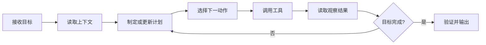

# 大模型推理机制详解

**调研日期：2026-08-03**

**文档范围：只讨论大模型推理能力的形成、一次请求的运行过程、测试时计算与推理服务实现。数据库如何介入见 [[02 数据库介入大模型推理的关键环节]]，厂商实践见 [[03 云厂商数据库参与大模型推理实践调研（2026-08）]]。**

> 核心结论：大模型底层并没有内置一套传统符号逻辑引擎。它仍然通过 Transformer，根据已有上下文逐个预测后续 token。复杂推理能力来自训练形成的参数化能力、中间推理 token 带来的顺序计算、测试时搜索与验证，以及外部工具反馈形成的闭环。

## 一、先统一“推理”的三个含义

讨论大模型推理时，常把三个不同概念混在一起。

| 概念 | 英文 | 关注的问题 | 典型内容 |
|---|---|---|---|
| 模型推断 | Inference | 模型怎样从输入生成输出 | Tokenization、Prefill、Decode、KV Cache |
| 认知推理 | Reasoning | 模型怎样完成多步问题求解 | CoT、问题分解、自检、搜索、验证 |
| 推理服务 | Inference Serving | 怎样低成本、高并发地运行模型 | Continuous Batching、PagedAttention、量化、并行化 |

三者的关系是：认知推理最终仍要通过模型推断实现，而推理服务决定这种推断的延迟、吞吐量和成本。

## 二、最底层机制：逐 token 的条件概率预测

### 2.1 Tokenization：把文本转换为模型可处理的离散单元

模型不能直接处理汉字、英文单词或 SQL 字符串，而是先由 tokenizer 将输入拆成 token，再将 token 映射为整数 ID。

例如：

```text
输入：查询华东区 2026 年已支付订单金额

可能的 token：
[查询] [华东] [区] [2026] [年] [已支付] [订单] [金额]
```

真实拆分由词表和 tokenizer 算法决定，同一句话在不同模型中可能产生不同 token 数。

这一环节的重要影响包括：

1. **上下文长度按 token 计算，而不是按字符计算。**
2. **输入成本和首 token 延迟与 token 数相关。**
3. **代码、表结构、长数字和罕见术语可能被拆成更多 token。**
4. **模型输出只能从词表中的 token 组合产生。**

### 2.2 Embedding：把 token 变成向量

每个 token ID 会被映射为高维向量，并叠加或融合位置信息。向量不是数据库意义上的一条事实记录，而是模型内部用于计算的连续表示。

模型后续各层会不断变换这些向量，使其逐渐编码：

- 词义和语法；
- 前后文指代；
- 任务要求；
- 实体与关系；
- 当前可能需要的计算步骤。

### 2.3 Transformer：通过注意力读取上下文

Transformer 的核心是自注意力和前馈网络。当前 token 可以根据注意力权重聚合上下文其他位置的信息，从而处理远距离依赖和复杂组合关系。[Attention Is All You Need](https://arxiv.org/abs/1706.03762)

简化后的单层过程可以理解为：

```text
输入向量
  → 生成 Query / Key / Value
  → 计算当前位置应关注哪些历史位置
  → 聚合历史信息
  → 前馈网络做非线性变换
  → 输出给下一层
```

实际模型会堆叠许多 Transformer 层。模型参数中并不是以“事实表”的形式保存知识，而是以分布式权重模式编码语言规律、概念关联和任务策略。

### 2.4 自回归生成：一次预测一个 token

给定输入 `x`，模型生成输出 `y` 的过程可以写成：

```math
P(y|x) = \prod_t P(y_t | x, y_{<t})
```

也就是：

1. 根据输入预测第一个输出 token；
2. 把该 token 追加到上下文；
3. 根据输入和已有输出预测下一个 token；
4. 重复，直到遇到结束条件。

因此，模型生成“先分析条件，再计算结果，最后回答”的全过程，在底层依然是一串连续的 token 预测。[Language Models are Few-Shot Learners](https://arxiv.org/pdf/2005.14165)

### 2.5 Logits、采样与解码策略

模型每一步会为整个词表输出 logits，再转换成概率分布。解码器决定如何选择下一个 token。

| 策略 | 做法 | 优点 | 局限 |
|---|---|---|---|
| Greedy | 选择概率最高的 token | 稳定、成本低 | 容易过早走入错误路径 |
| Temperature Sampling | 调整概率分布后采样 | 增加多样性 | 温度过高会降低稳定性 |
| Top-k | 只在概率最高的 k 个 token 中采样 | 控制随机范围 | k 是固定阈值 |
| Top-p | 在累计概率达到 p 的候选集中采样 | 候选规模可自适应 | 参数不当会过于保守或发散 |
| Beam Search | 同时保留若干高分序列 | 适合结构化生成 | 内存与计算成本更高 |

推理任务不一定应该使用完全确定性的 greedy。生成多个路径再验证，往往比单路径更可靠，但会增加 token 和模型调用成本。

## 三、一次模型请求的运行过程

### 3.1 上下文组装

真正进入模型的输入一般不只有用户问题，而是多个部分的组合：

```text
系统指令
+ 开发者指令
+ 用户问题
+ 历史对话
+ 检索到的资料
+ 工具定义
+ 工具返回结果
+ 输出格式约束
```

上下文组装会直接影响推理结果。常见问题包括：

- 指令互相冲突；
- 重要信息埋在过长上下文中；
- 检索结果不相关或已经过期；
- 工具返回文本中包含提示注入；
- 表结构、业务口径或时间范围缺失。

### 3.2 Prefill：一次性理解已有上下文

Prefill 阶段处理所有输入 token，并为每一层计算 Key/Value。其特点是：

- 输入 token 可以较充分地并行计算；
- 长上下文会增加首 token 延迟；
- 计算通常更偏算力密集；
- 结果形成后续 Decode 要使用的 KV Cache。

### 3.3 Decode：逐步生成新 token

Decode 阶段每轮只产生一个或少量 token。每生成一个 token，都需要：

1. 读取模型权重；
2. 读取已有 KV Cache；
3. 计算新 token 的各层表示；
4. 得到词表概率；
5. 选择 token 并追加到上下文。

Decode 的并行度低于 Prefill，通常更受显存带宽和 KV Cache 容量影响。

### 3.4 停止条件

生成会在以下条件之一满足时停止：

- 生成 EOS 结束 token；
- 命中指定 stop sequence；
- 达到最大输出 token 数；
- Agent 决定调用工具并暂停当前生成；
- 内容过滤器或安全策略中止；
- 超时或资源预算耗尽。

## 四、推理能力是怎样形成的

### 4.1 预训练：学习语言、知识和通用模式

预训练使用大规模文本、代码和其他模态数据，优化下一 token 预测目标。模型在这个过程中逐渐学习：

- 语言结构和表达方式；
- 世界知识的统计关联；
- 代码和形式语言模式；
- 常见问题与解决步骤；
- 文本中隐含的推理模式。

预训练获得的是“参数化知识”。其问题是：

- 知识有时间截止点；
- 很难精确修改单条事实；
- 不保证事实来源和可追溯性；
- 学会的是分布规律，不是数据库式精确记忆。

### 4.2 指令微调：学习按照任务要求回答

基础模型只擅长续写。指令微调通过“指令—回答”样本，使模型学习：

- 理解用户意图；
- 遵循输出格式；
- 拒绝不合适请求；
- 区分解释、总结、分类和生成等任务；
- 在多轮对话中保持角色和上下文。

指令微调改善的是可用性和行为对齐，不等于已经显著增强复杂推理能力。

### 4.3 推理轨迹监督：学习生成中间步骤

通过包含完整解题过程的监督数据进行微调，可以让模型学会：

- 先分解问题；
- 明确中间变量；
- 按顺序使用条件；
- 在最终答案前生成推理步骤。

Chain-of-Thought 研究表明，显式中间步骤能提升算术、常识和符号推理表现。[Chain-of-Thought Prompting](https://arxiv.org/abs/2201.11903)

但推理文本“看起来合理”不代表真实过程一定正确。模型可能先倾向某个答案，再生成一套事后解释。因此，关键业务不能只检查推理文本的流畅度。

### 4.4 结果奖励：按最终答案训练

如果任务答案容易自动验证，例如：

- 数学题结果；
- 程序是否通过测试；
- SQL 是否执行并返回正确结果；
- 形式证明是否通过证明器；

就可以根据最终结果对模型进行强化学习或偏好优化。

优点是标注成本较低、可规模化；局限是只有最终得分，模型可能通过偶然路径得到正确答案，无法精确知道中间哪一步出了问题。

DeepSeek-R1 的公开研究展示了利用大规模强化学习激励推理行为，再通过冷启动数据和多阶段训练改善可读性和稳定性的路线。[DeepSeek-R1](https://arxiv.org/abs/2501.12948)

### 4.5 过程奖励：评价每个中间步骤

过程奖励模型会判断每一步是否有效、是否使用了正确条件、是否开始偏离正确路径。

它可以用于：

- 训练阶段筛选高质量推理轨迹；
- 搜索阶段决定扩展哪条路径；
- 推理阶段尽早终止明显错误的分支；
- 最终阶段比较多个候选解。

主要困难是步骤级标注昂贵，而且验证器本身也可能犯错。

### 4.6 蒸馏：把强模型的推理能力迁移到小模型

常见做法是让强推理模型生成大量高质量解题轨迹，再用这些数据训练较小模型。

蒸馏的价值包括：

- 降低推理成本；
- 部署到资源受限环境；
- 为特定领域保留常用推理模式。

但小模型通常更容易在超出训练分布、长链推理和复杂工具选择上退化。

## 五、运行时怎样增强推理

### 5.1 显式 Chain-of-Thought：用 token 作为工作区

最简单的推理增强方式是让模型在回答前生成中间步骤：

```text
问题
→ 已知条件
→ 子问题
→ 中间结论
→ 最终答案
```

前面生成的 token 会重新进入后续预测，相当于让模型多次利用自身输出继续计算。这也是为什么增加合理的推理 token 有时能提升准确率。

局限包括：

- 推理链越长，成本越高；
- 早期错误会向后传播；
- 模型可能重复、绕圈或过度思考；
- 显式推理文本不一定忠实反映内部计算。

### 5.2 问题分解：把复杂任务拆成子任务

问题分解通常包含：

1. 明确最终目标；
2. 识别未知量；
3. 找出依赖的子问题；
4. 确定执行顺序；
5. 合并子结果。

适合：多跳问答、复杂 SQL、长文档分析、代码修改和跨系统任务。

风险是分解错误会把后续步骤导向错误目标。因此可以在执行前增加计划检查，或允许模型根据新信息动态调整计划。

### 5.3 Self-Consistency：生成多条路径后投票

Self-Consistency 不只生成一条推理链，而是采样多个不同路径，再根据最终答案的一致性选择结果。[Self-Consistency Improves Chain of Thought Reasoning](https://arxiv.org/abs/2203.11171)

流程如下：

```text
同一个问题
├─ 路径 A → 答案 42
├─ 路径 B → 答案 42
├─ 路径 C → 答案 37
└─ 路径 D → 答案 42

聚合结果 → 42
```

适合答案相对唯一、能够归一化比较的任务。开放式写作中，多数投票通常没有明确意义。

### 5.4 搜索：在推理状态空间中探索

更复杂的方法会把每个中间状态看作搜索节点：

- **Best-of-N**：独立生成 N 个完整答案，选择最优；
- **Beam Search**：每一步保留若干高分前缀；
- **Tree of Thoughts**：扩展多个思路节点并进行剪枝；
- **MCTS**：在生成、评估和回溯之间循环。

搜索的关键不只是生成候选，而是拥有一个可靠的评分函数。评分来源可以是：

- 模型自身评分；
- 独立 reward model；
- 规则；
- 单元测试；
- 数据库约束；
- 编译器或形式验证器。

### 5.5 Verifier：对候选答案进行验证

Verifier 可以只看最终答案，也可以看整个推理过程。典型流程是：

```text
生成多个候选
→ 规则或模型打分
→ 淘汰明显错误
→ 对高分候选做外部验证
→ 选择最终结果
```

在 GSM8K 数学题上，生成多个候选并训练 verifier 进行排序，能够明显提高表现。[Training Verifiers to Solve Math Word Problems](https://arxiv.org/abs/2110.14168)

需要避免“生成器和验证器共享同一盲区”。高风险任务最好至少加入一种确定性验证来源。

### 5.6 自我反思与纠错

模型可以在得到初稿后执行第二轮检查：

- 是否遗漏条件；
- 单位和时间范围是否一致；
- 结论是否由证据支持；
- 是否存在反例；
- 工具返回值是否被正确解释。

自我反思成本低，但并不天然可靠。只让同一个模型说“请再检查一遍”，可能重复原错误。更有效的方式是提供新的证据、执行结果、测试失败信息或独立验证器反馈。

### 5.7 工具调用：把模型接入外部能力

模型可以生成结构化工具调用：

```json
{
  "tool": "query_orders",
  "arguments": {
    "region": "华东",
    "year": 2026,
    "status": "paid"
  }
}
```

宿主程序执行工具后，把结果加入上下文，模型再继续推理。ReAct 将其组织为“Thought/Action/Observation”循环，使推理和行动交替发生。[ReAct](https://arxiv.org/abs/2210.03629)

Toolformer 则研究了让模型学习何时调用 API、选择哪个 API、传递什么参数以及如何利用结果。[Toolformer](https://arxiv.org/abs/2302.04761)

工具调用的价值在于：

- 获得训练截止日之后的信息；
- 精确执行数学、SQL 和代码；
- 与真实业务系统交互；
- 用外部结果约束模型幻觉。

## 六、Agent 推理循环

当模型不只回答一次，而是持续执行任务时，通常形成 Agent 循环：



### 6.1 规划

规划模块确定：

- 最终交付物；
- 子任务顺序；
- 哪些步骤可以并行；
- 哪些操作需要权限或人工确认；
- 终止条件和预算。

### 6.2 行动选择

模型根据当前状态，从可用动作中选择一个：

- 搜索资料；
- 查询数据库；
- 执行代码；
- 修改文件；
- 请求审批；
- 输出最终答案。

### 6.3 观察

工具返回值会被序列化成文本或结构化内容，重新放入上下文。模型并不是直接“感知”数据库，而是在读取宿主系统提供的结果表示。

### 6.4 状态更新

模型根据新结果修改计划、标记任务完成、记录失败原因或选择重试。长任务不能只依赖上下文，应将状态持久化；具体见 [[02 数据库介入大模型推理的关键环节#五、介入点四：Agent 状态与工作流持久化]]。

### 6.5 终止判断

Agent 必须有明确终止机制：

- 目标已通过验收；
- 达到最大步骤数；
- 成本或时间预算耗尽；
- 连续重试无进展；
- 需要用户提供新权限或信息；
- 风险策略要求停止。

## 七、推理服务怎样支撑上述过程

### 7.1 KV Cache

每个历史 token 在每一层产生的 Key/Value 会被缓存。生成新 token 时可以直接复用，而不必重新计算全部历史。

KV Cache 的特征是：

- 随上下文长度、层数、并发数增长；
- 占用大量 GPU 显存；
- 每条序列长度不同，容易产生内存碎片；
- 多轮对话和共享前缀存在复用机会。

### 7.2 PagedAttention

PagedAttention 借鉴虚拟内存分页，将逻辑连续的 KV Cache 映射到不连续物理块，减少显存碎片，并支持不同请求之间共享部分缓存。[Efficient Memory Management for Large Language Model Serving with PagedAttention](https://doi.org/10.1145/3600006.3613165)

它解决的是推理服务资源管理问题，不直接增强模型的逻辑正确率。

### 7.3 Continuous Batching

传统静态批处理必须等待同一批请求全部完成。Continuous Batching 可以在 token 迭代边界移除完成请求，并加入新请求，提高 GPU 利用率。

调度器需要平衡：

- 吞吐量；
- 首 token 延迟；
- token 间延迟；
- 长短请求公平性；
- KV Cache 容量。

### 7.4 Prefix Cache

当多个请求拥有相同前缀，例如相同系统提示、工具定义或长文档，可以复用该前缀的 KV Cache，减少重复 Prefill。

缓存命中要求 token 序列和位置一致，不能只按语义相似判断。

### 7.5 Speculative Decoding

推测解码由较小模型快速提出多个候选 token，再由大模型批量验证。被接受的候选可以一次推进多个 token，从而减少大模型逐 token Decode 的轮数。

它主要优化速度，理论上不应改变目标大模型的输出分布；实际收益取决于草稿模型命中率和硬件利用方式。

### 7.6 量化与模型并行

- **量化**：用更低精度保存权重或激活，降低显存占用和带宽压力；
- **张量并行**：把单层矩阵运算拆到多张 GPU；
- **流水线并行**：把不同层放到不同设备；
- **数据并行**：复制模型处理不同请求；
- **专家并行**：MoE 模型把专家网络分布到不同设备。

这些手段影响成本、延迟和可能的数值误差，但与 CoT、搜索、验证等认知推理策略属于不同层次。

## 八、大模型推理的主要失败模式

### 8.1 幻觉

模型生成语言上合理但事实错误的内容。根本原因是下一 token 预测目标并不等同于事实验证。

缓解方式：检索、数据库查询、引用来源、工具验证、拒答阈值。

### 8.2 错误传播

早期中间步骤出错后，后续 token 会把错误结论当作新上下文继续推导。

缓解方式：分步验证、分支搜索、回溯、执行反馈。

### 8.3 过度思考

模型在简单问题上生成过长推理链，反而引入新错误，并增加延迟和成本。

缓解方式：按任务难度动态分配推理预算、置信度触发多路径、设置步骤上限。

### 8.4 验证器偏差

Verifier 可能偏好形式流畅的错误答案，或者与生成模型共享相同知识盲区。

缓解方式：使用独立数据训练、引入确定性执行器、定期做反例评测。

### 8.5 上下文污染

不相关资料、旧事实、恶意文本或错误工具结果进入上下文后，会改变模型后续推断。

缓解方式：来源分级、结构化隔离、内容清洗、最小上下文、提示注入检测。

### 8.6 工具误用

模型可能选择错误工具、构造错误参数，或误读返回结果。

缓解方式：严格 schema、枚举和类型约束、权限控制、执行前校验、结果后验证。

### 8.7 不确定性表达失真

模型语言上的自信程度不等于概率校准后的正确率。不能把“我确定”直接当作置信度。

缓解方式：使用历史评测校准、答案一致性、外部证据覆盖率和 verifier 分数联合判断。

## 九、怎样评估一个推理系统

不能只看最终回答是否流畅。建议分层评估。

| 层级 | 指标 | 说明 |
|---|---|---|
| 任务结果 | Accuracy、Pass@k、执行成功率 | 最终结果是否正确 |
| 事实可靠性 | 引用正确率、证据覆盖率、幻觉率 | 答案是否由可信证据支持 |
| 过程质量 | 步骤正确率、工具选择率、SQL 执行正确率 | 中间链路是否可靠 |
| Agent 能力 | 任务完成率、平均步骤数、恢复成功率 | 长任务是否能完成和恢复 |
| 成本 | 输入/输出 token、工具调用数、GPU 时间 | 每次成功任务的实际成本 |
| 延迟 | TTFT、TPOT、端到端 P50/P95/P99 | 用户等待时间和尾延迟 |
| 安全 | 越权率、危险操作拦截率、敏感数据泄露率 | 是否满足权限与安全边界 |

评测集应包含：

- 正常问题；
- 边界条件；
- 缺少信息的问题；
- 冲突证据；
- 过期数据；
- 提示注入；
- 工具失败；
- 数据库超时；
- 无法完成、应该拒答的问题。

## 十、最终认识

大模型推理可以概括为四层：

1. **参数层**：预训练和后训练把知识、语言模式和推理策略编码进权重；
2. **Token 层**：模型通过生成中间 token 获得额外顺序计算和工作区；
3. **搜索与验证层**：多路径、评分、回溯和 verifier 提高正确率；
4. **系统层**：工具、数据库、工作流和权限系统把概率模型接入真实世界。

单独的大模型擅长理解意图、提出假设、分解问题和组织语言；它不擅长保证实时事实、精确集合运算、事务一致性和可恢复执行。这正是数据库与大模型推理结合的主要空间，详见 [[02 数据库介入大模型推理的关键环节]]。

## 参考资料

- [Attention Is All You Need](https://arxiv.org/abs/1706.03762)
- [Language Models are Few-Shot Learners](https://arxiv.org/pdf/2005.14165)
- [Chain-of-Thought Prompting Elicits Reasoning in Large Language Models](https://arxiv.org/abs/2201.11903)
- [Self-Consistency Improves Chain of Thought Reasoning in Language Models](https://arxiv.org/abs/2203.11171)
- [Training Verifiers to Solve Math Word Problems](https://arxiv.org/abs/2110.14168)
- [ReAct: Synergizing Reasoning and Acting in Language Models](https://arxiv.org/abs/2210.03629)
- [Toolformer: Language Models Can Teach Themselves to Use Tools](https://arxiv.org/abs/2302.04761)
- [DeepSeek-R1: Incentivizing Reasoning Capability in LLMs via Reinforcement Learning](https://arxiv.org/abs/2501.12948)
- [Efficient Memory Management for Large Language Model Serving with PagedAttention](https://doi.org/10.1145/3600006.3613165)
