# Lakebase Branch 管控服务化能力调研与测试报告（完整验证版）

> 公开仓库脱敏版：截图中的账号邮箱、Workspace 地址、数据库连接地址及本机用户名/路径已打码；原始证据保留在本地源目录。

**日期**：2026-10-24  **范围**：Databricks Lakebase Postgres，Project `branch2`  **CLI**：v1.22.1  **状态**：P01–P04、P06–P11 已完成；P05 部分通过（套餐配额阻塞成功路径）

## 1. 测试目标与环境

目标是摸清 Lakebase Branch 在**管控服务化**层面的资源模型、数据隔离、生命周期、异步任务、配置管理、异常处理及 API/UI 一致性，为 Neon/PG Branch 管控实现提供借鉴。

- Workspace：`dbc-d88fab7c-ba31.cloud.databricks.com`
- Project：`projects/branch2`；UID：`096ce299-30b2-4ccc-9830-a655f0e5f52f`
- PostgreSQL：18；数据库：`databricks_postgres`
- 资源树：`production → dev → dev-child`；另有 `production → api-test`
- Project 默认计算：2–4 CU，休眠 86400s；历史保留 604800s（7 天）
- 认证：Databricks CLI OAuth，凭据保存在 OS keyring

**证据说明**：以下结果基于本次对话中的控制台和 CLI 截图；不是独立后台审计。每项区分“实测通过”“界面/帮助可见”“待验证”。

## 2. 已完成测试矩阵

| ID | 测试项 | 结果 | 关键证据/结论 |
|---|---|---|---|
| UI-01 | 创建 `dev` 分支 | 通过 | 来源 `production`；支持 1 天 TTL；独立 UID、连接串 |
| UI-02 | 快照隔离 | 通过 | 父分支后建表，旧子分支最初不可见；Reset 后可见 |
| UI-03 | DML 隔离 | 通过 | `dev` 更新 Alice=999、删除 Bob、插入 David；`production` 保持原三行 |
| UI-04 | DDL 隔离 | 通过 | `dev` 新增 `remark` 列及 `idx_orders_amount` 索引，父分支不变 |
| UI-05 | Schema Diff | 通过 | 控制台展示列和索引的具体差异 |
| UI-06 | Reset from parent | 通过 | 重置后数据与父分支一致；UI 警告替换database/角色、中断连接，连接串不变 |
| UI-07 | 保护分支 | 通过（界面规则） | `production` 设为 protected；界面说明不可删除/归档/重置，相关 Compute 不能删除 |
| UI-08 | TTL 与保护约束 | 通过 | 有过期时间的分支不能保护；取消 TTL 后还受保护分支配额限制 |
| UI-09 | 多级分支 | 通过 | `dev-child` 来源 `dev`，继承当时数据及 Schema/索引 |
| UI-10 | 父子删除依赖 | 通过 | 删除有子分支的 `dev` 被拒绝，提示 cannot delete branch that has children |
| UI-11 | Read Replica 创建 | 通过 | `dev-child` 新增 `read-replica-1`，标记 RO |
| UI-12 | 只读与复制 | 通过 | `pg_is_in_recovery()=true`，`transaction_read_only=on`；INSERT 报 SQLSTATE 25006；能读到 Primary 新写入 id=101 |
| UI-13 | Replica 删除 | 通过 | 删除 Replica 后 Primary 保留；重启入口仅观察未实测 |
| API-01 | CLI OAuth | 通过 | `auth describe` 显示正确 Host、用户、认证方式与 keyring |
| API-02 | List Projects | 通过 | 返回 UID、PG18、默认 CU、休眠、历史保留 |
| API-03 | List/Get Branch | 通过 | `source_branch`、LSN、过期时间、保护、UID、READY 与 UI 一致 |
| API-04 | 异步创建 | 通过 | `create-branch --no-wait` 返回 `done=false`，`get-operation` 后 `done=true`、Branch READY |
| API-05 | CLI/UI 同步 | 通过 | `api-test` 在 UI 可见，UID/TTL/来源一致，并显示 Primary Compute |
| API-06 | List/Get Endpoint | 通过 | Endpoint 独立 UID、READ_WRITE、ACTIVE、直连和 Pooler 地址、2–4 CU、24h |
| API-07 | Endpoint Update Mask | 通过 | 不带 `spec.` 前缀报 Unknown field path；带 `spec.` 后异步提交成功 |
| API-08 | Endpoint 配置生效 | 通过 | CU 2–4→0.5–2；休眠 86400s→3600s；UID、Host 不变；UI 同步 |
| API-09 | 同名创建冲突 | 通过 | 返回 `branch already exists` 和 TraceId；原 UID/TTL/LSN/update_time 未变 |
| API-10 | Soft Delete | 通过 | `delete-branch --no-wait` 返回 `done=true`、`google.protobuf.Empty` |
| API-11 | Soft Delete 后可见性 | 通过 | `get-branch` 报 `branch id not found`，同名创建报 already exists |
| API-12 | Purge | 通过 | `delete-branch --purge --no-wait` 返回 `done=true` |
| API-13 | Purge 后重建 | 通过 | 同名 `api-test` 重建成功，UID 变化，来源 LSN 更新 |
| API-14 | 显式源 Branch 创建 | 通过 | `codex-source-test` 显式来源 `dev`；API 返回来源路径、LSN/时间；数据与 Schema 快照和 `dev` 一致 |
| API-15 | 时间点 Branch | 通过 | 指定 `source_branch_time`；PITR 仅含 cutoff 前 `before` 行，不含之后的 `after` 行 |
| API-16 | Branch TTL 更新 | 通过 | `86400s → no_expiry → 172800s`；过期时间更新，Branch UID 不变 |
| API-17 | Branch 保护约束 | 部分通过 | TTL 冲突按预期拒绝；取消 TTL 后因当前套餐 protected Branch 配额已满而拒绝，未触碰 `production` |
| API-18 | Read Replica 创建/删除 | 通过 | READ_ONLY 0.5–1 CU；写入报 SQLSTATE 25006；删除后 Primary 保留并 ACTIVE |
| API-19 | 自动休眠/唤醒 | 通过 | 60s 设置生效并进入 IDLE；只读查询约 4.19s 完成，随后恢复 ACTIVE |
| API-20 | 并发与超时 | 通过 | 同名并发一成一败；失败含 TraceId；1s 客户端超时后资源最终 READY |
| API-21 | 临时资源清理 | 通过 | Replica→子 Branch→父 Branch；最终 `codex-*` 数量为 0，原有四分支全部保留 |
| API-22 | 显式 LSN 分支 | 通过 | 从提交后 LSN `0/1D5D6E0` 创建，仅 `before-commit` 可见，`after-commit` 不可见；API 回显相同 LSN |
| API-23 | latest Timeline 分叉点 | 通过 | 不指定 LSN 时返回来源 LSN `0/1D5D8B8`，两条已提交标记都可见 |
| API-24 | LSN 事务原子性 | 通过 | 从事务提交前 LSN `0/1D5BB78` 创建，该事务中创建的表整体不可见，未出现部分事务状态 |
| API-25 | LSN 边界与互斥参数 | 通过 | `0/1` 被拒绝为早于 Branch 首次活动；LSN + timestamp 同时指定被拒绝，均返回 TraceId |

## 3. API 资源模型

```text
Project  projects/branch2
 ├─ Branch  branches/production  [default, protected]
 │   ├─ Branch  branches/dev
 │   │   └─ Branch branches/dev-child
 │   └─ Branch  branches/api-test
 └─ Endpoint 是 Branch 下的资源：branches/{branch_id}/endpoints/{endpoint_id}

Operation：挂在相关资源路径下的 operations/{id}
```

**关键区别**：Branch API 中 `parent=projects/branch2` 是资源归属；`status.source_branch=projects/branch2/branches/dev` 才是数据来源。`source_branch_lsn` 和 `source_branch_time` 用于追踪创建快照。Project、Branch、Endpoint 都有各自的 UID。仅凭这些不能证明底层存储的 CoW 实现。

**异步 LRO**：`done=false` 表示当时未完成；`done=true` 表示任务结束，还要检查 `error` 或 `response`。`--no-wait` 也可能立即返回 `done=true`。创建成功的 Operation 返回 Branch 对象，删除成功返回 `google.protobuf.Empty`。

**资源状态与规格**：Endpoint 的 `status` 展示 CU、休眠、组配置、连接地址。CLI 更新请求使用 `spec.*` 字段及 Update Mask；本次未证明所有资源均具有完整独立的 desired-state/status 调和机制。

## 4. 关键实测命令

```bash
databricks auth describe
databricks postgres list-projects
databricks postgres list-branches projects/branch2
databricks postgres get-branch projects/branch2/branches/dev-child
databricks postgres create-branch projects/branch2 api-test --ttl 1d --no-wait
databricks postgres list-endpoints projects/branch2/branches/api-test
databricks postgres get-endpoint projects/branch2/branches/api-test/endpoints/primary
```

Endpoint 更新的成功命令（**已执行，仅作记录，不要重复操作现有资源**）：

```bash
databricks postgres update-endpoint \
  projects/branch2/branches/api-test/endpoints/primary \
  'spec.autoscaling_limit_min_cu,spec.autoscaling_limit_max_cu,spec.suspend_timeout_duration' \
  --json '{"name":"projects/branch2/branches/api-test/endpoints/primary","spec":{"autoscaling_limit_min_cu":0.5,"autoscaling_limit_max_cu":2,"suspend_timeout_duration":"3600s"}}' \
  --no-wait
```

删除与重建的成功命令（**仅历史记录，不要直接复制执行**）：

```bash
databricks postgres delete-branch projects/branch2/branches/api-test --no-wait
databricks postgres delete-branch projects/branch2/branches/api-test --purge --no-wait
databricks postgres create-branch projects/branch2 api-test --ttl 1d
```

旧 Branch UID：`br-restless-credit-d1y2p81h`；重建 UID：`br-floral-field-d178y4ft`。旧 Endpoint UID：`ep-soft-fog-d1j1tglg`；重建后的 Endpoint UID：`ep-orange-field-d10hd931`（P01 已验证）。

## 5. 验证任务执行结果

| 编号 | 任务 | 执行思路 | 验收标准 |
|---|---|---|---|
| P01（已完成） | 重建 Endpoint 身份 | 对现有 `api-test` 只读 `list-endpoints`，比较旧 UID/Host | 新 UID、新 Host；恢复 Project 默认 2–4 CU、86400s 休眠；API/UI 一致 |
| P02（已完成） | 显式指定源 Branch | 先查 CLI/API schema；新建 `codex-source-test` 来源 `dev` | API `source_branch=dev`，数据和 Schema 快照正确；UI Schema Diff 无差异 |
| P03（已完成） | 历史时间点分支（PITR） | 在新的 `codex-*` 分支建立前后时间标记；查 API 参数和保留窗口 | `before` 可见、`after` 不可见；记录时间与 LSN |
| P04（已完成） | Branch TTL 更新 | 查 `update-branch --help`，仅修改 `codex-*` | 过期时间变化，UID 不变；父子/TTL 约束已记录 |
| P05（部分通过） | Branch 保护 API | 测试 TTL 冲突及保护配额 | TTL 冲突通过；成功保护、取消保护、删除拒绝受套餐配额阻塞 |
| P06（已完成） | Endpoint 独立删除 | 在临时 Branch 增加 Replica，再通过 API 删除 | Primary 不受影响；Operation/状态一致 |
| P07（已完成） | 自动休眠/唤醒 | 在临时 Endpoint 配置 60s 休眠并空闲等待 | IDLE→查询唤醒→ACTIVE；恢复耗时 4.19s |
| P08（已完成） | 错误/并发/任务超时 | 低并发同名创建、约束错误、1s 超时及最终查询 | 记录 TraceId、状态及最终资源一致性 |
| P09（已完成） | 测试资源清理 | 按 Replica→子→父顺序清理 | `codex-*` 为 0；Project 与已有资源保留 |
| P10（已完成） | 最终报告 | 补齐命令、原始结果、截图、耗时和结论 | 已形成完整矩阵、限制和架构建议 |
| P11（已完成） | Timeline/LSN 补充验证 | latest、显式 LSN、事务边界、过旧 LSN、互斥参数 | 全部符合预期；截图已追加；临时资源已 Purge |

### 5.1 P01 — 重建 Endpoint 身份（已完成）

- 执行窗口：2026-10-24 16:39:28–16:39:33（GMT+8）
- 操作性质：只读；未修改任何 Branch、Endpoint 或 Project 配置
- 认证：新建独立 CLI profile `codex-lakebase`，用于绕过本机原默认 profile 名称异常；OAuth Token 未写入报告
- 查询命令：

```bash
databricks postgres list-endpoints projects/branch2/branches/api-test \
  --profile codex-lakebase --output json
databricks postgres get-endpoint \
  projects/branch2/branches/api-test/endpoints/primary \
  --profile codex-lakebase --output json
```

关键原始结果：

```json
{
  "create_time": "2026-10-24T08:14:15Z",
  "endpoint_id": "primary",
  "name": "projects/branch2/branches/api-test/endpoints/primary",
  "parent": "projects/branch2/branches/api-test",
  "uid": "ep-orange-field-d10hd931",
  "update_time": "2026-10-24T08:14:17Z",
  "status": {
    "autoscaling_limit_min_cu": 2,
    "autoscaling_limit_max_cu": 4,
    "current_state": "ACTIVE",
    "endpoint_type": "ENDPOINT_TYPE_READ_WRITE",
    "hosts": {
      "host": "ep-orange-field-d10hd931.database.us-west-2.cloud.databricks.com",
      "read_write_pooled_host": "ep-orange-field-d10hd931-pooler.database.us-west-2.cloud.databricks.com"
    },
    "suspend_timeout_duration": "86400s"
  }
}
```

结论：

1. Endpoint UID 从旧值 `ep-soft-fog-d1j1tglg` 变为 `ep-orange-field-d10hd931`，说明 Branch Purge 后同名重建不会复用 Endpoint 身份。
2. 直连 Host 和 Pooler Host 均随新 UID 变化，旧连接地址不应继续使用。
3. Endpoint 配置恢复 Project 默认值：2–4 CU、休眠 86400 秒（控制台显示 1 Day），未继承旧 Endpoint 曾修改的 0.5–2 CU、3600 秒配置。
4. API 与 UI 一致：Branch UID 为 `br-floral-field-d178y4ft`，Primary 状态 ACTIVE，控制台显示 2–4 CU；编辑弹窗显示 Endpoint ID `ep-orange-field-d10hd931` 和 1 Day 休眠。弹窗仅查看后取消，未保存修改。

界面证据：

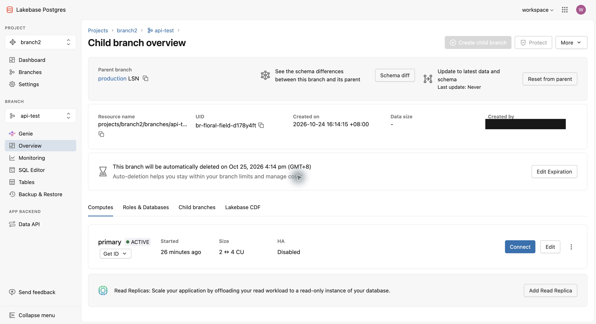

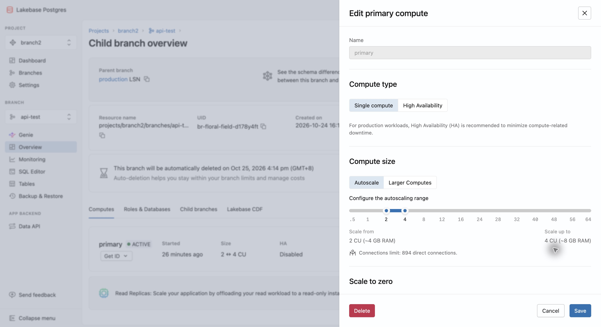

### 5.2 P02 — 显式指定源 Branch（已完成）

- 执行窗口：2026-10-24 16:42:23–16:42:41（GMT+8）；随后完成 UI/SQL 对照取证
- 写入范围：只新建临时 Branch `projects/branch2/branches/codex-source-test`；未修改 `production`、`dev`、`dev-child`、`api-test`
- 用户确认：执行前已展示完整创建命令、目标与影响，并取得明确确认
- 生命周期：TTL `86400s`，控制台显示将于 2026-10-25 16:42（GMT+8）自动删除
- 创建命令：

```bash
databricks postgres create-branch projects/branch2 codex-source-test \
  --json '{"spec":{"source_branch":"projects/branch2/branches/dev","ttl":"86400s"}}' \
  --no-wait --profile codex-lakebase --output json
```

异步提交结果：

```json
{
  "done": false,
  "name": "projects/branch2/branches/codex-source-test/operations/CAIYASIkZTgzNmY0ZTctMWRlMi00NzY4LWJlYTgtOWE4NGM3NWQ4ZmYwKAA="
}
```

Operation 完成后的关键原始结果：

```json
{
  "done": true,
  "response": {
    "name": "projects/branch2/branches/codex-source-test",
    "uid": "br-noisy-glade-d1f8lias",
    "create_time": "2026-10-24T08:42:25Z",
    "update_time": "2026-10-24T08:42:27Z",
    "spec": {
      "source_branch": "projects/branch2/branches/dev",
      "ttl": "86400s"
    },
    "status": {
      "current_state": "READY",
      "source_branch": "projects/branch2/branches/dev",
      "source_branch_lsn": "0/1D2F788",
      "source_branch_time": "2026-10-24T08:41:58Z",
      "expire_time": "2026-10-25T08:42:25Z"
    }
  }
}
```

Primary Endpoint 关键结果：

```json
{
  "name": "projects/branch2/branches/codex-source-test/endpoints/primary",
  "uid": "ep-winter-bird-d1d0t3if",
  "status": {
    "current_state": "ACTIVE",
    "endpoint_type": "ENDPOINT_TYPE_READ_WRITE",
    "autoscaling_limit_min_cu": 2,
    "autoscaling_limit_max_cu": 4,
    "suspend_timeout_duration": "86400s"
  }
}
```

在 `codex-source-test` 与 `dev` 上分别执行相同只读 SQL：

```sql
SELECT current_database() AS db, current_user AS role,
       pg_is_in_recovery() AS recovery;
SELECT id, customer_name, amount
FROM branch_lab.orders ORDER BY id;
SELECT column_name, data_type
FROM information_schema.columns
WHERE table_schema='branch_lab' AND table_name='orders'
ORDER BY ordinal_position;
```

数据对照结果（两个 Branch 一致）：

| id | customer_name | amount |
|---:|---|---:|
| 1 | Alice | 999.00 |
| 3 | Charlie | 300.00 |
| 4 | David | 400.00 |

Schema 对照结果（两个 Branch 一致）：

| column_name | data_type |
|---|---|
| id | bigint |
| customer_name | character varying |
| amount | numeric |
| created_at | timestamp with time zone |
| remark | character varying |

结论：

1. API 明确返回 `spec/status.source_branch=projects/branch2/branches/dev`，控制台 Parent branch 也显示 `dev`，显式来源配置生效。
2. 新 Branch 在 4 秒内进入 READY，具有独立 Branch UID `br-noisy-glade-d1f8lias` 和 Endpoint UID `ep-winter-bird-d1d0t3if`。
3. `branch_lab.orders` 的三行数据和五列 Schema 与 `dev` 完全一致；控制台 Schema Diff 进一步显示 “Your schemas are in sync”。
4. 创建后立即查询得到的 `logical_size_bytes=0` 不能解释为没有继承数据；SQL 已直接证明快照数据存在。
5. Tables 页面若默认查看 `public` schema 会显示 0 tables；目标表位于 `branch_lab` schema，不属于异常。

界面证据：

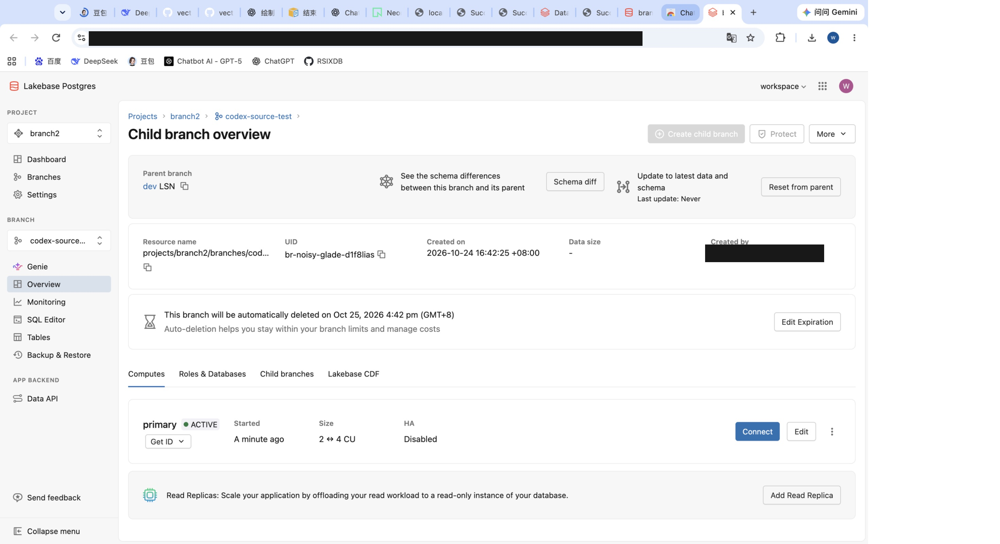

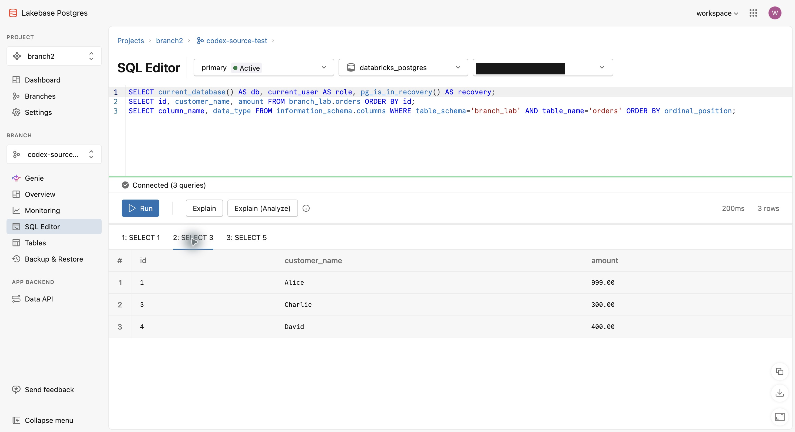

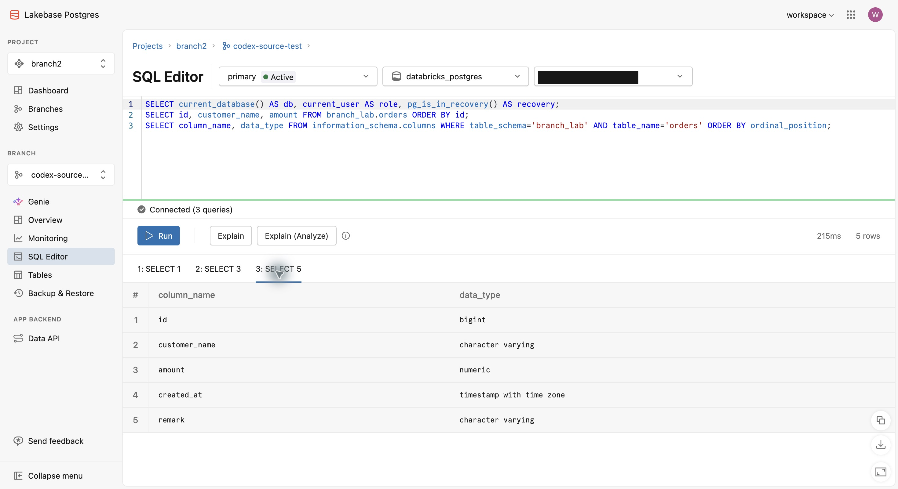

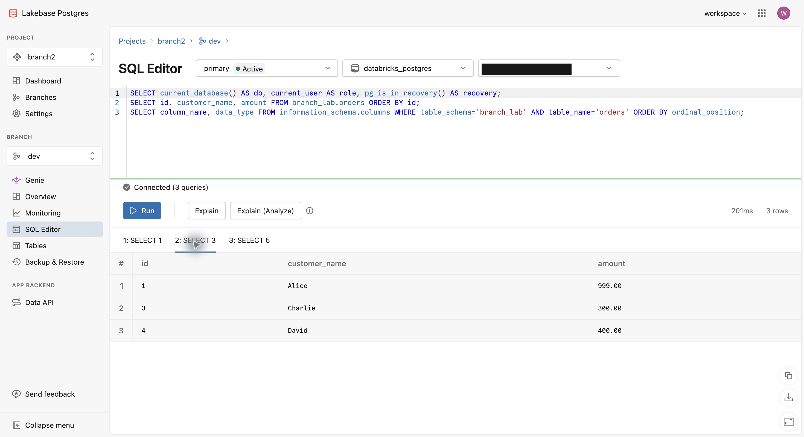


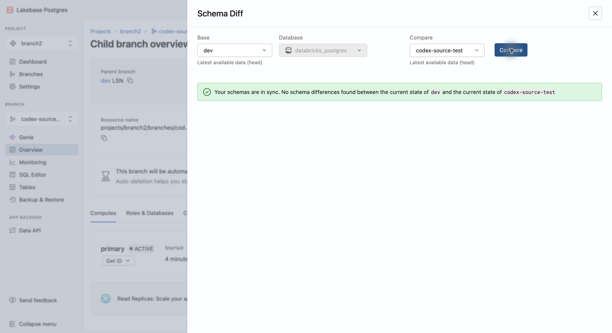

### 5.3 P03 — 历史时间点分支 PITR（已完成）

在 `codex-source-test` 上创建 `codex_validation.pitr_marker`，先后写入 `before` 与 `after`：

```text
before: 2026-10-24T09:02:42.495544Z，LSN 0/1D5EC50
cutoff: 2026-10-24T09:02:42.695624Z，LSN 0/1D5EE50
after:  2026-10-24T09:02:49.105621Z，LSN 0/1D5EE50
```

首次创建 PITR 子分支时，源 Branch 仍有 TTL，API 按预期拒绝：

```text
Branches with an expiration date cannot have child branches
TraceId: 96699c56471bfd5f42dc6d9b37645471
```

把临时源 Branch 更新为 `no_expiry=true` 后执行：

```bash
databricks postgres create-branch projects/branch2 codex-pitr-test \
  --json '{"spec":{"source_branch":"projects/branch2/branches/codex-source-test","source_branch_time":"2026-10-24T09:02:42.695624Z","ttl":"86400s"}}' \
  --no-wait --profile codex-lakebase --output json
```

结果：Operation 从 `done=false` 变为 `done=true`；Branch UID `br-fragrant-waterfall-d1d04j4v`，READY，来源 LSN `0/1D5EF40`，API 状态时间规范化为 `2026-10-24T09:02:42Z`。查询 PITR Branch 只返回：

```json
[{"phase":"before","created_at":"2026-10-24T09:02:42.495544+00:00","lsn":"0/1D5EC50"}]
```

结论：cutoff 之前的 `before` 可见，之后的 `after` 不可见，PITR 数据边界验证通过。

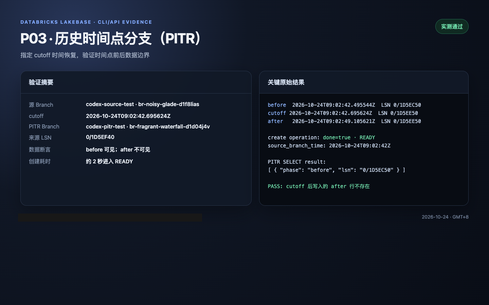

### 5.4 P04 — Branch TTL 更新（已完成）

使用 `spec.expiration` Update Mask 分别执行 `no_expiry=true` 与 `ttl=172800s`：

```bash
databricks postgres update-branch \
  projects/branch2/branches/codex-pitr-test spec.expiration \
  --json '{"spec":{"ttl":"172800s"}}' \
  --profile codex-lakebase --output json
```

- `codex-pitr-test` UID 始终为 `br-fragrant-waterfall-d1d04j4v`，过期时间更新为 `2026-10-26T09:04:27Z`。
- 清理子分支后，`codex-source-test` 从 `no_expiry` 更新为 2 天 TTL，UID 仍为 `br-noisy-glade-d1f8lias`，过期时间为 `2026-10-26T09:07:38Z`。
- 有 TTL 的 Branch 不能创建子 Branch；该限制由 P03 首次失败直接验证。

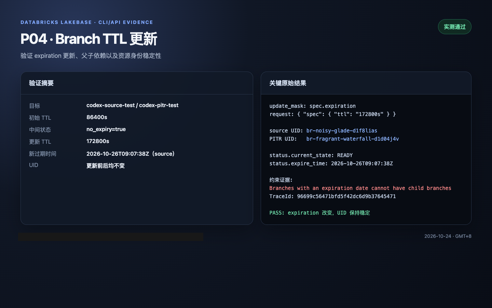

### 5.5 P05 — Branch 保护 API（部分通过）

对有 TTL 的 `codex-pitr-test` 设置 `spec.is_protected=true`：

```text
A branch with an expiration date cannot be set as protected
TraceId: 6de61bc0df9cde6b23f10ed10e080525
```

取消 TTL 后再次设置保护：

```text
You have reached the maximum number of protected branches for your current plan.
TraceId: 309fd37194493fcfd990d7f23ef13cb6
```

结论：TTL 冲突与套餐配额拒绝路径通过；由于 `production` 已占用当前套餐唯一 protected Branch 配额，且安全边界禁止修改它，因此本轮不能验证“成功保护→删除拒绝→取消保护”。未修改任何现有 Branch。

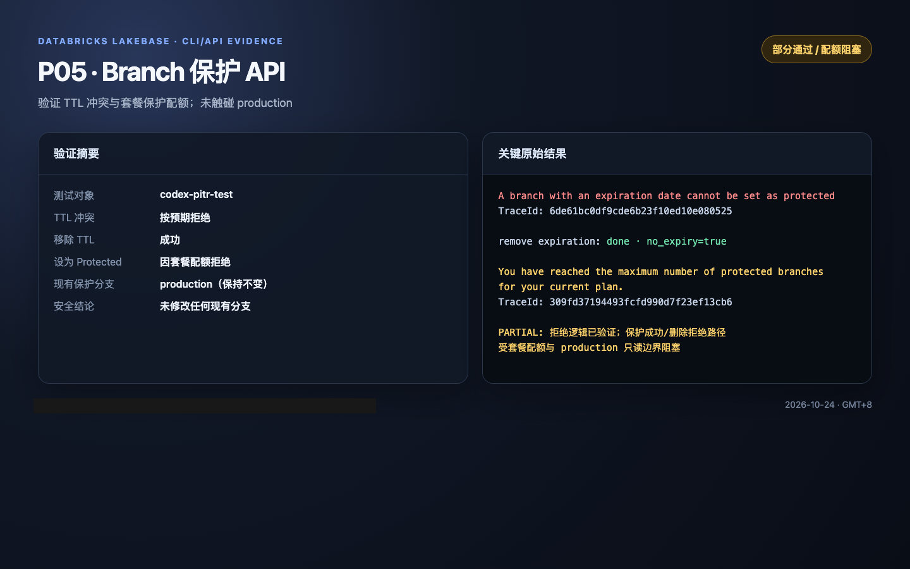

### 5.6 P06 — Endpoint 独立删除（已完成）

创建只读 Replica：

```bash
databricks postgres create-endpoint \
  projects/branch2/branches/codex-pitr-test codex-read-replica \
  --json '{"spec":{"endpoint_type":"ENDPOINT_TYPE_READ_ONLY","autoscaling_limit_min_cu":0.5,"autoscaling_limit_max_cu":1}}' \
  --no-wait --profile codex-lakebase --output json
```

- Replica UID：`ep-frosty-shape-d1qhvody`；ACTIVE；0.5–1 CU。
- `pg_is_in_recovery()=true`，`transaction_read_only=on`。
- INSERT 被拒绝：SQLSTATE `25006`，`cannot execute INSERT in a read-only transaction`。
- 删除 Replica 的 Operation `done=true`，返回 `google.protobuf.Empty`。
- 删除后仅剩 Primary `ep-rough-wildflower-d1btx6ek`，状态 ACTIVE。

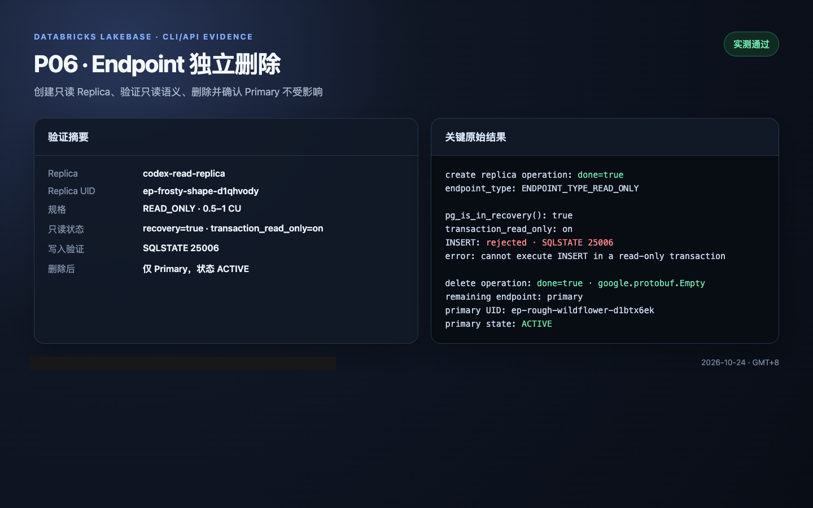

### 5.7 P07 — 自动休眠与唤醒（已完成）

将临时 Primary 的 `spec.suspend_timeout_duration` 从 86400s 改为 60s。只读轮询观察到 `current_state=IDLE`；随后执行只读 SELECT：

```json
{"time":"2026-10-24T09:05:55.924901+00:00","recovery":false,"database":"databricks_postgres"}
```

端到端命令耗时 `4.19s`，再次查询 Endpoint 状态为 ACTIVE，`update_time=2026-10-24T09:05:55Z`。结论：自动休眠、首次连接唤醒及连接恢复均实测通过。

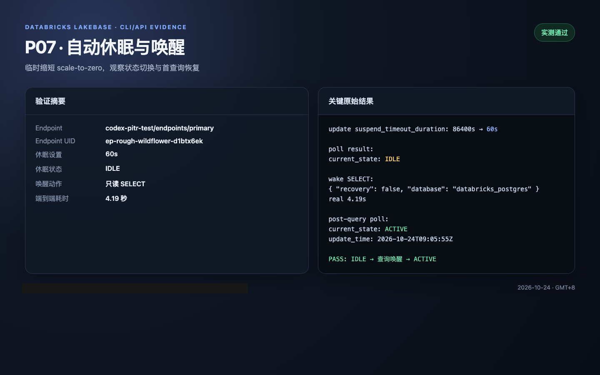

### 5.8 P08 — 错误、并发与任务超时（已完成）

同时提交两个 `codex-race-test` 创建请求：一个返回 LRO 并最终 READY，UID `br-shy-frog-d1486h91`；另一个被拒绝：

```text
branch already exists; branch_name:"codex-race-test"
TraceId: d82ab5bc49ddfba0deb0060d69d22454
```

随后用 `--timeout 1s` 创建 `codex-timeout-test`，客户端返回 `context deadline exceeded`，Operation 名中包含 ID `NjY0NDZkMWQtODI2OS00Y2VjLWEwZjMtZTE5ODkwYmJkNDIz`。再次 GET 后资源实际已 READY，UID `br-proud-mud-d1xpa07g`。

结论：同名竞争没有产生重复资源；客户端超时不能直接视作服务端失败，必须用 Operation 或资源 GET 做最终确认。

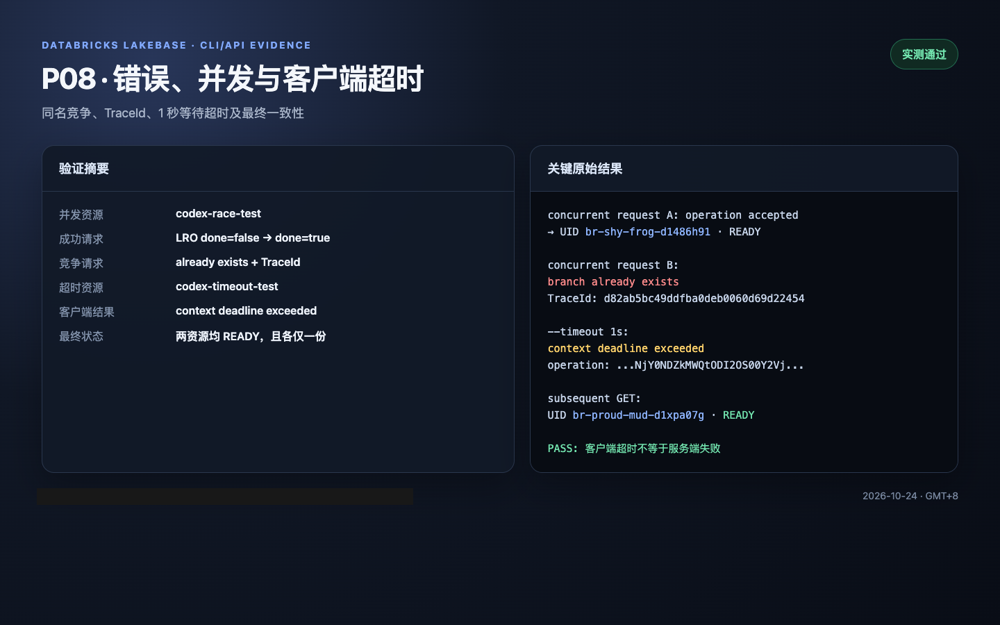

### 5.9 P09 — 测试资源清理（已完成）

按 `Replica → codex-pitr-test → codex-source-test` 顺序清理，再删除并发与超时测试分支。所有有效删除 Operation 均 `done=true`。`codex-pitr-test` 软删除后 GET 返回 Not Found；随后额外 Purge 请求返回资源已不存在，表明该资源已不可再定位，本报告不据此声称底层物理块已即时回收。

最终 `list-branches` 仅返回：

| Branch | UID | 状态 |
|---|---|---|
| production | `br-steep-cherry-d1x4da5k` | READY / protected / default |
| dev | `br-polished-math-d16xdb2e` | READY |
| dev-child | `br-wispy-king-d1ey8l41` | READY |
| api-test | `br-floral-field-d178y4ft` | READY |

最终 `codex-*` 数量为 0，原有四个 Branch 全部保留。

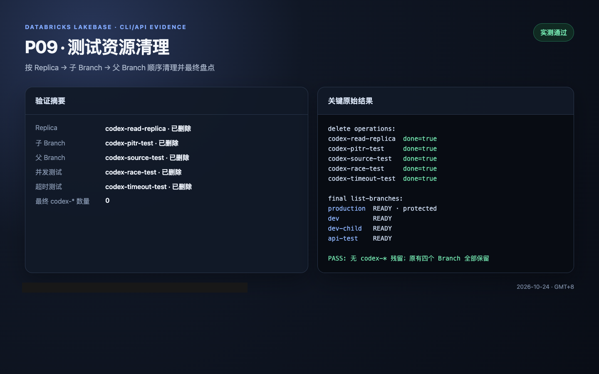

### 5.10 P10 — 最终报告（已完成）

P01–P04、P06–P11 均完成闭环验证；P05 的两条拒绝路径已验证，成功保护路径因套餐配额与既定安全边界未执行。所有场景均记录命令或 SQL、UID、Operation/TraceId、结果与截图；所有 `codex-*` 临时资源已清理。

### 5.11 P11 — Timeline/LSN 边界验证（已完成）

本轮只创建 `codex-lsn-*` 临时资源，未修改 `production`、`dev`、`dev-child`、`api-test`。先从 `dev` 创建无 TTL 临时源 Branch `codex-lsn-source`（UID `br-autumn-tree-d11if3aq`），再执行 LSN 测试。

#### A. 提交后 LSN 的正向分支

在源 Branch 中先提交 `before-commit`，然后在新的 SQL 请求中取得已 flush LSN，再提交 `after-commit`：

```text
COMMITTED_BOUNDARY|0/1D5D6E0|2026-10-24 09:21:06.513601+00
LATEST_AFTER_COMMIT|0/1D5D7B0|2026-10-24 09:21:11.355619+00
before-commit|2026-10-24 09:21:04.397109+00
after-commit|2026-10-24 09:21:08.861754+00
```

使用显式 LSN 创建：

```bash
databricks postgres create-branch projects/branch2 codex-lsn-committed \
  --json '{"spec":{"source_branch":"projects/branch2/branches/codex-lsn-source","source_branch_lsn":"0/1D5D6E0","ttl":"86400s"}}' \
  --profile codex-lakebase --output json
```

Branch UID `br-snowy-frog-d1ifsyt8`，状态 READY，`spec/status.source_branch_lsn` 都精确回显 `0/1D5D6E0`。子 Branch 查询仅返回：

```text
before-commit|2026-10-24 09:21:04.397109+00
```

结论：指定 LSN 能精确确定 Timeline 分叉点；已提交的 `before-commit` 可见，其后提交的 `after-commit` 不可见。

#### B. latest 分支对照

不传 `source_branch_lsn/time` 创建 `codex-lsn-latest`，API 返回来源 LSN `0/1D5D8B8`，大于第二条写入后观测的 `0/1D5D7B0`。子 Branch 查询同时返回 `before-commit` 和 `after-commit`。

结论：未指定分叉点时，服务端选择父 Branch 当前可用的最新一致 LSN，并将最终 LSN 回写到 Branch status。

#### C. 提交前 LSN 与事务原子性

首次对照在同一个 PostgreSQL 请求/事务中执行建表、写入和读取 LSN，取得提交前 LSN `0/1D5BB78`。从该 LSN 创建 `codex-lsn-exact` 后，查询返回：

```text
ERROR: relation "codex_validation.lsn_marker" does not exist
```

这是事务边界的正确结果：该 LSN 尚未包含整个建表/写入事务，新 Branch 没有暴露部分提交状态。因此管控不应将业务事务内随意获取的 WAL LSN 当作已提交安全点。

#### D. 边界错误

```text
source_branch_lsn=0/1
The provided LSN is before your branch's first activity, try a more recent LSN.
TraceId: 9fa843319b117d6e44e245dbca1c7d2d

source_branch_lsn + source_branch_time
parent LSN and parent timestamp are mutually exclusive
TraceId: 4dda05ce59f9273e413f75d0907730f5
```

结论：过旧 LSN 在创建前被服务端拒绝；LSN 与 timestamp 是互斥的两种分叉点表达。

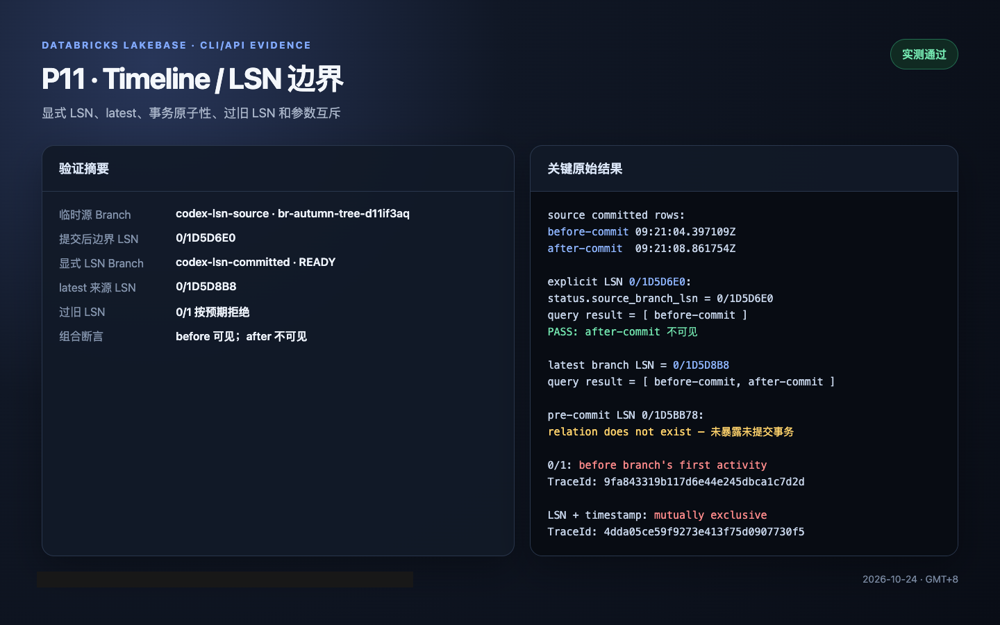

清理结果：`codex-lsn-exact`、`codex-lsn-committed`、`codex-lsn-latest` 和 `codex-lsn-source` 均已按子到父顺序 Purge。最终 `codex-lsn-*` 数量为 0；原有四个 Branch 全部 READY。

## 6. Codex 执行安全要求

1. **只读允许**：`branch2` 下的 `production`、`dev`、`dev-child`、`api-test`。**写操作只允许**新创建且名称以 `codex-` 开头的临时分支及其 Endpoint；禁止修改、重置、删除现有四个分支和整个 Project。
2. 任何真实删除、Purge、保护状态变更、创建付费 Compute 前，先展示目标完整路径、UID、预计影响并要求用户明确确认；不得自动执行破坏性动作。
3. 先 `--help` 和 GET 确认命令/字段，再执行。参数错误或权限不足时停止，不猜测 API 字段并反复试错。
4. 每步记录命令、开始结束时间、标准输出/错误、Operation name、`done`、`response/error`、UID、TraceId、API/UI 对比、结论。不要保存 OAuth Token、密码、完整含密钥连接串。
5. PITR、自动休眠和显式 LSN 边界已实测；物理存储回收、大数据量 CoW 效率、HA 故障切换等尚未实测事项不得标记通过。
6. 若 Databricks CLI 无法提供所需操作，优先检查官方帮助/文档与 API schema，明确记录不支持或待确认。

## 7. 建议 Codex 使用的交接提示词

> 请阅读本完整验证报告与《Lakebase Branch 能力总结与 Neon 服务化对接设计》。后续如需补测，严格保护 production、dev、dev-child、api-test，仅修改新建的 codex-* 临时资源；记录原始 JSON、SQL、Operation/TraceId、截图、耗时和清理结果。

## 8. 对 Neon/PG Branch 管控的借鉴

- **资源建模**：Project/Branch/Endpoint/Operation 四类资源路径与独立 UID；逻辑名称可复用但 UID 不复用。
- **生命周期**：TTL、保护、父子依赖校验、Soft Delete、Purge、名称保留与资源清理顺序。
- **异步任务**：LRO 任务 ID、轮询、状态与错误；不能将提交成功视为资源 READY。
- **分支能力**：数据快照、来源 LSN、时间点创建、Schema Diff、Reset、隔离性。
- **计算管理**：分支与 Endpoint 分层，独立规格/休眠/读副本/网络入口/认证。
- **可运维性**：Update Mask、TraceId、配置与状态查询、API/UI 一致性、权限和配额。

## 9. 已知限制和注意事项

- 本轮数据量小，不能证明大数据量分支创建的耗时或物理 CoW 存储效率。
- `logical_size_bytes` 是逻辑数据大小，不等于新增物理占用或计费量。
- Replica 的 `replay_time_delta` 不能直接当作复制延迟；之前负数 `remaining_bytes` 是与固定历史 LSN 比较所致。
- Endpoint `last_active_time=2000-01-01T00:00:00Z` 疑似默认/占位值，不应当作真实活跃时间。
- `get-branch` 软删除后报 Not Found，不证明数据已物理清除；Purge 成功也不证明即时回收完成。
- 保护 API 已验证 TTL 冲突与套餐配额拒绝；受当前套餐唯一 protected Branch 配额及 `production` 只读边界限制，“成功保护→删除拒绝→取消保护”仍未实测。

**当前最后状态**：P01–P04、P06–P11 已完成；P05 因套餐 protected Branch 配额被现有 `production` 占满而部分通过。最终 `codex-*` 临时 Branch 和 Replica 均已清理，`production`、`dev`、`dev-child`、`api-test` 四个原有 Branch 全部保留且 READY。


## 10. 原始截图证据（完整附件）

以下为本次对话中可访问的全部 96 张截图，按文件名时间顺序排列。部分早期截图的原始文件名不含时间戳，放在末尾；请结合内容核对。截图包含终端、数据库控制台、认证界面及由原始 CLI/API/SQL 结果生成的本地验证证据界面，分享前注意脱敏。

### 证据 E001 — image(20261024-034719).png


### 证据 E002 — image(20261024-034747).png


### 证据 E003 — image(20261024-034845).png


### 证据 E004 — image(20261024-035055).png


### 证据 E005 — image(20261024-035135).png


### 证据 E006 — image(20261024-035156).png


### 证据 E007 — image(20261024-035237).png


### 证据 E008 — image(20261024-035258).png


### 证据 E009 — image(20261024-061146).png


### 证据 E010 — image(20261024-061455).png


### 证据 E011 — image(20261024-061530).png


### 证据 E012 — image(20261024-061752).png


### 证据 E013 — image(20261024-061838).png


### 证据 E014 — image(20261024-061857).png


### 证据 E015 — image(20261024-061949).png


### 证据 E016 — image(20261024-062442).png


### 证据 E017 — image(20261024-062529).png


### 证据 E018 — image(20261024-062619).png


### 证据 E019 — image(20261024-062744).png


### 证据 E020 — image(20261024-063017).png


### 证据 E021 — image(20261024-063939).png


### 证据 E022 — image(20261024-064212).png


### 证据 E023 — image(20261024-064517).png


### 证据 E024 — image(20261024-064608).png


### 证据 E025 — image(20261024-064640).png


### 证据 E026 — image(20261024-065820).png


### 证据 E027 — image(20261024-065946).png


### 证据 E028 — image(20261024-070035).png


### 证据 E029 — image(20261024-070207).png


### 证据 E030 — image(20261024-070326).png


### 证据 E031 — image(20261024-070401).png


### 证据 E032 — image(20261024-070559).png


### 证据 E033 — image(20261024-070604).png


### 证据 E034 — image(20261024-070830).png


### 证据 E035 — image(20261024-071116).png


### 证据 E036 — image(20261024-073136).png


### 证据 E037 — image(20261024-073241).png


### 证据 E038 — image(20261024-073325).png


### 证据 E039 — image(20261024-073353).png


### 证据 E040 — image(20261024-073449).png


### 证据 E041 — image(20261024-073635).png


### 证据 E042 — image(20261024-073742).png


### 证据 E043 — image(20261024-074811).png


### 证据 E044 — image(20261024-074916).png


### 证据 E045 — image(20261024-074959).png


### 证据 E046 — image(20261024-075044).png


### 证据 E047 — image(20261024-075148).png


### 证据 E048 — image(20261024-075527).png


### 证据 E049 — image(20261024-075631).png


### 证据 E050 — image(20261024-075709).png


### 证据 E051 — image(20261024-075819).png


### 证据 E052 — image(20261024-075908).png


### 证据 E053 — image(20261024-080028).png


### 证据 E054 — image(20261024-080111).png


### 证据 E055 — image(20261024-080153).png


### 证据 E056 — image(20261024-080242).png


### 证据 E057 — image(20261024-080321).png


### 证据 E058 — image(20261024-080357).png


### 证据 E059 — image(20261024-080531).png


### 证据 E060 — image(20261024-080622).png


### 证据 E061 — image(20261024-080710).png


### 证据 E062 — image(20261024-080749).png


### 证据 E063 — image(20261024-080831).png


### 证据 E064 — image(20261024-080905).png


### 证据 E065 — image(20261024-080942).png


### 证据 E066 — image(20261024-081030).png


### 证据 E067 — image(20261024-081155).png


### 证据 E068 — image(20261024-081334).png


### 证据 E069 — image(20261024-081432).png


### 证据 E070 — image(1).png


### 证据 E071 — image(10).png


### 证据 E072 — image(2).png


### 证据 E073 — image(3).png


### 证据 E074 — image(4).png


### 证据 E075 — image(5).png


### 证据 E076 — image(6).png


### 证据 E077 — image(7).png


### 证据 E078 — image(8).png


### 证据 E079 — image(9).png


### 证据 E080 — image.png

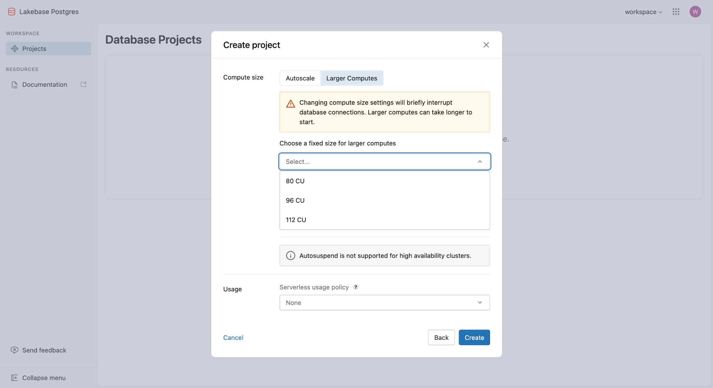

### 证据 E081 — P01 api-test 重建后 Endpoint 默认配置


### 证据 E082 — P01 Endpoint UID、2–4 CU 与 1 天休眠


### 证据 E083 — P02 codex-source-test 来源 dev


### 证据 E084 — P02 codex-source-test 数据快照


### 证据 E085 — P02 codex-source-test Schema 快照


### 证据 E086 — P02 dev 数据对照


### 证据 E087 — P02 dev Schema 对照


### 证据 E088 — P02 dev 与 codex-source-test Schema 无差异


### 证据 E089 — P03 PITR 验证结果


### 证据 E090 — P04 TTL 更新结果


### 证据 E091 — P05 保护 API 约束结果


### 证据 E092 — P06 Replica 独立删除结果


### 证据 E093 — P07 自动休眠与唤醒结果


### 证据 E094 — P08 并发、超时与错误结果


### 证据 E095 — P09 临时资源清理结果


### 证据 E096 — P11 Timeline/LSN 边界验证


