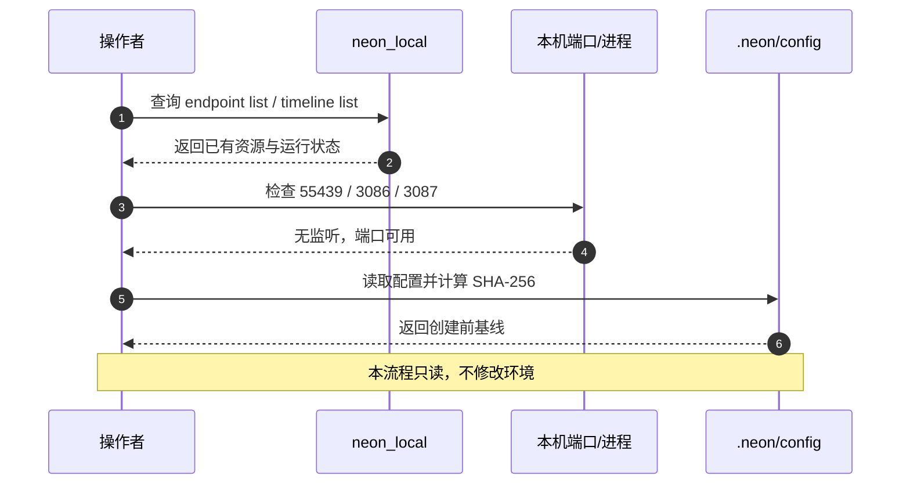
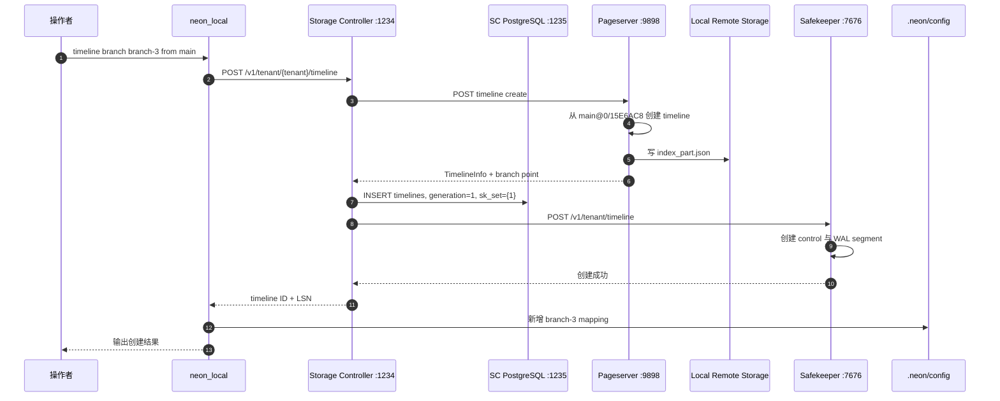
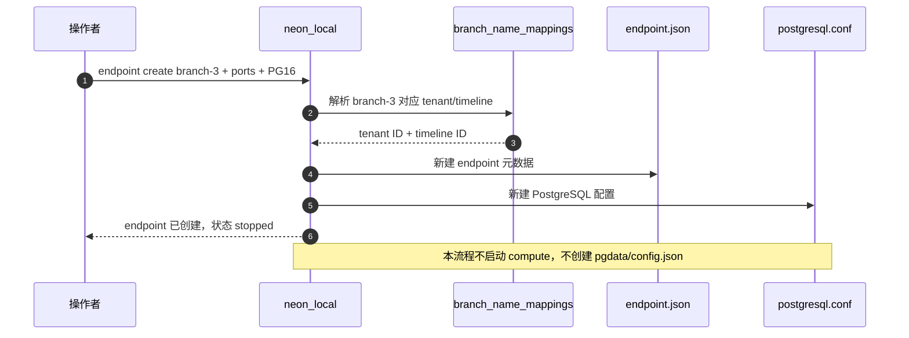
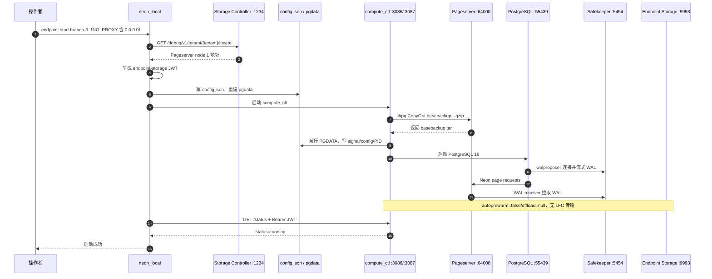

# Neon 本地 `branch-3` / endpoint / compute 创建审计

> 执行日期：2026-10-27（Asia/Shanghai）<br>
> 工作目录：`/Users/kivan/Documents/neon`<br>
> 环境：仓库内 `.neon/` 本地控制面，不是 Neon Cloud 账号<br>
> 结果：成功。`branch-3` timeline、同名 endpoint 与 Compute 均已创建，Compute 保持运行。<br>
> 安全：私钥、JWT、endpoint-storage token 均不落盘到本文；只保留字段名、用途和 `<REDACTED>`。

## 1. 最终资源清单

| 资源 | 最终值 | 状态 |
|---|---|---|
| Tenant | `ff5117463416aef7a63e532978974a01` | Active |
| 父 branch / timeline | `main` / `8a1073677c60f7bf37ab2b49185f2802` | 保留不变 |
| 新 branch | `branch-3` | 已创建 |
| 新 timeline | `05be0f2b0399df1cdef4c4ec6d06b88f` | Active |
| 分支点 | `0/15E6AC8` | 来自 `main` 当时的 last-record LSN |
| Endpoint ID | `branch-3` | running |
| Compute 模式 | `Primary` | running |
| PostgreSQL | `127.0.0.1:55439` / PG 16.9 | 可连接、可读写 |
| Compute external HTTP | `0.0.0.0:3086` | JWT 鉴权，`status=running` |
| Compute internal HTTP | `127.0.0.1:3087` | 内部控制面接口 |
| Pageserver | libpq `localhost:64000`; HTTP `localhost:9898` | Active |
| Safekeeper | PG `127.0.0.1:5454`; HTTP `127.0.0.1:7676` | generation 1，node 1 |
| Endpoint Storage | `127.0.0.1:9993` | 已配置；本 endpoint 未开启 prewarm/offload |

本地环境中的 branch 由 Pageserver timeline、Storage Controller timeline 记录和 `.neon/config` 中的 `branch_name_mappings` 共同表达。Endpoint 是本地控制面元数据目录；Compute 是由该 endpoint 配置启动的 `compute_ctl + PostgreSQL` 进程组。

## 2. 按执行流程组织的完整记录

本节是主审计记录。每一步都按照“执行入口 → 下游请求/协议 → 文件或数据库变化 → 当步验证”的顺序组织。后面的附录保留按资料类型展开的完整字段，方便单独检索。

### 流程 1：环境基线与端口确认



#### 1.1 执行入口

```bash
date '+%Y-%m-%d %H:%M:%S %z'
target/debug/neon_local endpoint list
target/debug/neon_local timeline list
lsof -nP -iTCP:55439 -iTCP:3086 -iTCP:3087 -sTCP:LISTEN || true
shasum -a 256 .neon/config
sed -n '1,220p' .neon/config
```

#### 1.2 读取到的状态

- 执行时间：`2026-10-27 11:21:55 +0800`。
- `branch-2` 正在运行；`branch-1`、`main` endpoint 为 stopped。
- timeline 树尚无 `branch-3`。
- `55439/3086/3087` 均未被监听。
- `.neon/config` 创建前 SHA-256 为 `666cb962525bf36ef3369a399ffa87041fd98b982a98c70fe1b33fa75397fe7d`。
- 这一步没有写请求，也没有修改文件或数据库。

### 流程 2：创建 `branch-3` / timeline



#### 2.1 CLI 入口

```bash
target/debug/neon_local timeline branch \
  --branch-name branch-3 \
  --ancestor-branch-name main
```

CLI 返回：

```text
Created timeline '05be0f2b0399df1cdef4c4ec6d06b88f'
at Lsn 0/15E6AC8
for tenant ff5117463416aef7a63e532978974a01
Ancestor timeline: main
```

#### 2.2 CLI → Storage Controller

`neon_local` 将 branch 名解析为父 timeline ID，再向 Storage Controller 发出以下等价请求：

```bash
curl -i -X POST \
  'http://127.0.0.1:1234/v1/tenant/ff5117463416aef7a63e532978974a01/timeline' \
  -H 'Content-Type: application/json' \
  --data-binary '{
    "new_timeline_id": "05be0f2b0399df1cdef4c4ec6d06b88f",
    "ancestor_timeline_id": "8a1073677c60f7bf37ab2b49185f2802",
    "ancestor_start_lsn": null,
    "pg_version": null
  }'
```

`ancestor_start_lsn=null` 表示让 Pageserver 使用父 timeline 当前最新一致点；`read_only=false` 因默认值而未序列化。

#### 2.3 Storage Controller → Pageserver

单 shard 环境中，Storage Controller 把同一创建请求发送到 node 1：

```bash
curl -i -X POST \
  'http://127.0.0.1:9898/v1/tenant/ff5117463416aef7a63e532978974a01/timeline' \
  -H 'Content-Type: application/json' \
  --data-binary '{
    "new_timeline_id": "05be0f2b0399df1cdef4c4ec6d06b88f",
    "ancestor_timeline_id": "8a1073677c60f7bf37ab2b49185f2802",
    "ancestor_start_lsn": null,
    "pg_version": null
  }'
```

Pageserver 选择 `main` 的 `last_record_lsn=0/15E6AC8`，建立新 timeline，并写入：

```text
.neon/pageserver_1/tenants/ff5117463416aef7a63e532978974a01/
  timelines/05be0f2b0399df1cdef4c4ec6d06b88f/ephemeral-2

.neon/local_fs_remote_storage/pageserver/tenants/
  ff5117463416aef7a63e532978974a01/timelines/
  05be0f2b0399df1cdef4c4ec6d06b88f/index_part.json-00000005
```

remote index 验证时 SHA-256 为 `62fd5d1654e5aeaf55803a614215805903dacc233e0387255ac668d29bfc393a`。

#### 2.4 Storage Controller → Safekeeper

Pageserver 返回 timeline 信息后，Storage Controller 创建 generation 1 的 WAL membership：

```bash
curl -i -X POST \
  'http://127.0.0.1:7676/v1/tenant/timeline' \
  -H 'Content-Type: application/json' \
  --data-binary '{
    "tenant_id": "ff5117463416aef7a63e532978974a01",
    "timeline_id": "05be0f2b0399df1cdef4c4ec6d06b88f",
    "mconf": {
      "generation": 1,
      "members": [{"id": 1, "host": "127.0.0.1", "pg_port": 5454}],
      "new_members": null
    },
    "pg_version": 160009,
    "system_id": null,
    "wal_seg_size": null,
    "start_lsn": "0/15E6AC8",
    "commit_lsn": null
  }'
```

Safekeeper 因此新建：

```text
.neon/safekeepers/sk1/ff5117463416aef7a63e532978974a01/
  05be0f2b0399df1cdef4c4ec6d06b88f/safekeeper.control
.neon/safekeepers/sk1/ff5117463416aef7a63e532978974a01/
  05be0f2b0399df1cdef4c4ec6d06b88f/000000010000000000000001.partial
```

#### 2.5 Storage Controller 数据库变化

同一流程在 `storage_controller` 数据库的 `timelines` 表新增：

```text
tenant_id                   ff5117463416aef7a63e532978974a01
timeline_id                 05be0f2b0399df1cdef4c4ec6d06b88f
start_lsn                   0/15E6AC8
generation                  1
sk_set                      {1}
new_sk_set                  NULL
cplane_notified_generation  0
deleted_at                  NULL
sk_set_notified_generation  0
```

验证命令：

```bash
/Users/kivan/Documents/neon/pg_install/v16/bin/psql \
  -h 127.0.0.1 -p 1235 -d storage_controller -P pager=off \
  -c "SELECT * FROM timelines WHERE timeline_id='05be0f2b0399df1cdef4c4ec6d06b88f';" \
  -c "SELECT * FROM hadron_timeline_safekeepers WHERE timeline_id='05be0f2b0399df1cdef4c4ec6d06b88f';" \
  -c "SELECT * FROM safekeeper_timeline_pending_ops WHERE timeline_id='05be0f2b0399df1cdef4c4ec6d06b88f';"
```

后两张表均为 0 行：membership 由 `timelines.sk_set={1}` 表达，并且没有待补偿 Safekeeper 操作。

#### 2.6 本地 branch mapping 变化

API 全部成功后，CLI 更新 `.neon/config`。TOML 序列化同时重排原有 mapping；语义新增项只有 `branch-3`：

```diff
 [branch_name_mappings]
 dev = [[
     "ff5117463416aef7a63e532978974a01",
     "e936bf1a0dde77cd584ed8516a096805",
 ]]
-branch_1 = [[
-    "ff5117463416aef7a63e532978974a01",
-    "26b365690eed5226ec7f3c1056962552",
-]]
+branch-3 = [[
+    "ff5117463416aef7a63e532978974a01",
+    "05be0f2b0399df1cdef4c4ec6d06b88f",
+]]
 main = [[
     "ff5117463416aef7a63e532978974a01",
     "8a1073677c60f7bf37ab2b49185f2802",
 ]]
+branch_1 = [[
+    "ff5117463416aef7a63e532978974a01",
+    "26b365690eed5226ec7f3c1056962552",
+]]
 branch-2 = [[
     "ff5117463416aef7a63e532978974a01",
     "0f7ed75219241a25a8084bc227822be0",
 ]]
```

文件 SHA-256 从 `666cb9...fe7d` 变为 `e321c3...5951`。

#### 2.7 当步验证

```bash
shasum -a 256 .neon/config
target/debug/neon_local timeline list
```

```text
main [8a1073677c60f7bf37ab2b49185f2802]
┣━ @0/15E6AC8: branch-3 [05be0f2b0399df1cdef4c4ec6d06b88f]
┣━ @0/15E6AC8: branch-2 [0f7ed75219241a25a8084bc227822be0]
┗━ @0/15DA1C0: branch_1 [26b365690eed5226ec7f3c1056962552]
```

### 流程 3：创建 `branch-3` endpoint



#### 3.1 CLI 入口

```bash
target/debug/neon_local endpoint create branch-3 \
  --branch-name branch-3 \
  --pg-port 55439 \
  --external-http-port 3086 \
  --internal-http-port 3087 \
  --pg-version 16
```

此步骤不发送 Storage Controller/Pageserver 写请求，只解析本地 branch mapping，然后创建 endpoint 文件。

#### 3.2 新建 `endpoint.json`

修改前不存在，修改后 SHA-256 为 `2f3d55a969ff60f2083292b04097f9f6d11bfba4b3d6a1956ea0aba3bf25e6d7`：

```diff
--- /dev/null
+++ .neon/endpoints/branch-3/endpoint.json
@@
+{
+  "endpoint_id": "branch-3",
+  "tenant_id": "ff5117463416aef7a63e532978974a01",
+  "timeline_id": "05be0f2b0399df1cdef4c4ec6d06b88f",
+  "mode": "Primary",
+  "pg_port": 55439,
+  "external_http_port": 3086,
+  "internal_http_port": 3087,
+  "pg_version": 16,
+  "grpc": false,
+  "skip_pg_catalog_updates": true,
+  "reconfigure_concurrency": 1,
+  "drop_subscriptions_before_start": false,
+  "features": [],
+  "cluster": null,
+  "compute_ctl_config": {
+    "jwks": {"keys": [{
+      "use": "sig", "key_ops": ["verify"], "alg": "EdDSA",
+      "kid": "sn6lON-gDkBOtTJaJuPWwiIt712cMu6ZMY3cCpK7P_M",
+      "kty": "OKP", "crv": "Ed25519",
+      "x": "Er2Ef4iMuaU35XiF4SEdsojgepmS4M-7GUfzVp8EWHE"
+    }]},
+    "tls": null
+  },
+  "privileged_role_name": null
+}
```

#### 3.3 新建 `postgresql.conf`

修改前不存在，修改后 SHA-256 为 `66af6c108242e98ef84580298170b8643a564dfa7eeb314f9ff9673439f324c8`：

```diff
--- /dev/null
+++ .neon/endpoints/branch-3/postgresql.conf
@@
+max_wal_senders=10
+wal_log_hints=off
+max_replication_slots=10
+hot_standby=on
+shared_buffers=1MB
+effective_io_concurrency=2
+fsync=off
+max_connections=100
+wal_level=logical
+wal_sender_timeout=5s
+listen_addresses='127.0.0.1'
+port=55439
+wal_keep_size=0
+restart_after_crash=off
+shared_preload_libraries=neon
+max_replication_write_lag=15MB
+max_replication_flush_lag=10GB
+synchronous_standby_names=walproposer
+neon.safekeepers='localhost:5454'
```

#### 3.4 当步验证

```bash
find .neon/endpoints/branch-3 -maxdepth 1 -type f \
  -print -exec shasum -a 256 {} \;
target/debug/neon_local endpoint list
```

此时 `branch-3` endpoint 状态为 stopped；`config.json` 和 `pgdata/` 尚不存在。

### 流程 4：启动 `branch-3` Compute



#### 4.1 CLI 入口

```bash
NO_PROXY=localhost,127.0.0.1,0.0.0.0,::1 \
  target/debug/neon_local endpoint start branch-3 --start-timeout 90s
```

显式加入 `0.0.0.0` 是因为 CLI 使用 `http://0.0.0.0:3086/status` 检查 Compute；若不加入，当前 HTTP proxy 会截获本地请求。

#### 4.2 CLI → Storage Controller：定位 tenant

```bash
curl -sS \
  'http://127.0.0.1:1234/debug/v1/tenant/ff5117463416aef7a63e532978974a01/locate' \
  | jq .
```

返回 node 1 的 Pageserver 地址：libpq `localhost:64000`、gRPC `localhost:51051`、HTTP `localhost:9898`，shard count 0、stripe size 2048。

#### 4.3 生成 `config.json`

CLI 生成 24 小时有效的 endpoint-storage JWT，并创建 `.neon/endpoints/branch-3/config.json`。修改前不存在；修改后 SHA-256 为 `051643852a3ba105821b8a860b08abe3b0dff129701d4f5c2ad32d491a831026`。

关键 diff（token 脱敏）：

```diff
--- /dev/null
+++ .neon/endpoints/branch-3/config.json
@@
+{
+  "spec": {
+    "tenant_id": "ff5117463416aef7a63e532978974a01",
+    "timeline_id": "05be0f2b0399df1cdef4c4ec6d06b88f",
+    "endpoint_id": "branch-3",
+    "mode": "Primary",
+    "pageserver_connection_info": {
+      "shard_count": 0,
+      "shards": {"0000": {"pageservers": [{
+        "id": 1,
+        "libpq_url": "postgres://no_user@localhost:64000",
+        "grpc_url": "grpc://no_user@localhost:51051"
+      }]}},
+      "prefer_protocol": "libpq"
+    },
+    "safekeepers_generation": 1,
+    "safekeeper_connstrings": ["127.0.0.1:5454"],
+    "endpoint_storage_addr": "127.0.0.1:9993",
+    "endpoint_storage_token": "<REDACTED>",
+    "autoprewarm": false,
+    "offload_lfc_interval_seconds": null,
+    "suspend_timeout_seconds": -1
+  }
+}
```

#### 4.4 CLI → compute_ctl：实际进程

```bash
/Users/kivan/Documents/neon/target/debug/compute_ctl \
  --external-http-port 3086 \
  --internal-http-port 3087 \
  --pgdata /Users/kivan/Documents/neon/.neon/endpoints/branch-3/pgdata \
  --connstr 'postgresql://cloud_admin@127.0.0.1:55439/postgres' \
  --config /Users/kivan/Documents/neon/.neon/endpoints/branch-3/config.json \
  --pgbin /Users/kivan/Documents/neon/pg_install/v16/bin/postgres \
  --compute-id branch-3
```

该流程创建 `compute.log`、`compute_ctl.pid` 和 `pgdata/`。

#### 4.5 compute_ctl → Pageserver：basebackup

本次使用 libpq CopyOut，不是 HTTP：

```text
basebackup ff5117463416aef7a63e532978974a01 \
           05be0f2b0399df1cdef4c4ec6d06b88f \
           0/15E6AC8 --gzip
```

Pageserver 返回 gzip tar；`compute_ctl` 解压 PGDATA 并生成 signal、配置和 PID 文件，然后启动 PostgreSQL 16。

#### 4.6 Compute → Safekeeper / Pageserver

- PostgreSQL walproposer 连接 `127.0.0.1:5454`，在 generation 1 下发送 WAL。
- Neon storage manager 使用 `localhost:64000` 向 Pageserver 请求页面。
- Pageserver WAL receiver 从 Safekeeper 持续接收 WAL。
- `autoprewarm=false` 且 `offload_lfc_interval_seconds=null`，因此没有 Endpoint Storage LFC 对象传输。

#### 4.7 当步验证

```bash
target/debug/neon_local endpoint list
BRANCH3_JWT="$(target/debug/neon_local endpoint generate-jwt branch-3)"
NO_PROXY=localhost,127.0.0.1,0.0.0.0,::1 \
  curl -sS -H "Authorization: Bearer ${BRANCH3_JWT}" \
  'http://0.0.0.0:3086/status'
unset BRANCH3_JWT
```

```json
{
  "start_time": "2026-10-27T03:22:54.447775Z",
  "tenant": "ff5117463416aef7a63e532978974a01",
  "timeline": "05be0f2b0399df1cdef4c4ec6d06b88f",
  "status": "running",
  "last_active": null,
  "error": null
}
```

### 流程 5：端到端写入与 WAL 传播验证

```mermaid
sequenceDiagram
    autonumber
    participant U as 操作者
    participant PG as PostgreSQL :55439
    participant SK as Safekeeper :5454/:7676
    participant PS as Pageserver :64000/:9898

    U->>PG: 查询版本、角色、恢复状态、当前 LSN
    PG-->>U: Primary / PG16.9 / 初始 LSN
    U->>PG: BEGIN; CREATE; INSERT; SELECT
    PG-->>U: 事务内读回验证行
    U->>PG: ROLLBACK
    PG-->>U: 验证表不存在，WAL 已推进
    PG->>SK: walproposer 发送新 WAL
    SK-->>PG: commit acknowledgement
    SK->>PS: WAL streaming
    U->>SK: GET timeline status
    SK-->>U: flush_lsn = commit_lsn = 0/1610400
    U->>PS: GET timeline status
    PS-->>U: Active, last_record_lsn = 0/1610400
```

#### 5.1 PostgreSQL 基础检查

```bash
/Users/kivan/Documents/neon/pg_install/v16/bin/psql \
  'postgresql://cloud_admin@127.0.0.1:55439/postgres' \
  -v ON_ERROR_STOP=1 \
  -c "SELECT current_database(), current_user, pg_is_in_recovery(), pg_current_wal_lsn(), version();"
```

结果为 PG 16.9、`cloud_admin`、`pg_is_in_recovery=false`。

#### 5.2 事务内写入并回滚

```bash
/Users/kivan/Documents/neon/pg_install/v16/bin/psql \
  'postgresql://cloud_admin@127.0.0.1:55439/postgres' \
  -v ON_ERROR_STOP=1 \
  -c "SELECT pg_current_wal_lsn() AS wal_before;
      BEGIN;
      CREATE TABLE codex_branch3_validation(id integer PRIMARY KEY, note text);
      INSERT INTO codex_branch3_validation VALUES (1, 'branch-3 write path ok');
      SELECT * FROM codex_branch3_validation;
      ROLLBACK;
      SELECT to_regclass('public.codex_branch3_validation') AS table_after_rollback,
             pg_current_wal_lsn() AS wal_after;"
```

- 事务内成功读回数据。
- 回滚后验证表不存在。
- WAL 从 `0/15E8AD8` 推进到 `0/1610400`。

#### 5.3 验证 Safekeeper 已提交 WAL

```bash
curl -sS \
  'http://127.0.0.1:7676/v1/tenant/ff5117463416aef7a63e532978974a01/timeline/05be0f2b0399df1cdef4c4ec6d06b88f' \
  | jq '{flush_lsn,commit_lsn,timeline_start_lsn,backup_lsn,mconf}'
```

结果：`flush_lsn=commit_lsn=0/1610400`，membership generation 1、member node 1。

#### 5.4 验证 Pageserver 已接收 WAL

```bash
curl -sS \
  'http://127.0.0.1:9898/v1/tenant/ff5117463416aef7a63e532978974a01/timeline/05be0f2b0399df1cdef4c4ec6d06b88f' \
  | jq '{state,last_record_lsn,disk_consistent_lsn,remote_consistent_lsn,ancestor_timeline_id,ancestor_lsn,walreceiver_status}'
```

结果：`state=Active`、`last_record_lsn=0/1610400`，与 Safekeeper 一致；ancestor 与分支点正确。`disk_consistent_lsn`、`remote_consistent_lsn` 暂停在 `0/15E6AC8`，说明新 WAL 已接收但尚未由 checkpoint/flush 推进一致点。

#### 5.5 最终状态

```bash
target/debug/neon_local endpoint list
target/debug/neon_local timeline list
/Users/kivan/Documents/neon/pg_install/v16/bin/psql \
  'postgresql://cloud_admin@127.0.0.1:55439/postgres' -Atc \
  "SELECT to_regclass('public.codex_branch3_validation') IS NULL,
          pg_is_in_recovery();"
```

结果：`branch-2`、`branch-3` 均 running；`branch-3` 位于 `main@0/15E6AC8`；SQL 返回 `t|f`，即验证表不存在且当前节点不是恢复实例。

## 3. 最终结论与保留状态

- `branch-3`、同名 endpoint 和 Compute 创建成功。
- `branch-2` 保持运行，没有被停止或修改其 endpoint 配置。
- PostgreSQL、Compute HTTP、Storage Controller、Pageserver、Safekeeper 验证通过。
- 最终复核：`endpoint list` 显示 `branch-2`、`branch-3` 均为 running；`timeline list` 显示 `main -> branch-3@0/15E6AC8`；SQL 返回 `validation_table_absent=true`、`pg_is_in_recovery=false`。
- 写入探针已回滚，没有留下 `codex_branch3_validation` 表；WAL/LSN 推进作为验证证据保留。
- `branch-3` Compute 当前保持 running；基础 Neon 服务和 Release Pageserver 同样保持运行。
- 后续从带代理的环境启动此 endpoint 时，`NO_PROXY` 必须包含 `0.0.0.0`。

## 附录：文件检查与审计命令

```bash
shasum -a 256 \
  .neon/config \
  .neon/endpoints/branch-3/endpoint.json \
  .neon/endpoints/branch-3/config.json \
  .neon/endpoints/branch-3/postgresql.conf

sed -n '1,220p' .neon/config
sed -n '1,220p' .neon/endpoints/branch-3/endpoint.json
sed -n '1,220p' .neon/endpoints/branch-3/postgresql.conf
sed -n '1,260p' .neon/endpoints/branch-3/config.json \
  | sed -E 's/("endpoint_storage_token"[[:space:]]*:[[:space:]]*").*(")/\1<REDACTED>\2/'

find .neon/pageserver_1/tenants/ff5117463416aef7a63e532978974a01/timelines/05be0f2b0399df1cdef4c4ec6d06b88f \
  -maxdepth 2 -type f -print -exec shasum -a 256 {} \;

find .neon/local_fs_remote_storage/pageserver \
  -type f -path '*05be0f2b0399df1cdef4c4ec6d06b88f*' \
  -print -exec shasum -a 256 {} \;

find .neon/safekeepers/sk1 \
  -type f -path '*05be0f2b0399df1cdef4c4ec6d06b88f*' \
  -print -exec shasum -a 256 {} \;

find .neon/endpoints/branch-3 -maxdepth 2 -type f -print | sort
```
