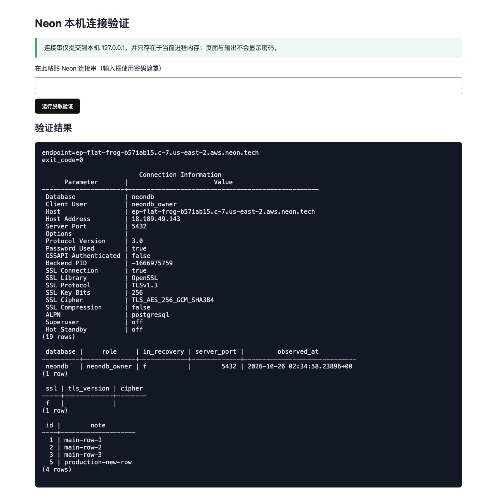
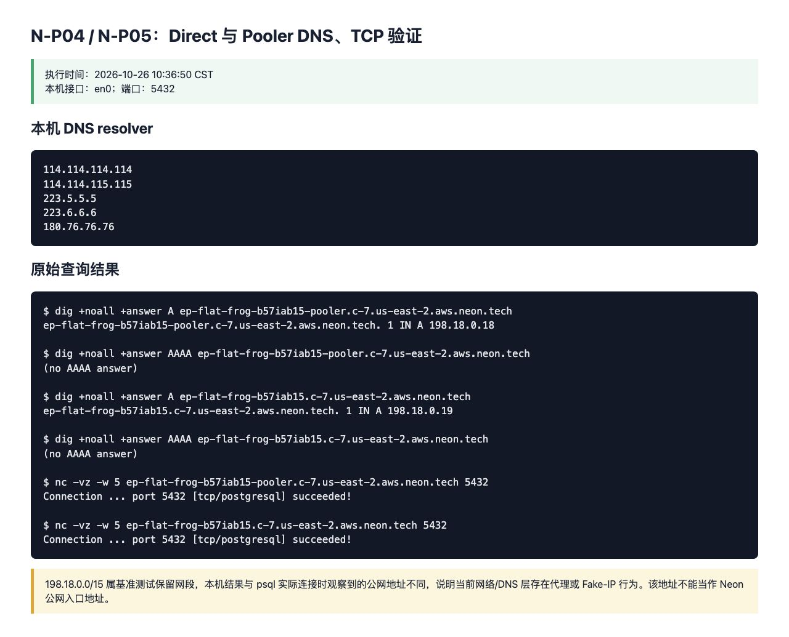
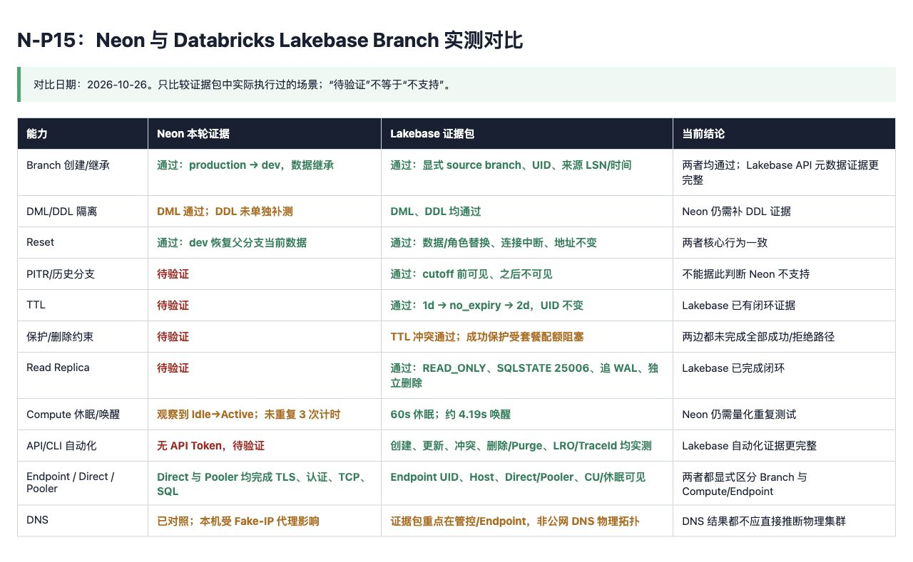

# Neon Branch 云服务体验测试报告（阶段版）
整理日期：2026-10-26  
最近执行更新：2026-10-26  
范围：Neon 官方云服务 Branch、Compute 生命周期、DNS/Pooler 初步观察  
用途：阶段留档及 Codex 后续执行交接

> 安全：先前对话中出现过含明文密码的连接串。请在 Neon 控制台轮换该数据库用户密码。报告、截图、脚本、日志中不要保存明文密码、完整连接串或 API Token。

## 1. 调研目标
- 验证 Branch 创建、数据继承、父子分支写入隔离和 Reset。
- 观察 Compute 从 Idle 到 Active 的行为。
- 初步记录 Pooler DNS 解析结果，区分入口 IP 与实际 Compute。
- 为后续 Codex 自动化补齐待办、验收标准和安全边界。

## 2. 测试环境
- Neon Console：https://console.neon.tech/
- 测试 Project：对话中称为 `branchStudy`（以控制台实际名称为准）
- 父/默认分支：`production`；子分支：`dev`
- 数据库：`neondb`
- 测试表：`branch_demo(id INT PRIMARY KEY, note TEXT)`
- 初始数据：`(1,'main-row-1')`、`(2,'main-row-2')`、`(3,'main-row-3')`
- 备注：前期示例使用过 `main`，实际分支名为 `production`，后续统一使用 `production`。

## 3. 已完成测试矩阵
| ID | 测试项 | 状态 | 结论/证据 |
|---|---|---|---|
| N-01 | 创建 Project | 完成（用户确认） | 已看到默认分支；未收到单独截图 |
| N-02 | 查看默认分支 | 完成（用户确认） | 实际默认分支为 `production` |
| N-03 | 创建表并插入 3 行基准数据 | 完成（用户确认） | `branch_demo` 初始数据已建立 |
| N-04 | 创建 `dev` Branch | 通过（用户确认） | 创建成功；耗时未记录 |
| N-05 | 查看父子关系 | 部分记录 | `dev` 的父分支为 `production`；需补完整列表截图 |
| N-06 | Compute Idle 状态 | 通过（截图） | production 与 dev 均显示 Idle，配置显示 0.25–2 CU |
| N-06A | Compute 唤醒 | 通过（观察） | `dev` 首次执行 SQL 有明显等待，成功后状态变 Active；未量化冷启动时间 |
| N-07 | dev 继承基准数据 | 通过（用户确认） | dev 查询到初始 3 行 |
| N-08 | dev 独立写入 | 通过（用户确认） | id=1 改为 `dev-updated`，新增 id=4 |
| N-09 | 子分支写入不影响父分支 | 通过（用户确认） | production 仍为原始 3 行 |
| N-10 | 父分支新增 id=5 | 通过（用户确认） | production 新增 `production-new-row` |
| N-11 | 父分支新写入不自动同步子分支 | 通过（用户确认） | dev 未出现 id=5 |
| N-12 | Reset 确认弹窗 | 已截图 | 警告涉及数据库/角色替换、连接中断、连接串不变及过期时间延长 |
| N-13 | Reset 后验证 | 通过（截图） | dev 变为 id=1,2,3,5；id=1 恢复，id=4 消失，id=5 出现 |
| N-14 | 本机 psql 连接 | **通过（截图）** | Homebrew `libpq` 的 `psql` 认证成功；TLS 1.3；身份及基准数据查询成功 |
| N-15 | Direct 与 Pooler DNS/TCP 对比 | **通过（截图，含网络侧限制）** | 两种模式均可连接 5432；本机 DNS 返回 Fake-IP，另以 `psql` 连接信息记录实际公网地址 |
| N-16 | Read Replica 读写行为 | 待验证 | 尚未确认创建及写入拒绝 |
| N-17 | PITR/历史时间点 Branch | 待验证 | 尚未执行 |
| N-18 | REST API/CLI 自动化 | 待验证 | 尚未执行 |

## 4. 关键实验记录

### 4.1 数据继承和隔离
1. dev 创建后可查到父分支当时的 3 行数据。
2. dev 执行 `UPDATE branch_demo SET note='dev-updated' WHERE id=1`，并插入 `(4,'dev-new-row')`。
3. production 保持原始 3 行，说明 dev 写入未影响父分支。
4. production 插入 `(5,'production-new-row')` 后，dev 未自动出现 id=5，说明分支不会持续同步父分支后续写入。

### 4.2 Reset
Reset 前：production 为 ID 1,2,3,5；dev 为 ID 1,2,3,4。Reset 后 dev 查询到：
- `(1, 'main-row-1')`
- `(2, 'main-row-2')`
- `(3, 'main-row-3')`
- `(5, 'production-new-row')`

本次结果与父分支当前状态一致，dev 的独立修改被覆盖。Reset 属破坏性操作，未来自动化必须要求人工确认。

### 4.3 Compute 生命周期
Branch 列表截图显示 production 和 dev 的 Compute 均为 Idle。对 dev 首次执行 SQL 时出现明显等待，SQL 成功后状态转为 Active。结论仅限于观察：符合按需唤醒现象；未多次测量，不报告具体冷启动耗时。

## 5. DNS/Pooler 观察
### c-7 地址组
多个 Pooler endpoint 解析到同一组地址：
- IPv4：`3.18.239.121`、`18.189.49.143`、`3.141.122.14`
- IPv6：`2600:1f16:729:b915:bb3e:237c:b2ee:22a9`、`2600:1f16:729:b92b:fe3c:f60f:d694:464d`、`2600:1f16:729:b904:bb79:cee9:5022:3861`

### c-6 地址组
- IPv4：`52.14.39.200`、`52.95.251.153`、`77.112.100.143`
- IPv6：`2600:1f16:4bf:1627:d0d0:afd5:5c59:8d55`、`2600:1f16:4bf:160e:189f:c8e0:7fb9:f2d3`、`2600:1f16:4bf:1612:6589:6ed:598f:1612`

观察：多个不同 endpoint/Project 共享同一组 Pooler 地址；部分 Project 落在 c-6，部分在 c-7。`7.192.71.241` 是 nslookup 显示的 DNS resolver，不是 Neon endpoint 的解析 IP。不能仅凭 DNS 结果断言 c-6/c-7 对应的物理服务器、独立集群或负载均衡实现。Direct 与 Pooler 的对比尚未完成。

## 6. 已附截图
- `screenshots/N-06-compute-idle.png`：两个 Branch 的 Idle 状态。
- `screenshots/N-12-reset-confirmation.png`：Reset 确认弹窗。
- `screenshots/N-13-reset-result.png`：Reset 后查询结果。
- `screenshots/N-P02-production-local-connection.png`：production Pooler 本机认证、TLS、身份及数据查询结果。
- `screenshots/N-P04-direct-connection.png`：production Direct 本机认证、TLS、身份及数据查询结果。
- `screenshots/N-P04-dns-tcp-evidence.png`：Direct/Pooler DNS 与 TCP 5432 原始结果及 Fake-IP 限制说明。
- `screenshots/N-P15-neon-lakebase-comparison.png`：Neon 与 Databricks Lakebase 阶段实测能力对比。
- `screenshots/N-P07-console-blank-blocker.png`：续测期间 Neon Console 主内容区空白的阻塞现场（画面本身为空白）。
其中 `N-06-compute-idle.png` 同时覆盖 Project、Branch 列表、`production → dev` 父子关系和两个 Compute 的 Idle 状态；`N-13-reset-result.png` 同时覆盖 dev 上下文及 Reset 后基准 SQL。其他仅有用户文字确认的步骤不得伪造截图。

## 7. 后续待验证清单（Codex）
| 优先级 | ID | 任务 | 验收标准 |
|---|---|---|---|
| P0 | N-P01 | 轮换已暴露的数据库密码；建立安全凭据注入方式 | 不在脚本/日志/报告中保存明文密码 |
| P0 | N-P02 | 本机连接：网络、TLS、认证、SQL | 逐层记录错误或成功结果并截图 |
| P1 | N-P03 | 补齐 Project、Branch 列表、dev 详情、基准 SQL 截图 | 截图有上下文、凭据打码 |
| P1 | N-P04 | 从 Console 复制同一 endpoint 的 Direct 和 Pooler host，分别 nslookup | 保存原始命令、时间、resolver、A/AAAA 结果；不猜 hostname |
| P1 | N-P05 | 测试 TCP 5432 连通性 | 区分 DNS 解析成功与 TCP/认证成功 |
| P1 | N-P06 | 对 production primary、read replica、dev primary 执行身份查询 | 与 Console endpoint/Branch 类型交叉验证 |
| P1 | N-P07 | Read Replica 创建、读成功、写入拒绝、主写入可见性 | 截图记录资源类型、SQL 结果和费用/配额提示 |
| P1 | N-P08 | PITR：创建带时间标记的数据，从历史时间点创建临时分支 | 记录时间点、历史窗口、前后标记可见性 |
| P1 | N-P09 | 在一次性临时分支补测 Reset 的数据/Schema/连接影响 | 只操作临时分支，不操作 production |
| P2 | N-P10 | TTL、保护分支和删除规则（若计划支持） | 记录控制台/API 可见性和限制 |
| P2 | N-P11 | REST API 只读查询项目/分支/endpoint，再对临时分支做创建实验 | 保存脱敏请求/响应、资源 ID、状态与耗时 |
| P2 | N-P12 | Compute 休眠/唤醒测量，至少重复 3 次 | 记录 idle 时间、唤醒时间、状态和连接恢复 |
| P2 | N-P13 | 对已有 Project 复测 DNS 地址组 | 保存时间戳和结果；不要为此继续创建 Project |
| P2 | N-P14 | 清理临时资源 | 先列资源清单并人工确认；不删需保留资源 |
| P2 | N-P15 | 与 Databricks Lakebase 阶段报告对比 | 统一比较 Branch/Reset/PITR/TTL/Replica/API/Endpoint/DNS |

## 8. Codex 执行安全边界
1. 先阅读本报告，再从 N-P01 开始；每次只做一个实验。
2. 先只读检查与 `--help`，再提出操作计划。
3. 所有写操作仅限明确命名为 `codex-*` 的临时资源；不得修改/重置/删除 `production`、`dev` 或整个 Project。
4. Reset、删除、Purge、创建额外 Compute 或可能收费的操作必须先展示目标资源完整路径、UID、影响范围并等待人工确认。
5. 凭据只能通过本机安全环境变量/密钥管理注入；不得把 Token、密码、完整连接串写入日志、报告或 Git。
6. 每项记录命令、开始/结束时间、stdout/stderr、截图路径、操作状态、资源 ID、耗时、结论和未解决问题。
7. 不得把未执行的 PITR、Direct/Pooler、Replica、物理 GC 或故障切换标记为通过。

## 9. Codex 续测执行记录

### 9.1 N-P01 数据库密码轮换（完成）
- 执行日期：2026-10-26（Asia/Shanghai）
- 目标资源：Project `branchStudy`（Project ID `small-block-01078848`）→ Branch `production`（Branch ID `br-jolly-sky-b56xw9qe`）→ Role `neondb_owner`
- 已完成：打开 Neon Console 的连接面板并确认连接串中的密码保持掩码；进入 Reset password 最终确认页。
- 控制台影响说明：提交后当前密码立即失效，且无法再次访问旧密码。
- 当前状态：**完成**。用户已于 2026-10-26 在 Neon Console 亲自提交 `Reset`，控制台明确显示成功。
- 安全处理：新密码没有发送到聊天、报告、脚本、日志或 Git；后续连接串仅从浏览器剪贴板静默提交到 `127.0.0.1` 临时进程内存。
- 后续注入方式：连接测试时仅通过交互式密码提示或临时进程环境变量注入；命令与截图中只保留 host、port、database、role 等非密码字段。
- 截图：密码轮换成功页含一次性凭据区域；为避免保存敏感信息，本项仅记录控制台成功状态，不保存该页截图。

### 9.2 N-P02 / N-P06 production 本机连接、TLS、认证与身份查询（通过）
- 执行时间：2026-10-26 10:34 CST（连接返回时间为 UTC）。
- 客户端：`/opt/homebrew/opt/libpq/bin/psql`；密码没有出现在命令、日志或文件中。
- Pooler endpoint：`ep-flat-frog-b57iab15-pooler.c-7.us-east-2.aws.neon.tech:5432`。
- 认证结果：退出码 `0`；database=`neondb`；role=`neondb_owner`。
- TLS：客户端 `\\conninfo` 明确显示 SSL Connection=`true`、TLSv1.3、`TLS_AES_256_GCM_SHA384`、256 bit、ALPN=`postgresql`。
- 数据库身份：`pg_is_in_recovery() = false`，确认当前会话为可写主节点而非恢复态副本。
- 数据结果：`branch_demo` 返回 id `1,2,3,5`，与 Reset 后 production/dev 基准一致。
- 解释限制：Pooler 会终止客户端 TLS；因此后端执行 `pg_stat_ssl` 观察到的内部连接为 `ssl=false`，不否定客户端到 Pooler 的 TLSv1.3。

### 9.3 N-P04 / N-P05 Direct 与 Pooler DNS、TCP、认证对照（通过，含网络限制）
- Console 实际复制的 Pooler host：`ep-flat-frog-b57iab15-pooler.c-7.us-east-2.aws.neon.tech`。
- Console 实际复制的 Direct host：`ep-flat-frog-b57iab15.c-7.us-east-2.aws.neon.tech`；未猜测 hostname。
- 两个 host 的 TCP 5432 均连接成功，且 `psql` 认证、TLS、SQL 都成功。
- `psql \\conninfo` 本次观察到：Pooler 连接地址为 `3.18.239.121`，Direct 连接地址为 `18.189.49.143`。这些是单次观察，不代表固定绑定。
- 本机 resolver：`114.114.114.114`、`114.114.115.115`、`223.5.5.5`、`223.6.6.6`、`180.76.76.76`。
- 本机 `dig` 返回：Pooler=`198.18.0.18`、Direct=`198.18.0.19`，无 AAAA answer。`198.18.0.0/15` 是基准测试保留网段，结合 `psql` 实际地址可判断当前网络/DNS 层存在代理或 Fake-IP 行为；不能把该结果解释为 Neon 公网 IP。

### 9.4 当前环境约束与未完成项
- Neon Console 在完成上述验证后出现主内容区空白；已尝试刷新、直接 URL、新标签页，仍只能读取浏览器框架，无法安全获取 dev、Read Replica、PITR、TTL/保护规则和资源 UID。
- 本机没有 `neonctl`/`neon` 可执行文件，也没有可复用的 Neon CLI 登录配置或 Neon API Token，因此不能绕过 Console 执行 N-P11。创建 API Key 属持久访问凭据操作，不能自动创建。
- 未创建、Reset 或删除任何 `codex-*` 云端临时资源；N-P07/N-P08/N-P09/N-P10/N-P11/N-P12 仍不得标记为通过。
- N-P13 已在现有 Project `branchStudy` 上完成：结果见 9.3；当前网络返回 Fake-IP，另用 `psql \\conninfo` 记录实际连接地址。
- N-P14 完成资源清单复核：本轮没有创建任何 `codex-*` 云端资源，故无云端资源需要删除；production、dev 均未执行清理动作。

### 9.5 N-P15 Neon 与 Databricks Lakebase 阶段证据对比（完成）

对比只采用两份本地报告中已实际执行的结果。“Neon 待验证”表示本轮没有形成证据，不表示产品不支持。

| 能力 | Neon 当前证据 | Lakebase 证据包 | 阶段结论 |
|---|---|---|---|
| Branch 创建/继承 | 通过：`production → dev` | 通过：显式 source branch、UID、来源 LSN/时间 | 两者均通过；Lakebase API 元数据更完整 |
| DML/DDL 隔离 | DML 通过；DDL 未单独补测 | DML、DDL 均通过 | Neon 仍需补 DDL 证据 |
| Reset | 通过：dev 恢复父分支当前数据 | 通过：数据/角色替换、连接中断、地址不变 | 两者核心行为一致 |
| PITR | 待验证 | 通过：cutoff 前可见、之后不可见 | 不能据此判断 Neon 不支持 |
| TTL | 待验证 | 通过：`1d → no_expiry → 2d`，UID 不变 | Lakebase 已有闭环证据 |
| 保护/删除约束 | 待验证 | 部分通过：TTL 冲突通过；成功保护受套餐配额阻塞 | 两边均未完成全部路径 |
| Read Replica | 待验证 | 通过：READ_ONLY、SQLSTATE `25006`、追 WAL、独立删除 | Lakebase 已完成闭环 |
| Compute 休眠/唤醒 | 已观察 Idle→Active；未重复 3 次 | 通过：60s 休眠，约 4.19s 唤醒 | Neon 仍需量化重复测试 |
| API/CLI 自动化 | 无 API Token，待验证 | 创建、更新、冲突、删除/Purge、LRO/TraceId 均实测 | Lakebase 自动化证据更完整 |
| Endpoint / Direct / Pooler | Direct/Pooler 的 TLS、认证、TCP、SQL 均通过 | Endpoint UID、Host、Direct/Pooler、CU/休眠可见 | 两者都显式区分 Branch 与 Compute/Endpoint |
| DNS | 已对照；本机受 Fake-IP 影响 | 证据重点在管控/Endpoint，非公网 DNS 物理拓扑 | DNS 结果均不能直接推断物理集群 |

### 9.6 N-P01～N-P15 最终执行状态

| ID | 最终状态 | 本轮结果/阻塞原因 | 截图 |
|---|---|---|---|
| N-P01 | 完成 | 数据库密码已由用户在 Console 轮换；未留存凭据 | 不保存含一次性凭据页面 |
| N-P02 | 通过 | production Pooler 的网络、TLS、认证、SQL 均成功 | `N-P02-production-local-connection.png` |
| N-P03 | 部分完成 | Project、Branch 列表、父子关系及基准 SQL 已有证据；dev 独立详情页未补拍 | `N-06-compute-idle.png`、`N-13-reset-result.png` |
| N-P04 | 通过 | Console 实际 Direct/Pooler host 已分别验证 | `N-P04-direct-connection.png`、`N-P04-dns-tcp-evidence.png` |
| N-P05 | 通过 | Direct/Pooler TCP 5432 均成功 | `N-P04-dns-tcp-evidence.png` |
| N-P06 | 部分完成 | production primary 身份查询通过；read replica 与 dev primary 因 Console 空白未取得 endpoint | `N-P02-production-local-connection.png` |
| N-P07 | 未执行 | Console 空白，无法取得 Replica 资源 UID/配额提示；未创建可能收费的 Compute | `N-P07-console-blank-blocker.png` |
| N-P08 | 未执行 | Console 空白，无法安全选择历史时间点和创建临时分支 | `N-P07-console-blank-blocker.png` |
| N-P09 | 未执行 | 未能创建明确的 `codex-*` 一次性分支；未对 production/dev 再次 Reset | `N-P07-console-blank-blocker.png` |
| N-P10 | 未执行 | Console 空白，无法验证 TTL、保护及删除规则 | `N-P07-console-blank-blocker.png` |
| N-P11 | 未执行 | 无 Console 页面、CLI 登录态或 API Token；未创建持久 API Key | `N-P07-console-blank-blocker.png` |
| N-P12 | 未完成 | 仅已有一次 Idle→Active 观察，未完成 3 个独立休眠周期 | `N-06-compute-idle.png` |
| N-P13 | 完成（受网络限制） | 已在现有 Project 复测 DNS；Fake-IP 限制已记录 | `N-P04-dns-tcp-evidence.png` |
| N-P14 | 完成（无需删除） | 本轮没有创建 `codex-*` 云端资源；资源清单为空 | 不适用 |
| N-P15 | 完成 | 已与 Lakebase 证据包逐项对比 | `N-P15-neon-lakebase-comparison.png` |

最终统计：完成/通过 7 项（N-P01、02、04、05、13、14、15）；部分完成 2 项（N-P03、N-P06）；未执行或未满足验收 6 项（N-P07～N-P12）。所有未执行项目均保持显式状态，未将产品“可能支持”误写为“测试通过”。

原“建议交给 Codex 的提示词”顺延为第 10 节。

## 10. 建议交给 Codex 的提示词
请阅读 `Neon_Branch_阶段测试报告与Codex交接.md`，从 N-P01 开始逐项完成待验证任务。先检查环境与官方文档，每次只执行一个实验。所有写操作前先展示完整目标资源、影响范围和预期结果并等待人工确认。严格保护 production、dev 和整个 Project；只允许操作明确创建的 codex-* 临时资源。凭据通过本机安全环境变量/密钥管理注入，禁止写入源码、日志、报告或 Git。每步保存脱敏命令、原始结果、截图、耗时和结论；最终更新测试矩阵并形成 Neon 与 Databricks Lakebase 对比报告。
