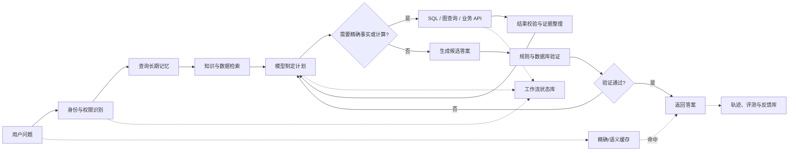

# 数据库介入大模型推理的关键环节

**调研日期：2026-08-03**

**文档范围：只讨论数据库在大模型推理系统中的介入位置、实现方式、数据模型、安全边界和落地优先级。大模型自身推理机制见 [[01 大模型推理机制详解]]，厂商产品与预览实践见 [[03 云厂商数据库参与大模型推理实践调研（2026-08）]]。**

> 核心结论：数据库通常不会进入 Transformer 每一层的矩阵计算，而是位于模型外部，为推理提供可信事实、精确计算、长期记忆、任务状态、验证约束、缓存和评测数据。最有价值的结合不是“让数据库模仿大模型”，而是让概率性的模型负责理解与规划，让数据库负责事实、集合运算、一致性和持久化。

## 一、总体介入地图

数据库可以在一次完整推理链路中的多个位置介入：



### 介入点总览

| 编号 | 介入环节 | 数据库的角色 | 主要提升 | 推荐优先级 |
|---|---|---|---|---|
| 1 | RAG 知识检索 | 外部非参数记忆 | 知识更新、证据和事实性 | P0 |
| 2 | SQL/结构化查询 | 精确查询与集合计算引擎 | 正确率、实时性、可解释性 | P0 |
| 3 | 图查询 | 实体关系与多跳路径引擎 | 关系推理能力 | P1，按场景 |
| 4 | 长期记忆 | 用户、实体、事件和经验存储 | 跨会话连续性 | P1 |
| 5 | Agent 状态 | 步骤、检查点和审批状态 | 可恢复、可审计、幂等 | P0/P1 |
| 6 | 验证与约束 | 确定性事实和业务规则 | 防止幻觉和越权 | P0 |
| 7 | 缓存 | 精确结果、语义结果、Prefix 元数据 | 降本、降延迟 | P1 |
| 8 | 评测与反馈 | 轨迹、错误、人工反馈和结果 | 持续优化 | P1 |
| 9 | 训练数据治理 | 数据版本、血缘、去重和质量 | 训练可靠性 | P1/P2 |

## 二、介入点一：RAG 知识检索

### 2.1 要解决的问题

大模型参数中的知识存在四个天然限制：

1. 训练结束后无法自动获得最新数据；
2. 单条事实很难精确修改或删除；
3. 不能天然给出事实来源；
4. 对企业私有知识和长尾知识覆盖不足。

RAG 将数据库或索引作为外部非参数记忆，在生成前取回与问题相关的证据。[Retrieval-Augmented Generation for Knowledge-Intensive NLP Tasks](https://arxiv.org/abs/2005.11401)

### 2.2 基本流程

```text
用户问题
→ 查询改写/实体识别
→ 权限过滤
→ 多路召回
→ 去重与重排
→ 选择证据片段
→ 组装上下文
→ 模型根据证据回答
→ 引用校验
```

### 2.3 数据进入知识库的流程

离线或增量索引管道通常包括：

1. **采集**：读取文档、网页、工单、Wiki、数据库记录；
2. **解析**：抽取正文、标题、表格、图片说明和元数据；
3. **切分**：按章节、语义或固定 token 数形成 chunk；
4. **清洗**：去除导航、重复页眉、乱码和过期版本；
5. **Embedding**：为 chunk 生成向量；
6. **索引**：写入向量索引、全文索引和元数据表；
7. **版本管理**：记录来源版本、生效时间和废止时间；
8. **权限同步**：把源系统 ACL 映射到检索过滤条件。

### 2.4 推荐的数据模型

```sql
CREATE TABLE knowledge_document (
    document_id       UUID PRIMARY KEY,
    source_system     TEXT NOT NULL,
    source_uri        TEXT,
    title             TEXT,
    version           TEXT,
    effective_from    TIMESTAMPTZ,
    effective_to      TIMESTAMPTZ,
    security_scope    JSONB,
    content_hash      TEXT,
    updated_at        TIMESTAMPTZ NOT NULL
);

CREATE TABLE knowledge_chunk (
    chunk_id          UUID PRIMARY KEY,
    document_id       UUID NOT NULL REFERENCES knowledge_document,
    section_path      TEXT,
    ordinal           INTEGER,
    content           TEXT NOT NULL,
    token_count       INTEGER,
    embedding         VECTOR,
    metadata          JSONB
);
```

具体字段和索引语法应根据数据库产品调整。关键不是 `VECTOR` 类型本身，而是把原文、来源、版本、权限和向量绑定在一起。

### 2.5 检索方式及适用场景

| 检索方式 | 擅长的问题 | 不擅长的问题 |
|---|---|---|
| 向量检索 | 同义表达、概念相似、自然语言问答 | 精确编号、严格时间条件、聚合 |
| 全文/BM25 | 产品名、错误码、专业术语、原文匹配 | 同义改写和隐含语义 |
| 元数据过滤 | 时间、部门、版本、租户、文档类型 | 无法单独判断内容相关性 |
| 关系查询 | 精确记录、Join、聚合、排序 | 非结构化语义问答 |
| 图查询 | 多跳关系、路径和邻居扩展 | 普通长文档总结 |

生产系统通常采用混合检索，而不是只依赖向量相似度。

### 2.6 重排与证据选择

初始召回强调“不要漏”，重排阶段强调“不要把无关资料送给模型”。常见策略：

- 向量分数与 BM25 分数融合；
- 使用 cross-encoder 或小模型 reranker；
- 对同一文档相邻 chunk 合并；
- 按来源权威性加权；
- 优先选择当前生效版本；
- 控制不同来源的重复证据；
- 为反面或冲突证据预留位置。

### 2.7 关键风险

1. **召回错误**：没找到真正相关资料；
2. **上下文污染**：找到的资料不相关或互相冲突；
3. **权限泄露**：先检索后过滤导致敏感片段进入模型；
4. **版本错误**：旧制度比新制度相似度更高；
5. **提示注入**：文档内容包含“忽略此前指令”等恶意文本；
6. **引用漂移**：答案声称来源 A，但结论实际不在 A 中。

权限过滤应尽量在召回阶段完成，而不是等模型生成后再脱敏。

### 2.8 评估指标

- Recall@k：正确证据是否被召回；
- Precision@k：召回内容中相关证据比例；
- MRR/NDCG：正确证据排名；
- Answer Faithfulness：答案是否由证据支持；
- Citation Correctness：引用是否真正覆盖结论；
- Freshness：是否使用当前有效版本；
- ACL Violation Rate：越权检索率；
- 每次成功回答的检索与 token 成本。

## 三、介入点二：SQL 与结构化数据查询

### 3.1 为什么结构化数据不应全部做成向量

以下问题更适合交给数据库：

- “2026 年华东区已付款订单总额是多少？”
- “哪些客户连续三个月消费下降？”
- “库存低于安全线且供应商交付周期超过 14 天的商品有哪些？”
- “当前审批人是谁？”

这些问题依赖精确过滤、Join、聚合、窗口函数和最新事务状态。把每行记录转成向量后检索，不能保证完整性和精确计算。

### 3.2 完整 Text-to-SQL 链路

```text
自然语言问题
→ 识别业务指标和时间口径
→ 选择相关数据域
→ 检索表、字段、关系和示例 SQL
→ 生成逻辑查询计划
→ 生成 SQL
→ AST、权限和成本校验
→ EXPLAIN
→ 只读执行
→ 结果检查
→ 模型解释并引用查询口径
```

### 3.3 Schema Linking

模型首先要把自然语言概念映射到数据库对象：

```text
“销售额” → fact_order.paid_amount
“华东区” → dim_region.region_group = '华东'
“已支付” → fact_order.payment_status = 'PAID'
“2026 年” → paid_at >= '2026-01-01' AND paid_at < '2027-01-01'
```

仅把完整 DDL 塞进 Prompt 往往效果不好。更稳妥的方式是维护语义层：

```sql
CREATE TABLE semantic_metric (
    metric_id           TEXT PRIMARY KEY,
    display_name        TEXT NOT NULL,
    description         TEXT,
    sql_expression      TEXT NOT NULL,
    default_time_column TEXT,
    allowed_dimensions  JSONB,
    owner               TEXT,
    version              TEXT
);
```

语义层负责把业务指标、维度、口径和物理字段建立确定映射。

### 3.4 SQL 生成策略

常见策略包括：

1. **直接生成 SQL**：简单，但对复杂 schema 稳定性较差；
2. **先生成查询计划再生成 SQL**：可检查表、Join、过滤和聚合；
3. **模板填充**：高频业务问题使用经过审核的模板；
4. **受约束解码**：生成阶段限制为合法 SQL 语法；
5. **执行反馈修正**：根据解析错误、列不存在或类型错误重新生成。

PICARD 在自回归解码过程中拒绝无法形成合法 SQL 的 token，从生成阶段降低非法查询比例。[PICARD](https://arxiv.org/abs/2109.05093)

### 3.5 执行前安全检查

生产环境至少需要：

- 只读数据库账号或只读副本；
- 表、列、函数和 schema 白名单；
- 禁止 DDL、DML、COPY、文件访问和危险扩展；
- SQL AST 解析，不依赖字符串正则；
- 强制租户和行级安全策略；
- 查询超时、扫描量、返回行数和并发限制；
- 参数化字面量；
- 对笛卡尔积、递归查询和大范围 Join 设置成本阈值；
- 执行前运行 `EXPLAIN` 或优化器成本检查；
- 全量记录生成、改写、批准和执行轨迹。

### 3.6 查询执行与纠错

执行错误可以作为新观察返回给模型，但不应直接返回敏感内部信息。建议把错误标准化：

```json
{
  "error_type": "UNKNOWN_COLUMN",
  "object": "order.pay_time",
  "hint": "Use fact_order.paid_at",
  "retryable": true
}
```

重试需要设置边界：

- 同类错误最多重试次数；
- 不允许通过扩大权限解决错误；
- 每次重试都重新做 AST 和成本检查；
- 参数变化但 SQL 结构相同的请求应复用已验证模板。

### 3.7 查询结果返回模型前的处理

不要无条件把数万行结果塞入上下文。可以：

- 让数据库完成聚合；
- 限制返回列和行数；
- 返回统计摘要和异常样本；
- 将大结果保存为文件，只给模型 schema 和摘要；
- 对金额、日期和单位做规范化；
- 携带执行时间、数据快照和口径信息。

### 3.8 数据写入的安全模式

模型直接生成并执行写 SQL 风险很高。推荐三阶段模式：

```text
模型提出意图和变更草案
→ 确定性程序生成或校验正式命令
→ 人工/策略审批
→ 事务执行
→ 读取回验
```

写入操作还应具备：

- 幂等键；
- 乐观锁或版本号；
- 事务边界；
- Dry Run；
- 影响行数上限；
- 可恢复或补偿操作；
- 审批人和执行者分离。

### 3.9 评估指标

- SQL Syntax Validity；
- Execution Accuracy；
- Result/Answer Accuracy；
- Schema Linking Accuracy；
- 首次执行成功率；
- 平均修正次数；
- 查询成本和 P95 延迟；
- 越权查询拦截率；
- 危险 SQL 漏检率；
- 业务口径一致率。

## 四、介入点三：图数据库与多跳关系推理

### 4.1 适用场景

当问题的核心是“关系和路径”而不是“相似文档”时，图数据库更合适，例如：

- 企业股权穿透；
- 供应链上下游影响；
- 知识图谱问答；
- 欺诈团伙和账号关联；
- 设备依赖和故障传播；
- 论文引用和作者关系。

### 4.2 基本流程

```text
自然语言问题
→ 实体链接
→ 识别关系和路径约束
→ 生成 Cypher/Gremlin/图查询
→ 查询相关子图
→ 压缩为路径、邻居或事实三元组
→ 模型基于子图解释
```

Graph RAG 的核心价值是检索与问题相关的子图，而不是把整个知识图谱序列化给模型。针对网络化文档和多跳问题，子图结构可以补足普通 chunk RAG 的不足。[GRAG: Graph Retrieval-Augmented Generation](https://arxiv.org/abs/2405.16506)

### 4.3 图数据模型

需要明确：

- 节点类型：人、公司、合同、设备、文档；
- 边类型：持有、控制、签署、依赖、引用；
- 边方向；
- 有效时间；
- 来源和置信度；
- 权限范围。

示例：

```text
(Person)-[OWNS {ratio, valid_from, valid_to}]->(Company)
(Company)-[CONTROLS]->(Company)
(Company)-[SIGNED]->(Contract)
```

### 4.4 图与关系数据库如何选择

优先关系数据库的情况：

- schema 稳定；
- 查询以过滤、聚合、Join 为主；
- 路径深度固定且较浅；
- 强事务和报表生态重要。

优先图数据库的情况：

- 关系种类多且持续演化；
- 路径长度不固定；
- 需要频繁遍历邻居或寻找路径；
- 关系本身比实体属性更重要。

不要因为“知识图谱”听起来先进就重复建设已有关系数据。应先用真实查询验证图模型能否明显降低复杂度。

### 4.5 风险与指标

主要风险：实体消歧错误、边来源不可信、时态关系被忽略、子图过大、路径泄露敏感关系。

建议指标：实体链接准确率、路径命中率、子图规模、边事实正确率、多跳答案正确率、查询延迟和权限违规率。

## 五、介入点四：长期记忆

### 5.1 为什么需要数据库记忆

模型上下文是有限且临时的。跨会话持续协作需要把部分信息保存到外部存储，再在合适时机取回。

MemGPT 将上下文窗口和外部存储类比为分层内存：模型只把当前需要的内容放在有限上下文中，其余内容保存在更大容量的外部层。[MemGPT](https://arxiv.org/abs/2310.08560)

### 5.2 记忆类型

| 类型 | 内容 | 示例 | 更新策略 |
|---|---|---|---|
| 语义记忆 | 相对稳定的事实 | 用户负责 MySQL 优化器 | 新事实覆盖或形成版本 |
| 情景记忆 | 发生过的事件 | 上周完成了一次压测 | 追加写入，可归档 |
| 偏好记忆 | 用户习惯 | 喜欢中文、结论先行 | 用户可查看和修改 |
| 程序记忆 | 可复用方法 | 发布前必须跑哪些检查 | 版本化、审核后生效 |
| 工作记忆 | 当前任务临时状态 | 已完成步骤 1–3 | 任务完成后压缩或过期 |

### 5.3 可信度分级

长期记忆必须区分来源：

```text
user_asserted     用户明确说明
system_verified   由业务系统或数据库验证
model_inferred    模型推测，尚未验证
derived_summary   对历史内容的压缩摘要
```

这些类别不应以相同权重参与后续推理。`model_inferred` 不应自动升级为事实。

### 5.4 推荐的数据模型

```sql
CREATE TABLE agent_memory (
    memory_id         UUID PRIMARY KEY,
    subject_id        TEXT NOT NULL,
    memory_type       TEXT NOT NULL,
    content           TEXT NOT NULL,
    structured_value  JSONB,
    source_type       TEXT NOT NULL,
    source_ref        TEXT,
    confidence        NUMERIC,
    valid_from        TIMESTAMPTZ,
    valid_to          TIMESTAMPTZ,
    expires_at        TIMESTAMPTZ,
    security_scope    JSONB,
    embedding         VECTOR,
    created_at        TIMESTAMPTZ NOT NULL
);
```

### 5.5 写入策略

不应把每句话都写入长期记忆。可使用以下准入条件：

- 用户明确要求记住；
- 信息可能在未来任务复用；
- 内容相对稳定；
- 来源和所属主体清晰；
- 不违反隐私和保留策略；
- 与已有事实冲突时能够版本化，而不是静默覆盖。

### 5.6 读取策略

记忆检索应同时考虑：

- 与当前问题的相关性；
- 时间新鲜度；
- 来源可信度；
- 用户和租户权限；
- 是否仍在有效期；
- 是否与当前事实冲突；
- 上下文 token 预算。

### 5.7 删除和遗忘

系统需要支持：

- 用户查看已保存记忆；
- 删除单条或全部个人记忆；
- 到期自动删除；
- 源数据删除后级联失效；
- 删除向量索引和派生摘要；
- 审计删除结果。

### 5.8 风险和指标

风险包括错误固化、隐私泄露、主体混淆、旧事实覆盖新事实、摘要丢失限定条件。

指标包括记忆命中率、错误记忆率、过期记忆使用率、冲突检测率、删除完整率和每轮上下文占用。

## 六、介入点五：Agent 状态与工作流持久化

### 6.1 要解决的问题

长任务可能持续数十分钟或数天，并经历工具调用、失败重试、人工审批和模型切换。只把状态保存在模型上下文里会导致：

- 进程退出后任务丢失；
- 无法准确恢复到上一步；
- 重试造成重复写入；
- 难以审计谁执行了什么；
- 多个 worker 可能同时执行同一步骤。

### 6.2 建议保存的实体

```text
task        任务目标、状态、预算、创建者
plan        当前计划及版本
step        每一步输入、状态、依赖和输出
attempt     某步骤的具体执行尝试
tool_call   工具、参数、权限上下文
tool_result 返回值摘要、引用和错误
approval    审批对象、审批人和结论
artifact    生成的文件、报告、代码或数据集
checkpoint  可恢复状态
event       追加式审计事件
```

### 6.3 简化数据模型

```sql
CREATE TABLE agent_task (
    task_id          UUID PRIMARY KEY,
    goal             TEXT NOT NULL,
    status           TEXT NOT NULL,
    owner_id         TEXT NOT NULL,
    plan_version     INTEGER NOT NULL DEFAULT 1,
    budget           JSONB,
    created_at       TIMESTAMPTZ NOT NULL,
    updated_at       TIMESTAMPTZ NOT NULL
);

CREATE TABLE agent_step (
    step_id          UUID PRIMARY KEY,
    task_id          UUID NOT NULL REFERENCES agent_task,
    parent_step_id   UUID,
    step_type        TEXT NOT NULL,
    status           TEXT NOT NULL,
    input            JSONB,
    output           JSONB,
    idempotency_key  TEXT,
    lease_owner      TEXT,
    lease_expires_at TIMESTAMPTZ,
    attempt_count    INTEGER NOT NULL DEFAULT 0,
    created_at       TIMESTAMPTZ NOT NULL,
    updated_at       TIMESTAMPTZ NOT NULL
);
```

### 6.4 状态机

步骤状态不应由自由文本随意表示，可以使用明确状态机：

```text
PENDING → RUNNING → SUCCEEDED
                  ↘ FAILED → RETRYING → RUNNING
                  ↘ WAITING_APPROVAL
                  ↘ CANCELLED
```

每个状态转换应记录原因、操作者和版本。

### 6.5 幂等性和并发控制

关键措施：

- 每个有副作用的工具调用使用 idempotency key；
- worker 领取步骤时使用租约；
- 更新任务状态时使用乐观锁；
- 外部写入完成后保存业务回执；
- 重启时先查询外部结果，避免直接重做；
- 对不可逆操作设置审批和二次确认。

### 6.6 Checkpoint

Checkpoint 不一定保存完整模型内部状态，通常保存可重建任务所需的结构化内容：

- 当前目标与计划版本；
- 已完成步骤；
- 关键工具结果引用；
- 待处理依赖；
- 剩余预算；
- 必须保留的上下文摘要。

### 6.7 评估指标

- 任务完成率；
- 崩溃恢复成功率；
- 重复副作用发生率；
- 平均重试次数；
- 审批等待时间；
- 孤儿任务数量；
- 状态一致性错误率；
- 单任务存储成本。

## 七、介入点六：验证、规则和业务约束

### 7.1 核心分工

模型擅长理解自然语言和提出候选，数据库擅长确认事实与约束。例如模型提出“客户可获得 20% 折扣”，系统应查询当前生效政策，而不是相信模型记忆。

```sql
SELECT discount_rate
FROM pricing_policy
WHERE customer_tier = :tier
  AND product_type = :product_type
  AND effective_from <= CURRENT_DATE
  AND effective_to > CURRENT_DATE;
```

### 7.2 可以验证的内容

- 账户余额和库存；
- 唯一性和外键关系；
- 是否满足资格；
- 时间有效性；
- 上下级或授权关系；
- 审批状态；
- 风险和额度限制；
- 统计结果；
- 模型引用的实体是否真实存在。

### 7.3 三类验证器

| 类型 | 示例 | 优点 | 局限 |
|---|---|---|---|
| 数据验证器 | SQL、图查询、主数据查询 | 精确、可追溯 | 依赖数据质量和时效 |
| 规则验证器 | 业务规则、JSON Schema、权限策略 | 确定性强 | 规则维护成本高 |
| 模型验证器 | Reward Model、LLM Judge | 覆盖开放式任务 | 仍然是概率模型 |

高风险动作应优先使用数据和规则验证器，模型验证器作为补充。

### 7.4 验证时机

- **生成前**：权限、数据范围、工具可用性；
- **执行前**：SQL/动作是否合法、成本是否超限；
- **执行后**：返回结果是否完整、是否满足预期 schema；
- **回答前**：结论是否由证据支持；
- **写入后**：读取回验，确认实际状态与预期一致。

### 7.5 冲突处理

当模型推断与数据库事实冲突时：

1. 标记冲突；
2. 检查数据库时间和数据版本；
3. 检查查询口径和权限过滤；
4. 如果数据库是权威源，以数据库为准；
5. 如果来源均不确定，明确告知用户而不是强行选择；
6. 保存冲突样本进入评测集。

## 八、介入点七：缓存与推理服务存储

### 8.1 精确缓存

完全相同的请求在相同条件下可以复用结果。缓存键应包含：

```text
规范化输入
+ 系统提示版本
+ 模型版本
+ 工具版本
+ 用户/租户权限范围
+ 数据快照或知识库版本
+ 输出参数
```

适合稳定、重复率高的问答；不适合余额、库存和审批状态等高时效数据。

### 8.2 语义缓存

语义缓存将问题转为 embedding，用向量近邻寻找含义相近的历史问题，并复用已有答案。[GPT Semantic Cache](https://arxiv.org/abs/2411.05276)

流程：

```text
新问题
→ embedding
→ 过滤租户、版本和有效期
→ 相似问题检索
→ 相似度与风险判断
→ 命中则复用，否则调用模型
```

### 8.3 语义缓存风险

文字相似不等于答案相同：

```text
“我现在的账户余额是多少？”
“我昨天的账户余额是多少？”
```

两者语义很相似，但时间条件不同。缓存系统必须识别：

- 时间；
- 主体；
- 权限；
- 地区；
- 单位；
- 数据版本；
- 实时性要求。

### 8.4 Prefix/KV Cache 与数据库的边界

KV Cache 是 Transformer 各层的中间张量，通常存放在 GPU 或高速 CPU 内存。数据库可以保存其目录、生命周期、租户和块位置元数据，但热路径本体不适合放在普通 OLTP 数据库中。

PagedAttention 通过分页管理 KV Cache，提高显存利用率。[PagedAttention](https://doi.org/10.1145/3600006.3613165)

需要区分：

- **语义缓存**：复用最终答案，允许语义近似；
- **Prompt/Response 精确缓存**：输入完全一致时复用答案；
- **Prefix Cache**：复用相同 token 前缀的 KV；
- **KV Cache**：单次或多次生成过程中复用神经网络中间状态。

### 8.5 缓存失效

缓存失效条件包括：

- 源数据发生变化；
- 知识库版本更新；
- Prompt 或模型升级；
- 权限变更；
- 业务规则变更；
- 超过 TTL；
- 人工标记答案错误。

### 8.6 指标

- 命中率；
- 正确命中率；
- 错误复用率；
- P50/P95 延迟降低；
- Token/API 成本节省；
- 跨租户污染率；
- 失效延迟。

## 九、介入点八：推理轨迹、评测与反馈闭环

### 9.1 应保存什么

建议保存：

- 用户问题或脱敏后的问题；
- Prompt、模型和检索版本；
- 召回文档 ID 和分数；
- 工具调用参数；
- SQL、执行计划摘要和查询结果引用；
- 结构化步骤状态；
- 最终答案；
- verifier 分数；
- 人工修改；
- 实际业务结果；
- 延迟和成本。

不应默认永久保存：

- 密钥和访问令牌；
- 无关个人敏感信息；
- 完整数据库行；
- 没有审计价值的隐藏推理长文本；
- 超出保留期限的原始 Prompt。

### 9.2 轨迹数据模型

```sql
CREATE TABLE reasoning_run (
    run_id             UUID PRIMARY KEY,
    task_type          TEXT,
    user_scope         TEXT,
    model_version      TEXT,
    prompt_version     TEXT,
    retrieval_version  TEXT,
    final_status       TEXT,
    final_answer_ref   TEXT,
    verifier_score     NUMERIC,
    input_tokens       INTEGER,
    output_tokens      INTEGER,
    latency_ms         BIGINT,
    created_at         TIMESTAMPTZ NOT NULL
);

CREATE TABLE reasoning_event (
    event_id            UUID PRIMARY KEY,
    run_id              UUID NOT NULL REFERENCES reasoning_run,
    sequence_no         INTEGER NOT NULL,
    event_type          TEXT NOT NULL,
    payload             JSONB,
    created_at          TIMESTAMPTZ NOT NULL,
    UNIQUE(run_id, sequence_no)
);
```

### 9.3 反馈类型

- 显式点赞/点踩；
- 用户改写最终答案；
- SQL 被人工修正；
- 工具调用被拒绝；
- 任务最终是否完成；
- 业务 KPI 是否改善；
- 安全审核结果；
- 后续事实证明原答案错误。

“用户没有投诉”不能直接当作答案正确。

### 9.4 如何形成优化闭环

```text
线上轨迹
→ 脱敏与质量过滤
→ 错误归类
→ 建立回归样本
→ 调整 Prompt / 检索 / 工具 / 模型
→ 离线评测
→ 小流量发布
→ 在线指标观察
```

### 9.5 数据用于哪些优化

- 训练或优化 reranker；
- 构造 Text-to-SQL 示例；
- 训练结果/过程 verifier；
- 发现需要新增的业务工具；
- 优化路由策略；
- 调整缓存阈值；
- 建立安全红队数据集；
- 分析不同模型的成本收益。

### 9.6 风险

- 把错误答案重新训练进模型；
- 线上数据包含隐私；
- 高活跃用户主导样本分布；
- 反馈与真实正确性不一致；
- Prompt 和模型版本缺失导致无法复现；
- 只记录成功请求，忽略失败路径。

## 十、介入点九：训练数据与数据治理

### 10.1 数据库的作用

数据库和数据湖仓可以管理：

- 原始语料目录；
- 数据来源和许可；
- 文档版本；
- 去重指纹；
- 质量评分；
- 敏感数据标签；
- 训练/验证/测试集划分；
- 样本生成过程；
- 标注和审核记录；
- 模型与数据版本血缘。

### 10.2 为什么数据血缘重要

当模型输出出现问题时，需要回答：

- 使用了哪些训练或微调数据；
- 数据是否获得授权；
- 是否包含已删除内容；
- 某个评测样本是否泄露到训练集；
- 哪个数据版本训练了哪个模型；
- 哪种清洗或合成方法产生了该样本。

### 10.3 推理数据集的特殊治理

推理轨迹通常比普通问答更容易包含“形式正确但逻辑错误”的样本。应记录：

- 最终答案是否可验证；
- 每步是否经过过程验证；
- 轨迹由哪个 teacher model 生成；
- 采样温度和 Prompt；
- 是否经过人工检查；
- 是否存在多条等价正确路径；
- 错误轨迹是否作为负样本使用。

## 十一、不同数据库类型的定位

| 数据库/存储类型 | 最合适的角色 | 不应强行承担的角色 |
|---|---|---|
| 关系数据库 | 业务事实、事务、SQL 工具、Agent 状态、审计 | 大规模非结构化语义检索的唯一引擎 |
| 向量数据库/向量索引 | 语义召回、记忆检索、语义缓存 | 精确聚合和强事务事实判断 |
| 全文搜索引擎 | 关键词、错误码、日志、混合检索 | 复杂事务写入 |
| 图数据库 | 多跳关系、路径、网络分析 | 普通文档存储和简单报表 |
| Key-Value/内存库 | 锁、会话、短期状态、缓存 | 权威业务事实的长期主存 |
| 时序数据库 | 模型、GPU、Agent 与业务指标监控 | 通用知识问答 |
| 对象存储 | 原始文档、大结果、模型与评测文件 | 低延迟细粒度事务查询 |
| 数据湖仓 | 大规模轨迹分析、训练数据和离线特征 | 在线 Agent 步骤锁和低延迟状态机 |

中等规模系统不必一开始引入所有产品。常见起点是：

- PostgreSQL：业务数据、元数据、Agent 状态、审计；
- PostgreSQL 向量扩展或专用向量库：语义检索；
- Elasticsearch/OpenSearch：全文和日志检索；
- Redis：短期缓存、租约和锁；
- 对象存储：原始文档和大体积结果。

## 十二、推荐的生产架构

### 12.1 六层结构

1. **模型层**：理解意图、分解问题、生成查询和组织答案；
2. **编排层**：选择模型、工具和步骤，控制重试与预算；
3. **检索层**：全文、向量、关系和图的混合召回；
4. **工具层**：只读 SQL、业务 API、计算器、代码执行器；
5. **验证与权限层**：身份、ACL、AST、规则、审批和审计；
6. **数据与观测层**：业务库、知识库、状态库、缓存和评测仓库。

### 12.2 推荐请求流程

```text
1. 验证用户身份和租户
2. 判断问题是知识问答、结构化查询还是操作请求
3. 读取必要的长期记忆
4. 检索文档、schema 和业务语义
5. 模型生成计划
6. 对工具参数执行类型、权限和成本校验
7. 执行查询或工具
8. 对结果进行结构化验证
9. 模型生成带依据的回答
10. 验证引用和关键结论
11. 保存最小必要轨迹和指标
12. 对可缓存请求写入带版本的缓存
```

### 12.3 权限传播

用户身份必须贯穿整个链路：

```text
用户身份
→ Agent 会话
→ 检索过滤
→ 数据库角色/行级策略
→ 工具调用
→ 缓存命名空间
→ 日志脱敏和审计
```

不能让所有用户共享一个拥有全库权限的 Agent 服务账号，再依赖 Prompt 告诉模型“不要查询敏感数据”。Prompt 不是权限系统。

## 十三、落地优先级与路线图

### 阶段一：只读、可验证问答

目标：先提升答案事实性，不产生业务副作用。

- 建立文档 RAG；
- 接入只读 SQL；
- 实现 schema/语义层；
- 加入权限过滤；
- 返回引用、时间和查询口径；
- 保存基础评测轨迹。

验收条件：正确率、引用正确率、越权率和查询成本达到门槛。

### 阶段二：多步 Agent 与持久化状态

目标：支持需要多个查询和工具调用的复杂任务。

- 建立任务/步骤状态机；
- 加入幂等键、租约、重试和 checkpoint；
- 引入数据库与规则 verifier；
- 建立离线回归集；
- 增加精确缓存和低风险语义缓存。

验收条件：崩溃可恢复、重复副作用为零、复杂任务完成率稳定。

### 阶段三：受控写入和业务闭环

目标：让 Agent 在严格控制下执行真实操作。

- 使用结构化动作而非自由 SQL；
- 引入审批和 Dry Run；
- 使用事务、幂等和读取回验；
- 对不可逆操作强制人工确认；
- 建立补偿流程和安全演练。

验收条件：权限、审计、恢复和责任边界均可验证。

### 阶段四：数据驱动持续优化

目标：使用真实轨迹改进系统，而不是只调 Prompt。

- 训练 reranker 和 verifier；
- 自动发现失败模式；
- 动态路由模型和推理预算；
- 按任务风险选择缓存与验证强度；
- 建立模型、Prompt、工具和数据版本发布体系。

## 十四、关键设计原则

1. **结构化数据优先结构化查询。** 不要把所有表都转成向量后再问模型。
2. **先权限过滤，再把内容交给模型。** 生成后脱敏不能替代访问控制。
3. **模型提出候选，确定性系统验证。** 关键事实和动作不能只靠语言自信度。
4. **读写分离。** 先完成只读能力，再逐步开放受控副作用。
5. **所有结果带版本和时间。** 实时数据、历史数据和政策版本必须可区分。
6. **保存结构化轨迹，不盲目保存全部推理文本。** 兼顾审计、隐私和成本。
7. **缓存必须绑定权限和数据版本。** 防止旧答案和跨租户污染。
8. **长任务状态必须持久化。** 上下文窗口不是可靠工作流数据库。
9. **向量库不是必要条件。** 数据量适中时，现有关系数据库和全文检索可能已经足够。
10. **用任务成功率评估整体系统。** 单独评估模型、检索或 SQL 生成都不等于最终业务可靠性。

## 十五、最值得优先研究的三个方向

### 15.1 结构化 RAG

让系统在文档检索、SQL 和图查询之间自动选择，而不是统一走向量检索。

研究重点：

- 查询意图路由；
- 业务语义层；
- 多源证据融合；
- 时间和权限感知检索；
- 文本证据与数据结果的联合引用。

### 15.2 可验证数据库 Agent

模型生成计划和查询，数据库、规则引擎和权限系统共同验证。

研究重点：

- SQL/动作受约束生成；
- 代价感知查询规划；
- 执行反馈纠错；
- 确定性 verifier；
- 安全事务和补偿机制。

### 15.3 持久化推理状态

把长任务的计划、步骤、证据、工具调用和审批做成可靠状态机。

研究重点：

- 推理状态数据模型；
- Checkpoint 和恢复；
- 分布式 Agent 并发控制；
- 轨迹压缩；
- 状态与模型上下文之间的动态换入换出。

## 参考资料

- [Retrieval-Augmented Generation for Knowledge-Intensive NLP Tasks](https://arxiv.org/abs/2005.11401)
- [ReAct: Synergizing Reasoning and Acting in Language Models](https://arxiv.org/abs/2210.03629)
- [Toolformer: Language Models Can Teach Themselves to Use Tools](https://arxiv.org/abs/2302.04761)
- [PICARD: Parsing Incrementally for Constrained Auto-Regressive Decoding from Language Models](https://arxiv.org/abs/2109.05093)
- [GRAG: Graph Retrieval-Augmented Generation](https://arxiv.org/abs/2405.16506)
- [MemGPT: Towards LLMs as Operating Systems](https://arxiv.org/abs/2310.08560)
- [GPT Semantic Cache: Reducing LLM Costs and Latency via Semantic Embedding Caching](https://arxiv.org/abs/2411.05276)
- [Efficient Memory Management for Large Language Model Serving with PagedAttention](https://doi.org/10.1145/3600006.3613165)
- [[01 大模型推理机制详解]]
- [[03 云厂商数据库参与大模型推理实践调研（2026-08）]]
